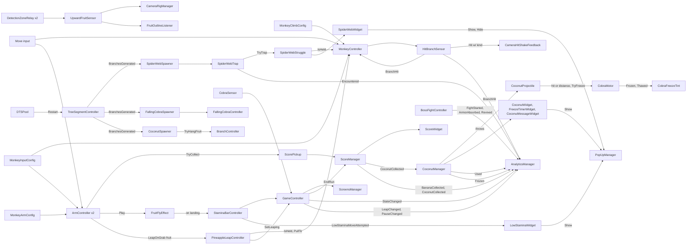

# Monkobra CONTEXT

Descriptive knowledge of this repository for agents and developers.

- Belongs Here: what the system is, ie architecture, domain model, API surface, patterns, known gaps; only what the code cannot show, as it stands, never its history
- Size: stay lean for the context window; when the file grows, move detail to `docs/` or cut it
- Upkeep: update in the same change that moves architecture, patterns, commands, or environment variables
- Structure: follow the existing sections; keep every statement true for every contributor
- Belongs in `AGENTS.md`: prescriptive rules for agents, ie commands, conventions, constraints, do/don't
- Belongs in `docs/`: system documentation for users and agents alike; link it from here, never grow this file to hold it
- Local Layer: put machine-specific or personal context in `CONTEXT.local.md`; create it if missing, never commit it

## Project Overview

Monkobra is a Unity course project (USC CSCI-526, Fall 2026). Where each kind of knowledge lives:

| Topic | Home |
| --- | --- |
| Concept, pillars, mechanics, difficulty intent | [Game Design Document](docs/monkobra-gdd.md) |
| Stack, scenes, run lifecycle, monkey, tree, stamina, score, input, UI, conventions | [Technical Design Document](docs/monkobra-tdd.md) |
| Cobra, falling cobra, branches, spider webs, touch outcomes | [Mobs](docs/mob-doc.md) |
| Detection zones, reach, release check, camera swap, outlines | [Grab System](docs/grab-doc.md) |
| Why difficulty follows height, the roll model, the single balance asset | [Balance Design](docs/balance-doc.md) |
| The run from start to loss, as one diagram | [Gameplay Loop](docs/gameplay-loop-doc.md) |
| Controls, setup | [README](README.md) |
| Git flow for teammates (Chinese) | [Work with Git](docs/work-with-git.md) |
| The three builds (WebGL for GitHub Pages, WebGL for itch.io, Windows), Player Settings, deploys | [Build](docs/build-doc.md) |
| Agent rules | [AGENTS.md](AGENTS.md) |

This file is the script index and the map of how the pieces connect. Behavior and numbers live in the documents above, never here.

## Repository Layout

```text
monkobra/
├── README.md          human onboarding
├── AGENTS.md          agent rules
├── CONTEXT.md         this file
├── CHANGELOG.md       version history, plus open triage tags in a comment
├── DEVLOG.md          weekly development journal, screenshots in devlog-assets/
├── docs/              design, technical, mob, grab, balance, gameplay loop, analytics, build, and git documents
├── devlog-assets/     images embedded by DEVLOG.md
├── builds/            local build output of all three builds, ignored by git
├── Assets/
│   ├── _Monkobra/     all authored assets, <Type>/<Module>/<asset>
│   │   ├── Scenes/    Lv1Scene, root prefab instances plus the plain `Envs` object, see [Scene Hierarchy](#scene-hierarchy)
│   │   ├── Scripts/   Analytics/, Cameras/, Environment/, GameController/, HackShortcuts/, ItemCoconut/, MobFallingCobra/, MobGreatCobra/, MobSpiderWeb/, Player/, PopUp/, Scoring/, UI/
│   │   ├── Plugins/   WebGL/Download.jslib (browser download of a text file)
│   │   ├── Prefabs/   Cameras/, Environment/, GameController/, MobFallingCobra/, MobGreatCobra/, MobSpiderWeb/, Player/, PopUp/ (`_PopUps`, `_PopUpBase`, one variant per popup), UI/, World/ (light, volume, event system)
│   │   ├── Materials/ Environment/, MobGreatCobra/, MobSpiderWeb/, Player/
│   │   ├── Inputs/    InputSystem_Actions
│   │   ├── Shaders/   Environment/FruitOutline (inverted-hull Shader Graph)
│   │   └── Settings/  _Shared/ (URP assets, volume profiles), Player/ (player balance, monkey arm, climb & input, leap), Environment/ (world balance, branch placement), MobGreatCobra/ (cobra balance), Cameras/, UI/, Analytics/, HackShortcuts/: one folder per module, assets directly inside
│   ├── WebGLTemplates/ FitWindow/index.html, the 16:9 fit-to-window WebGL page
│   ├── Settings/      Build Profiles/ (GithubPages, ItchIO), Unity-managed
│   ├── TextMesh Pro/  imported TMP essentials, not authored
│   └── Readme.asset   Unity template leftover
├── Monkobra/          committed WebGL export served by GitHub Pages
├── Packages/          manifest & lock
└── ProjectSettings/   Unity project settings
```

## Scene Hierarchy

`Lv1Scene`'s root is 8 prefab instances, so teammates edit different files, plus two plain scene objects: `Envs` and a Cinemachine `Target Group`. `Envs`, `Entities` and `UI` nest one prefab per unit. `Envs` has no prefab of its own, so adding or removing one of its children edits `Lv1Scene.unity` itself.

| Root | Nests |
| --- | --- |
| `Cameras` | the four Cinemachine cameras |
| `World/DirectionalLight`, `World/GlobalVolume`, `World/EventSystem` | three separate root prefabs, no wrapper |
| `Envs` (plain scene object) | `DTSPool` (with both spawners), `StartingZoneExitTrigger`, `Tree` (mock tree), `CoconutSystem` (`CoconutSpawner`), `RoughBarkSystem` (`RoughBarkSpawner`), `HeightMarkerSystem` (`HeightMarkerSystem`, on the trunk axis) |
| `Player/Entities` | `Monkey`, `GreatCobra` |
| `Boss/BossFight` | `BossFightController`, `BossKingBody`, `BossFightHud`; builds the Cobra King arena at runtime, its position does not matter |
| `GameController/GameController` | one GameObject carrying `GameController`, `AnalyticsManager`, `ScreensManager`, `ScoreManager`, `RampedDifficultyManager` as components |
| `UI/UI` | the `Canvas`, `InGameHUD` (`ProgressBar`, `StaminaBar`, `ScoreHeight` (`ScoreHUD`), the pause hint, `CoconutHUD`, `CoconutMessage` (widget host only), `FruitFlyLayer`), `FreezeTimerHUD`, `LowStaminaPrompt` (widget host only), `HackShortcutHelp`, `SpiderWebPrompt` (escape bar), `_PopUps` (`PopUp/_PopUps`, before `Screens` so the panels draw over it), `Screens` (`LoseScreen`, `TutorialScreen`, `PauseScreen`) |

Unity drops a reference between two prefab assets, so every link that crosses a root (e.g. `LoseScreen.scoreManager`, `Cameras` tracking target) is a property override on the scene instance. Each object rests in its original active state: owners such as `ScreensManager` switch screens on, managers stay active.

The repository root is the Unity project root. `Library/`, `Temp/`, `Logs/`, `UserSettings/`, `*.csproj`, and `*.slnx` are ignored.

## How the Pieces Connect



## Script Index

All under `Assets/_Monkobra/Scripts/`. Each row names the owner of the detail.

| Script | Role | Detail |
| --- | --- | --- |
| `GameController/GameController`, `GameState` | singleton, owns the `GameState` machine: Tutorial, StartingZone, Playing, Lost, Won; `LoseGame()` takes no cause, analytics infers it | [TDD](docs/monkobra-tdd.md#run-lifecycle) |
| `GameController/StartingZoneExitRelay` | on a trigger collider GO: the monkey entering calls `EndStartingZone()` | [TDD](docs/monkobra-tdd.md#run-lifecycle) |
| `GameController/PlayerBalanceConfig` | ScriptableObject (`Settings/Player/PlayerBalanceConfig.asset`): the player's run balance, ie stamina, starting zone, branch hit, score, coconut | [Balance Design](docs/balance-doc.md) |
| `Environment/WorldBalanceConfig` | ScriptableObject (`Settings/Environment/WorldBalanceConfig.asset`): world balance, ie ramped difficulty curve, branch & fruit chances, rough bark, spider web, boss fight | [Balance Design](docs/balance-doc.md) |
| `MobGreatCobra/CobraBalanceConfig` | ScriptableObject (`Settings/MobGreatCobra/CobraBalanceConfig.asset`): falling cobra & great cobra balance | [Balance Design](docs/balance-doc.md) |
| `Player/MonkeyController` | kinematic body: orbit, climb, stun, `IsHeld`, a height ceiling for the boss fight, `SyncOrbitAngle` to land a pulled body on the ring where it is | [TDD](docs/monkobra-tdd.md#monkey-movement) |
| `Player/MonkeyInputConfig` | ScriptableObject (`Settings/Player/MonkeyInputConfig.asset`): the move & interact input actions every monkey consumer reads | [TDD](docs/monkobra-tdd.md#input) |
| `Player/MonkeyArmConfig` | ScriptableObject (`Settings/Player/MonkeyArmConfig.asset`): arm stroke, reach, splay & width | [Grab](docs/grab-doc.md#tuning) |
| `Player/MonkeyClimbConfig` | ScriptableObject (`Settings/Player/MonkeyClimbConfig.asset`): held-time speed curves up and down, exhausted multiplier, idle stamina recovery, orbit speed, deceleration | [TDD](docs/monkobra-tdd.md#monkey-movement) |
| `Player/PineappleLeapController` | on the monkey root: runs a leap after a pineapple grab, hands up, pull, landing grace; sets `GameController.IsLeaping`; the pull stops at `BossFightController.LeapTopY` | [Grab](docs/grab-doc.md#pineapple-leap) |
| `Player/PineappleLeapConfig` | ScriptableObject (`Settings/Player/PineappleLeapConfig.asset`): a pineapple leap's distance, speed curve, hand rise time & landing grace | [Grab](docs/grab-doc.md#pineapple-leap) |
| `Player/ArmController` | one arm: climb stroke, reach, release check | [Grab](docs/grab-doc.md#reach-and-release) |
| `Player/DetectionZoneRelay` | side-tagged trigger forwarding enter and exit | [Grab](docs/grab-doc.md#detection) |
| `Player/UpwardFruitSensor` | singleton, reachable and grabbable fruit; the target and reach side follow the fruit closest to the monkey, re-picked every physics step | [Grab](docs/grab-doc.md#detection) |
| `Cameras/CameraRigManager` | swaps the four Cinemachine cameras; shows the look-down view briefly after a coconut throw | [Grab](docs/grab-doc.md#camera) |
| `Cameras/CameraLookUp` | on the behind camera: tilts the aim point up while climbing, plus `ExtraAimOffsetU` and `ViewDistanceScale`, eg the boss fight view | none |
| `Cameras/CameraHitShakeFeedback` | on the main camera: fires a light impulse for a branch hit, a heavier one for a falling cobra hit | [Mobs](docs/mob-doc.md#hit-penalty) |
| `Cameras/CameraCoolDownFeedback` | on the main camera: vignette blackdown and zoom-out pulse on each low-stamina move attempt, a lighter step while low and a stronger one when empty | [TDD](docs/monkobra-tdd.md#camera) |
| `Cameras/CameraEfxConfig` | ScriptableObject (`Settings/Cameras/CameraEfxConfig.asset`) of the camera efx tuning: both cool-down steps (vignette, zoom-out) and their timing | [TDD](docs/monkobra-tdd.md#camera) |
| `Player/HitBranchSensor` | singleton branch sensor: raises `BranchHit` and `Hit` (with a `HitKind`); `ReportHit` applies the same drop for a hazard touching the monkey outside the sensor | [Mobs](docs/mob-doc.md#hit-penalty) |
| `Environment/RoughBarkZone` | raised, irregular bark patch on the trunk that smoothly slows the monkey in every direction while touched; avoidable | [Mobs](docs/mob-doc.md) |
| `Environment/RoughBarkSpawner` | on the `RoughBarkSystem` prefab: once the score passes `roughBarkStartScore`, rolls broad patches ahead of the monkey, off obstacles; `RoughBarkSetup` & `RoughBarkSmokeCheck` are Editor tools | [TDD](docs/monkobra-tdd.md) |
| `Environment/TreeManager` | singleton on the mock tree, marks the trunk axis | [TDD](docs/monkobra-tdd.md#tree) |
| `Environment/TreeSegmentController` | places branches on a segment, skipping spots w/i `startingZoneBranchClearRadiusU` of the monkey before the run is playing, rolling branch and banana chance from the flat `startingZoneBranchChance` and `startingZoneBananaChance` below the exit trigger (`RampedDifficultyManager.IsInStartingZoneY`) and from the curves above it, then raises the static `BranchesGenerated` | [Mobs](docs/mob-doc.md#placement) |
| `Environment/DTSPool` | on an empty base marker: instantiates the segments, then recycles the lowest segment over the top, restarting it, for an endless tree | [TDD](docs/monkobra-tdd.md#tree) |
| `Environment/HeightMarkerSystem` | on `Envs/HeightMarkerSystem`: the climbed height every `intervalU` beside the trunk, on both its left and right as seen from the camera, in world units labelled m, on a generated dark rounded plate, from a pool of TextMeshPro labels keyed to height, never to segments; pulses a marker the first time the monkey passes it; the boss fight's height marker gets a bigger, red, beating plate w/ a small king look-alike, hidden once the fight begins | [TDD](docs/monkobra-tdd.md#ui) |
| `Environment/BranchFruitPlacementConfig` | ScriptableObject (`Settings/Environment/BranchFruitPlacementConfig.asset`) of branch placement | [Mobs](docs/mob-doc.md#placement) |
| `Environment/BranchController` | decides whether a branch bears a pineapple, a banana, or no fruit; `TryHangFruit` lets another spawner hang its own fruit on a bare branch's stem tip | [Grab](docs/grab-doc.md#fruit-supply) |
| `Environment/FruitOutlineListener` | two-tier fruit outline, on the object holding the fruit's collider | [Grab](docs/grab-doc.md#feedback) |
| `Environment/FruitFlyOnGrab` | on a fruit's root: its fly target and sprite; the `Coconut` and `Pineapple` prefabs carry one, the banana none | [Grab](docs/grab-doc.md#fruit-fly) |
| `Environment/LeapOnGrab` | marks a fruit whose grab starts a leap | [Grab](docs/grab-doc.md#pineapple-leap) |
| `MobSpiderWeb/SpiderWebSpawner` | on `Envs/DTSPool`: on each `BranchesGenerated`, rolls webs on that segment's trunk against a probability curve at its ramped difficulty | [Mobs](docs/mob-doc.md#placement-1) |
| `MobSpiderWeb/SpiderWebTrap` | web prefab root with one deepened trigger box | [Mobs](docs/mob-doc.md#trap-and-escape) |
| `MobSpiderWeb/SpiderWebStruggle` | on the monkey: trap state, escape bar, immunity; `ForceRelease` frees the monkey at once, eg for the boss fight | [Mobs](docs/mob-doc.md#trap-and-escape) |
| `MobSpiderWeb/SpiderWebBuilder` | `Build Web` context menu that builds the web strands out of cubes, a one-off authoring aid | none |
| `MobGreatCobra/CobraMotor` | chasing cobra path, coil, look, and balance-driven base speed with a stacking mistake surge (raises `CatchUpStarted`) and a timed boost on leaving the starting zone (raises `ChaseStarted`); `TryFreeze` holds it still for a coconut (raises `Frozen`, `Thawed`); `StartGuard` / `StopGuard` hold it below the boss arena, `KnockBack` throws the head back when the gold armor takes a bite | [Mobs](docs/mob-doc.md#cobra) |
| `MobGreatCobra/CobraFreezeTint` | next to `CobraMotor` on the `GreatCobra` prefab: tints the body light blue while frozen, blinking near the end, eyes untouched | [Mobs](docs/mob-doc.md#coconut-freeze) |
| `ItemCoconut/CoconutSpawner` | on `Envs/CoconutSystem`: on each `BranchesGenerated`, hangs at most one coconut per segment above `coconutStartHeightU` on a bare branch, clear of branches, fruit, and webs; Use Test Override for a low start height | [Grab](docs/grab-doc.md#coconut) |
| `ItemCoconut/CoconutManager` | singleton on the `GameController` prefab: counts the run's coconuts, throws one on its `UseCoconut` input action (a double-tap), starts `CobraMotor.TryFreeze` when it lands, relays the cobra's freeze events, and switches the coconut HUD roots on (they start inactive) | [Grab](docs/grab-doc.md#coconut) |
| `ItemCoconut/CoconutProjectile` | the thrown coconut (`Prefabs/Environment/CoconutProjectile`): falls straight down, ends on touching the cobra or after a fixed distance | [Grab](docs/grab-doc.md#coconut) |
| `MobGreatCobra/CobraSensor` | cobra contact calls `LoseGame`, unless the boss fight's gold armor absorbs it (`BossFightController.TryAbsorbCobraCatch`) | [Mobs](docs/mob-doc.md#contact) |
| `Boss/BossFightController` | on the `Boss/BossFight` prefab: starts the boss fight at `bossTriggerHeightU`, clears the arena, puts the great cobra on guard, caps the monkey's climb below the king, runs the rest/attack loop (bite, tail sweep, minions, head butt), banana branches whose grabbed bananas are also thrown in an arc at the crown, the EASY / NORMAL mode choice, the golden banana shield (`TryThrow`), king health, speech, the slow-motion finisher, an ad revive (any number of times) that restarts the fight with the mode choice, and the win reward: the armor kept as the run goes on (`TryAbsorbCobraCatch`, which in the fight flies the monkey back to the start, `ReturnToStart`) after a reward panel that stops time till Space or Continue; also exposes `BuildMarkerFigure` & `TriggerHeightU` for the trunk height marker, & raises `FightStarted`, `ArmorAbsorbed`, `Revived` | [Mobs](docs/mob-doc.md#cobra-king-boss) |
| `Boss/BossKingBody` | the Cobra King built at runtime from simple primitives: head tracking the monkey, strikes (butt & bite), crown jewel weak spot glow, hit flash, shatter into cubes freeing the crown; `BuildFigure` makes a small look-alike for the trunk height marker | [Mobs](docs/mob-doc.md#cobra-king-boss) |
| `Boss/BossKingContact` | on the king's root: raises `Touched` while a physical part of the monkey overlaps the king | [Mobs](docs/mob-doc.md#cobra-king-boss) |
| `Boss/BossFightHud` | boss fight UI built at runtime: entry flash, health bar, speech bubble, first-throw key prompt, EASY / NORMAL tags, damage numbers & words, banners, the kept-armor badge, the win's reward panel (Continue button), revive card & mock course ad | [Mobs](docs/mob-doc.md#cobra-king-boss) |
| `MobFallingCobra/FallingCobraSpawner` | on `Envs/DTSPool`: on each `BranchesGenerated`, hangs dormant falling cobras on that segment against a probability curve at its ramped difficulty, some ambushing just above a banana | [Mobs](docs/mob-doc.md#falling-cobra) |
| `MobFallingCobra/FallingCobraController` | dormant until the monkey is near (farther while it reaches for a banana), then warning, a constant fall that slides toward the monkey's angle, and a hit capsule that drops the monkey on any-part contact, at most twice per snake | [Mobs](docs/mob-doc.md#falling-cobra) |
| `GameController/RampedDifficultyManager` | singleton, measures any y above the player's start y (`GetClimbedYDistance`), the climb baseline, and maps any y above the `rampBase` trigger's y (`RampBaseYPosition`) to a 0~1 ramped difficulty via the `rampedDifficultyCurve` in `WorldBalanceConfig` | [Balance Design](docs/balance-doc.md#difficulty-follows-height) |
| `Analytics/AnalyticsManager` | singleton component on the `GameController` prefab, so a reload starts a fresh session and file: observes the game, fills `SessionData` & the open `RunData`, saves one markdown session file per scene load to `persistentDataPath/Analytics/` on run events, a timer, and quit or pause; samples height & stamina; dev keys from `HackShortcutConfig`: restart session, mock save, download report (`DownloadReport`) | [TDD](docs/monkobra-tdd.md#analytics) |
| `Analytics/AnalyticsMetric`, `AnalyticsMetrics` | enum of every event kind a run records, plus the static title & height-column table the report reads; add a metric here | [Analytics](docs/analytics-doc.md#adding-a-metric) |
| `UI/LoseScreenDownloadWidget` | dev-only button on `LoseScreen` that calls `AnalyticsManager.DownloadReport()`; turns its object off unless `HackShortcutConfig.IsActive`; takes the sibling `Button`, no Inspector Field | [Analytics](docs/analytics-doc.md#dev-keys) |
| `Analytics/RunData` | plain data of one run: events by `AnalyticsMetric` (`GetEvents`, `CountOf`), starting zone exit stamp, timed samples of height & stamina, status (`InProgress`, `Lost`, `Interrupted`), end, death cause, scores; also `EventStamp`, `RunSample`, `RunStatus` | none |
| `Analytics/DeathCause`, `Analytics/DeathCauseResolver` | static: infers a lost run's cause from its stamps: a branch hit or web encounter w/i `DeathCauseWindowS` before the loss, else `GreatCobra`; also the display names | [TDD](docs/monkobra-tdd.md#run-lifecycle) |
| `Analytics/MockAnalyticsGenerator` | static: builds a fully mocked `SessionData` & saves it as `0<stamp>-mock.md` beside the real files, live session untouched | none |
| `Analytics/AnalyticsConfig` | ScriptableObject (`Settings/Analytics/AnalyticsConfig.asset`): every analytics tuning value, ie sample & autosave intervals, death cause window | none |
| `Analytics/SessionData` | plain data of one session: title, app version, runs | none |
| `Analytics/AnalyticsMarkdownWriter` | static: renders a run entry with Mermaid graphs & the whole session file with a summary of `Lost` runs, writes the file | none |
| `Analytics/WebDownload` | static: hands a text file to the browser through `Plugins/WebGL/Download.jslib`; false outside a WebGL player | [TDD](docs/monkobra-tdd.md#analytics) |
| `HackShortcuts/HackShortcutConfig`, `HackShortcuts/HackAction` | ScriptableObject (`Settings/HackShortcuts/HackShortcutConfig.asset`): every dev/hack key with its action & help line; `IsActive` is true in development builds only; read by `AnalyticsManager`, `GameController` & `HackPineappleSpawner` | [TDD](docs/monkobra-tdd.md#hack-shortcuts) |
| `HackShortcuts/HackPineappleSpawner` | on the monkey: its F2 and F3 hack keys spawn a branch bearing a pineapple or a coconut straight above the monkey, belonging to no segment | [TDD](docs/monkobra-tdd.md#hack-shortcuts) |
| `HackShortcuts/HackShortcutPanel` | on a TMP text: writes one `key: description` line per hack key in `Awake`, hides itself outside a development build | [TDD](docs/monkobra-tdd.md#hack-shortcuts) |
| `PopUp/PopUpManager` | singleton on `Prefabs/PopUp/_PopUps`: shows one popup at a time by `PopUpId`, priority interrupts and queues, run gating, once-per-scene memory, drops all on a loss | [PopUps](docs/pop-up-doc.md#rules) |
| `PopUp/MessagePopUp` | on each popup variant prefab: text with a `{0}` slot, look, show and fade times, priority, flags; `Show` and `Hide` | [PopUps](docs/pop-up-doc.md#where-config-lives) |
| `PopUp/PopUpId` | enum of the 8 popup variants, the key callers pass to `Show` | [PopUps](docs/pop-up-doc.md#add-a-popup) |
| `Scoring/ScoreManager` | singleton, distance and reward score, each pickup scored and counted by its `PickupKind` | [TDD](docs/monkobra-tdd.md#score) |
| `Scoring/ScorePickup`, `Scoring/PickupKind` | on a fruit: hands points over once, as a banana or a coconut | [Grab](docs/grab-doc.md#on-a-successful-grab) |
| `UI/StaminaBarController` | singleton slider, drains, restores, empty slows monkey | [TDD](docs/monkobra-tdd.md#stamina) |
| `UI/StaminaBarAnimator` | punch on fruit pickup, shake on move attempt while stamina is low | [TDD](docs/monkobra-tdd.md#stamina) |
| `UI/FruitFlyEffect`, `UI/FruitFlyTarget` | singleton on `InGameHUD/FruitFlyLayer`: flies a grabbed fruit's sprite to the stamina bar, a top-right anchor, or the monkey, then runs the grab's arrival callback | [Grab](docs/grab-doc.md#fruit-fly) |
| `UI/FruitFlyConfig` | ScriptableObject (`Settings/UI/FruitFlyConfig.asset`): flight duration, look, and easing | [Grab](docs/grab-doc.md#fruit-fly) |
| `UI/ScreensManager`, `UI/ProgressBarWidget`, `UI/ScoreWidget`, `UI/LoseScreen` | tutorial panel (goal line, then keyboard-key controls drawn from uGUI Images, `Fonts/UI` subset font) and lose panel, climb progress, with the surge and chase-start warnings handed to `PopUpManager`, red cobra marker and the cobra gap in world units labelled m, score label, final height, score, and banana count on the lose panel | [TDD](docs/monkobra-tdd.md#ui) |
| `UI/CoconutWidget` | on `InGameHUD/CoconutHUD`, inactive until the first coconut: icon, count, and a double-tap hint until the first use of the session | [Grab](docs/grab-doc.md#coconut) |
| `UI/FreezeTimerWidget` | on the `FreezeTimerHUD` prefab under `_UI`, inactive except while the cobra is frozen: countdown and shrinking bar | [Grab](docs/grab-doc.md#coconut) |
| `UI/CoconutMessageWidget` | on `InGameHUD/CoconutMessage`: turns the coconut events into `PopUpManager.Show` calls for the first coconut, a freeze, a refused freeze, and the thaw | [Grab](docs/grab-doc.md#coconut) |
| `UI/SpiderWebWidget` | escape bar, and the first-trap hint through `PopUpManager`, hidden on escape | [Mobs](docs/mob-doc.md#trap-and-escape) |
| `UI/PauseScreenWidget` | pause panel, shown while `GameController.IsPaused` (Esc or P; R restarts), toggled on `PauseChanged` | [TDD](docs/monkobra-tdd.md#ui) |
| `UI/KeyPromptUI`, `UI/FruitGrabPrompt` | runtime keycap ("space", "hold, then release") following a world point, used by the boss HUD; `FruitGrabPrompt` on the Canvas teaches the grab of each fruit kind with a held popup (`BananaFirst`, `PineappleFirst`, `CoconutGrab`) while an unlearned fruit is in reach, until one of that kind is grabbed in the run | [Grab](docs/grab-doc.md) |
| `Scoring/SessionLeaderboard`, `UI/LeaderboardWidget`, `UI/LeaderboardRowWidget` | simulated rivals fixed per launch; the widget fills the leaderboard nested in `LoseScreen` with the player's rank when it opens | none |
| `UI/LowStaminaWidget` | asks `PopUpManager` for the low-stamina hint on the first event behind the bar shake and cool-down | [TDD](docs/monkobra-tdd.md#ui) |

## Known Gaps & Constraints

Gaps that belong to one subsystem are listed in [Mobs](docs/mob-doc.md#known-gaps) and the [Grab System](docs/grab-doc.md#known-gaps). Project-wide ones:

- No tests or run commands exist: verification means opening `Lv1Scene` in the Editor
- `DTSPool` deactivates its mock tree, `Envs/Tree`, at runtime, so a component that must run cannot sit under it
- Broader difficulty scaling is not yet designed, see the [Game Design Document](docs/monkobra-gdd.md#difficulty)

## Living Document Maintenance

A stale briefing is worse than none. Update this file in the same pull request that adds, moves, or renames a script, or shifts how the pieces connect. The assistant that made the change writes the update as its final step, and the file stays on the pull-request checklist.
