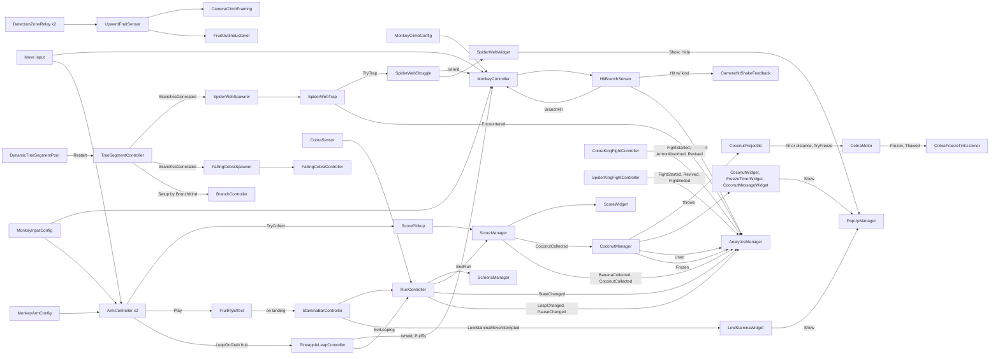

# Monkobra CONTEXT

Descriptive knowledge of this repository for agents and developers.

- Belongs Here: what the system is, ie architecture, domain model, API surface, patterns, known gaps; only what the code cannot show, as it stands, never its history
- Size: stay lean for the context window; when the file grows, move detail to `docs/` or cut it
- Upkeep: update in the same change that moves architecture, patterns, commands, or environment variables
- Structure: follow the existing sections; keep every statement true for every contributor
- Belongs in `AGENTS.md`: prescriptive rules for agents, ie commands, conventions, constraints, do/don't
- Belongs in `docs/`: system documentation for users and agents alike; link it from here, never grow this file to hold it
- Local Layer: put machine-specific or personal context in `CONTEXT.local.md`; create it if missing, never commit it

## Project Overview

Monkobra is a Unity course project (USC CSCI-526, Fall 2026). Where each kind of knowledge lives:

| Topic | Home |
| --- | --- |
| Concept, pillars, mechanics, difficulty intent | [Game Design Document](docs/monkobra-gdd.md) |
| Stack, scenes, run lifecycle, monkey, tree, stamina, score, input, UI, conventions | [Technical Design Document](docs/monkobra-tdd.md) |
| Cobra, falling cobra, branches, spider webs, touch outcomes | [Mobs](docs/mob-doc.md) |
| Detection zones, reach, release check, camera swap, outlines | [Grab System](docs/grab-doc.md) |
| Why difficulty follows height, the roll model, the single balance asset | [Balance Design](docs/balance-doc.md) |
| The run from start to loss, as one diagram | [Gameplay Loop](docs/gameplay-loop-doc.md) |
| Controls, setup | [README](README.md) |
| Online leaderboard setup, rules, local testing | [Leaderboard](docs/leaderboard-doc.md) |
| Git flow for teammates (Chinese) | [Work with Git](docs/work-with-git.md) |
| The three builds (WebGL for GitHub Pages, WebGL for itch.io, Windows), Player Settings, deploys | [Build](docs/build-doc.md) |
| Agent rules | [AGENTS.md](AGENTS.md) |

This file is the script index and the map of how the pieces connect. Behavior and numbers live in the documents above, never here.

## Repository Layout

```text
monkobra/
├── README.md          human onboarding
├── AGENTS.md          agent rules
├── CONTEXT.md         this file
├── CHANGELOG.md       version history, plus open triage tags in a comment
├── DEVLOG.md          weekly development journal, screenshots in devlog-assets/
├── docs/              design, technical, mob, grab, balance, gameplay loop, analytics, build, UI style, and git documents
├── devlog-assets/     images embedded by DEVLOG.md
├── builds/            local build output of all three builds, ignored by git
├── tools/             offline generators outside Unity: `backdrop/`, `music/`, `sfx/` (Python), `firebase/` (leaderboard rules & tests), `comic/` (the intro comic's art: traced faces & character kit, storyboard, and the final motion-comic layers in `panels/` with `panels.json` holding rects, captions & motion)
├── Assets/
│   ├── _Monkobra/     all authored assets, <Type>/<Module>/<asset>
│   │   ├── Scenes/    TitleScene, IntroComicScene, LevelSelectScene, GameplayScene, and the 2 generated `DEVBoss...Scene` boss test copies; the gameplay scene is root prefab instances plus the plain `Envs` object, see [Scene Hierarchy](#scene-hierarchy)
│   │   ├── Scripts/   one folder per module (see Script Index), `SceneFlow/Editor/`
│   │   ├── Plugins/   WebGL/Download.jslib (browser download of a text file), WebGL/TitleScreenLoader.jslib (tells the loading page the title is drawn)
│   │   ├── Prefabs/   per module; `UI/` holds the `MenuButton` and `IconButton` prefabs of the [UI Style](docs/ui-style-doc.md) and the `MenuHint_Keyboard`, `MenuHint_Touch` hints shared by the level select, pause, and lose screens; `PopUp/` holds `PopUpManager`, `_PopUpBase`, `PopUp_Fruit` (every popup is data in `Settings/PopUp/PopUpCatalog`, not a prefab); `World/` holds light, volume, event system, `EventSystem_Menu`, `MenuCamera`
│   │   ├── Materials/, Sprites/, Shaders/, Inputs/   per module; `Sprites/UI/` the button frames and glyphs, `Sprites/InputIcons/` the key icons and their `*_keycap` fills; `Inputs/InputSystem_Actions`, `Shaders/Outline/OutlineHull` (hand-written inverted-hull outline, width in world units) & `Shaders/Outline/OutlineMask` (stencil mark of a fruit's body, so the hull outlines only the whole silhouette) & `Shaders/Outline/OutlineSeeThrough` (depth-Greater misty halo for a fruit hidden by the trunk, the fruit shape stenciled out), `Shaders/Environment/ToonBark` (hand-written stylized trunk & branch shader: soft 2 tone light, painterly mottle, moss patches by world-position noise with a soft dark rim, thin silhouette), `Shaders/Environment/BackdropSky` (the jungle backdrop's far world on 1 dome: sky, clouds, 4 hill ridges, the canopy from above with the river, the floor under the near trees, all worked out per view ray) & `BackdropSurface` (the near trees) & `BackdropClouds` (camera-facing puffs drawn procedurally) & `BackdropBirds` (flocks flown & flapped in the vertex shader), sharing `BackdropCommon.hlsl` (the `_Backdrop*` globals & the haze); `Textures/Environment/Backdrop_*` are painted by `tools/backdrop/make_backdrop.py`
│   │   ├── Fonts/     `Baloo2/` the UI font (Baloo 2 SemiBold & ExtraBold, Latin set, their TMP assets & Title material); accent fonts under their own folders, see [UI Style](docs/ui-style-doc.md#type)
│   │   └── Settings/  `_Shared/` (URP assets, volume profiles) plus one folder per module, assets directly inside
│   ├── WebGLTemplates/ FitWindow/index.html, the 16:9 fit-to-window WebGL page and its loading page (USC Games and Peel Five logos, then the cobra eats dots on real download progress), whose last frame is the `TitleScreen` picture
│   ├── Settings/      Build Profiles/ (GithubPages, ItchIO), Unity-managed
│   ├── TextMesh Pro/  imported TMP essentials, not authored
│   └── Readme.asset   Unity template leftover
├── Monkobra/          committed WebGL export served by GitHub Pages
├── Packages/          manifest & lock
└── ProjectSettings/   Unity project settings
```

## Scene Hierarchy

Four scenes, in build order: `TitleScene` (startup), `IntroComicScene` (the story, once a launch, before the first level selection), `LevelSelectScene`, `GameplayScene` (both run modes, picked on load). The three menu scenes are shells of `MenuCamera`, `EventSystem_Menu`, their screen prefab (`TitleScreen`, `IntroComicScreen` or `LevelSelectScreen`) and `GameController`; the menus read the `InputSystem_Actions` UI map through their own event system, so the gameplay `EventSystem` stays unchanged. Hardcore Mode is the same scene started through `SceneNames.Load(SceneNames.GAMEPLAY, RunMode.Hardcore)`, so nothing is kept in step by hand.

Two more scenes, `DEVBossCobraKingScene` and `DEVBossSpiderKingScene`, are generated copies of `GameplayScene` for testing one boss fight each; they are rebuilt by `Monkobra > Build Boss Dev Scenes`, never edited by hand, see [Boss Dev Scenes](docs/monkobra-tdd.md#boss-dev-scenes).

`GameplayScene`'s root is 8 prefab instances, so teammates edit different files, plus 4 plain scene objects: `UI` (the `Canvas`), `Envs`, `Entities`, and a Cinemachine `Target Group`. `UI`, `Envs` and `Entities` nest one prefab per unit and have no prefab of their own, so adding or removing one of their children edits `GameplayScene.unity` itself. `Entities` is the monkey's orbit center: `MonkeyController` and `CameraAnchor` read `transform.parent.position` of `_Monkey`, so `Entities` stays at the tree axis and keeps `_Monkey` and `GreatCobra` as children.

| Root | Nests |
| --- | --- |
| `Cameras` | the climb camera, the three event shot cameras (coconut, cobra alert, leap), the camera anchor and two shot targets, the director, framing and shake components |
| `World/DirectionalLight`, `World/GlobalVolume`, `World/EventSystem` | three separate root prefabs, no wrapper |
| `Envs` (plain scene object) | `DynamicTreeSegmentPool` (with both spawners), `StartingZoneExitTrigger`, `Tree` (mock tree), `RoughBarkSystem` (`RoughBarkSpawner`), `HeightMarkerSystem` (`HeightMarkerSystem`, on the trunk axis), `JungleBackdrop` (`JungleBackdrop`, on the trunk axis), `SpiderWebIntro` (`SpiderWebIntroEvent` & `SpiderKingBody`, the web intro story event) |
| `Player/_Monkey`, `MobGreatCobra/GreatCobra` | children of the plain `Entities` object, 1 prefab each |
| `BossCobraKing/CobraKingFight` | `CobraKingFightController`, `CobraKingBody`, `BossFightHud`; builds the Cobra King arena at runtime, its position does not matter |
| `BossSpiderKing/SpiderKingFight` | `SpiderKingFightController`, `SpiderKingBody`, `BossFightHud`; builds the Spider King arena at runtime; spawned by `CobraKingFightController.spiderFightPrefab` when a scene has none |
| `GameController/GameController` | one GameObject carrying `GameController`, `TutorialSkipManager`, `AnalyticsManager`, `ControlStyleManager`, `MusicManager` as components, in every scene; the first instance is kept across scene loads, a later copy deactivates & destroys itself before its managers wake |
| `RunController/RunController` | one GameObject carrying `RunController`, `ScreensManager`, `ScoreManager`, `RampedDifficultyManager` as components |
| `UI/UI` | the `Canvas`, `TouchControls` (first child, so it draws below everything), `CobraProximityVignette`, `ProgressBar`, `StaminaBar` (also hosts `LowStaminaWidget`), `ScoreHeight` (`ScoreHUD`), `PauseButton`, `CoconutHUD`, `CoconutMessage` (widget host only), `FruitFlyLayer` (last of the HUD parts, above the bars), `FreezeTimerHUD`, `HackShortcutHelp`, `SpiderWebPrompt` (escape bar), `PopUpManager` (`PopUp/PopUpManager`, before the screens so the panels draw over it), then `PauseScreen`, `TutorialScreen`, `LoseScreen` as the last children |

Unity drops a reference between two prefab assets, so every link that crosses a root (e.g. `LoseScreen.scoreManager`, `CameraAnchor.monkey`) is a property override on the scene instance. Each object rests in its original active state: owners such as `ScreensManager` switch screens on, managers stay active.

## How the Pieces Connect



## Script Index

All under `Assets/_Monkobra/Scripts/`. Each row names the owner of the detail.

| Script | Role | Detail |
| --- | --- | --- |
| `RunController/RunController`, `GameState` | singleton, owns the `GameState` machine: Tutorial, StartingZone, Playing, Lost, Won; `LoseGame()` takes no cause, analytics infers it | [TDD](docs/monkobra-tdd.md#run-lifecycle) |
| `GameController/GameController` | singleton on the `GameController` prefab (`Prefabs/GameController/`), kept across scene loads, the only class that destroys a duplicate or calls `DontDestroyOnLoad` for the manager components beside it (execution order -1000, the managers' -990): holds what any scene may need
| `RunController/StartingZoneExitRelay` | on a trigger collider GO: the monkey entering calls `EndStartingZone()` | [TDD](docs/monkobra-tdd.md#run-lifecycle) |
| `Player/PlayerBalanceConfig` | ScriptableObject (`Settings/Player/PlayerBalanceConfig.asset`): the player's run balance, ie stamina, starting zone, branch hit, coconut | [Balance Design](docs/balance-doc.md) |
| `Scoring/ScoreConfig` | ScriptableObject (`Settings/Scoring/ScoreConfig.asset`): every score value, ie points per meter and points per reward kind; read by `ScoreManager` | [Balance Design](docs/balance-doc.md) |
| `Environment/WorldBalanceConfig` | ScriptableObject (`Settings/Environment/WorldBalanceConfig.asset`): world balance, ie the pre, mid & post boss ramp curves, the 4 branch kinds (a density curve each), rough bark, spider web, boss zone & fight | [Balance Design](docs/balance-doc.md) |
| `MobGreatCobra/CobraBalanceConfig` | ScriptableObject (`Settings/MobGreatCobra/CobraBalanceConfig.asset`): falling cobra & great cobra balance | [Balance Design](docs/balance-doc.md) |
| `Player/MonkeyController` | singleton `I`, set in `Awake`, so read it from `Start` on; `GetRootOrNull()` gives its root object, null w/o a monkey; kinematic body: orbit, climb, stun, `IsHeld`, `IsInputLocked` (set by `CameraRigManager` while the cobra alert or spider intro cuts away: no climb, reach, coconut or web struggle input), a height ceiling for the boss fight, `SyncOrbitAngle` to land a pulled body on the ring where it is | [TDD](docs/monkobra-tdd.md#monkey-movement) |
| `Player/MonkeyInputConfig` | ScriptableObject (`Settings/Player/MonkeyInputConfig.asset`): the move & interact input actions every monkey consumer reads | [TDD](docs/monkobra-tdd.md#input) |
| `Player/MonkeyArmConfig` | ScriptableObject (`Settings/Player/MonkeyArmConfig.asset`): arm stroke, reach, splay & width | [Grab](docs/grab-doc.md#tuning) |
| `Player/MonkeyClimbConfig` | ScriptableObject (`Settings/Player/MonkeyClimbConfig.asset`): held-time speed curves up and down, exhausted multiplier, idle stamina recovery, orbit speed, deceleration | [TDD](docs/monkobra-tdd.md#monkey-movement) |
| `ItemPineapple/PineappleLeapController` | on the monkey root: runs a leap after a pineapple grab, hands up, pull, landing grace; sets `RunController.IsLeaping`; the pull stops at `CobraKingFightController.LeapTopY` | [Grab](docs/grab-doc.md#pineapple-leap) |
| `ItemPineapple/PineappleLeapConfig` | ScriptableObject (`Settings/ItemPineapple/PineappleLeapConfig.asset`): a pineapple leap's distance, speed curve, hand rise time & landing grace | [Grab](docs/grab-doc.md#pineapple-leap) |
| `Player/ArmController` | one arm: climb stroke, reach, release check | [Grab](docs/grab-doc.md#reach-and-release) |
| `Player/MonkeySfxListener` | on the `_Monkey` root: the monkey's sound effects, a banana, coconut or pineapple grab, a miss (`ArmController.FruitGrabbed`, `GrabMissed`), the leap's rush (`PineappleLeapController.Begun`), a coconut thrown, the cobra frozen & thawed (`CoconutManager`), each tug against a web, higher as escape nears, silent as it catches or lets go (`SpiderWebStruggle.EscapePressed`), a height marker (`HeightMarkerSystem.MarkerReached`), low stamina once per dip (`StaminaBarController.LowStaminaMoveAttempted`), a hit (`HitBranchSensor.Hit`), the bite on a loss (`RunController.StateChanged`), and after any grabbed fruit, boss fights' too, a random happy call at `happyChance`, `happyCooldownS` apart; listens only, 6 2D sources in turn; clips in `Audio/SFX/Player/`, synthesized by `tools/sfx/make_sfx.py` in the music's palette | none |
| `Player/MonkeyModelArms` | on the monkey root: poses the skinned Mr. Mo model's arms each frame, runs after `MonkeyModelAnimator`; while climbing the hands follow the animator's speed-matched climb cycle, while reaching or while a leap holds the hands up they blend onto the physics hands so the visible grab lands where it is judged, back to the cycle as soon as the hands let go; two bone IK with elbows out & back, both bones lengthening alike past a bent arm's reach, a wrist that bends but never twists, fingers curled on the bark and open to reach; visuals only, the old capsule, tail & arm cube renderers are off while their colliders still play | [Monkey Model](docs/monkey-model-doc.md#arms) |
| `Player/MonkeyOutline` | on the monkey root: appends the cream always-on `Outline_Monkey` material (the `OutlineHull` shader, 0.040 u) as an extra slot on every renderer under the model root | [Monkey Model](docs/monkey-model-doc.md#outline) |
| `Player/MonkeyModelAnimator` | on the monkey root: procedural climb look of the Mr. Mo model; a climb cycle advancing with the monkey's real speed (one cycle per `strideU`), shared by all 4 limbs in a diagonal gait (`LimbCycle`), held with every limb gripping the bark while a hit knocks the monkey down (`MonkeyController.IsStunned`); legs, hip sway, breathing; legs by two bone IK whose thigh twists so the kneecap faces the bend (never backward); on start reskins a mesh copy so the arms' elbow & wrist rings and the legs' hip, knee & ankle rings each move as one even piece (a stretched arm keeps its thickness, the hip ring is cushioned by the hips so a raised thigh never folds the butt in) and the hips-skinned tail gets a runtime bone chain swinging on a spring; an over the shoulder look down the trunk every few seconds, far more often while the great cobra is close or surging, never while reaching, leaping, webbed or in the boss arena; reads state only, moves model bones only | [Monkey Model](docs/monkey-model-doc.md) |
| `Player/ModelTwoBoneIK` | static: world space two bone IK, optionally twisting the upper bone so the middle joint's front faces the bend, & bone lookup by name for the skinned model's limbs | [Monkey Model](docs/monkey-model-doc.md) |
| `Player/DetectionZoneRelay` | side-tagged trigger forwarding enter and exit | [Grab](docs/grab-doc.md#detection) |
| `Player/UpwardFruitSensor` | singleton, reachable and grabbable fruit; the target and reach side follow the fruit closest to the monkey, re-picked every physics step | [Grab](docs/grab-doc.md#detection) |
| `Cameras/CameraAnchor` | the one transform every camera tracks: the monkey's rendered position with an eased, dead-zoned yaw round the trunk, so strafing never spins the world; reads `CameraConfig` | [TDD](docs/monkobra-tdd.md#camera) |
| `Cameras/CameraConfig` | ScriptableObject (`Settings/Cameras/CameraConfig.asset`), the one camera tuning asset: anchor, climb framing, the three shots, shake, stamina vignette, comfort | [TDD](docs/monkobra-tdd.md#camera) |
| `Cameras/CameraClimbFraming` | on the climb camera: the upward rest aim, a lead from the target's real vertical speed, a grab shift toward the fruit side picked once per press, and `SetBossFraming` for the boss fight view | [Grab](docs/grab-doc.md#camera) |
| `Cameras/CameraRigManager` | the shot director on the `CameraRig`: cuts to the coconut, cobra alert, leap, or spider intro shot by priority, minimum hold, cap and cooldown, never touches the interact action; for the cobra alert starts the framing's journey (`BeginJourney`), boosts the great cobra's climb (`SetStartCreep`, at once) from the first moment of the pull away till the camera arrives, then back to chase speed, its exit boost released (`ReleaseStartBoost`) as the shot ends; raises `ShotChanged`, and `CutAwayReturning` once as the cobra alert camera starts back (`travelS + seeS` in), and locks the monkey's input while the cobra alert or the spider intro is live (`IsCutAwayShot`); blend times per camera pair in `Settings/Cameras/CameraBlends.asset` | [TDD](docs/monkobra-tdd.md#camera) |
| `Cameras/CameraShotTarget` | the point the coconut shot tracks: the anchor blended with the thrown coconut, anchor yaw kept, holds the last spot when the coconut is gone | [TDD](docs/monkobra-tdd.md#camera) |
| `Cameras/CameraSpiderIntroFraming` | on the spider intro camera: stands out from the monkey on the anchor's yaw, a bit below, looking up; its focus eased to the middle of the span from the monkey's feet to the subject (`SetSubject`, the king), the field of view widened to fit both; idle w/o a subject | [Mobs](docs/mob-doc.md#spider-king-intro) |
| `Cameras/CameraCutAway` | next to `CameraRigManager` on the `CameraRig`: while the cobra alert or the spider intro cuts away from the monkey (`ShotChanged`, `IsCutAway`), the game's UI goes (every screen space canvas switched off, back at once on a pause or the run's end) and black cinema bars grow slowly in at the top & bottom (`cutAwayBarSlideS`, 2 s); the cobra alert's bars draw back out as the camera starts back (`CutAwayReturning`), the UI returns at the shot's end (the spider intro's bars leave then too); the bars build their own overlay canvas, in real time; `ProgressBarWidget` holds the "Run!" popup till the UI is back; height & slide in `CameraConfig` (`cutAwayBarShare`, `cutAwayBarSlideS`) | [TDD](docs/monkobra-tdd.md#camera) |
| `Cameras/CameraCobraAlertFraming` | on the cobra alert camera, which it flies itself (its Follow & composer are off, no Cinemachine blend): `BeginJourney` saves the live view, then the camera is that view blended into the framed cobra view by a smootherstep progress, pulling away, holding, and pulling back the same way; the framed view stands on the cobra head's own side of the trunk (`CobraMotor.TryGetHead`), out along its angle, so the trunk never hides the head, its focus eased in height to the middle of the cobra's own coil, close at a set horizontal distance looking down by a set angle, widens the field of view to fit the whole cobra | [Mobs](docs/mob-doc.md#camera-alert) |
| `Cameras/CameraLeapFraming` | on the leap camera: the higher aim and the pull-back along its own direction while a pineapple leap runs | [TDD](docs/monkobra-tdd.md#camera) |
| `Cameras/CameraHitShakeFeedback` | on the main camera: fires a light impulse for a branch hit, a heavier one for a falling cobra hit, scaled by `CameraConfig` | [Mobs](docs/mob-doc.md#hit-penalty) |
| `Cameras/CameraRoughBarkShake` | on the `CameraRig`: eases the Perlin noise of every camera up while the monkey moves on rough bark | [Mobs](docs/mob-doc.md#rough-bark-shake) |
| `Cameras/CameraCoolDownFeedback` | on the main camera: vignette blackdown pulse on each low-stamina move attempt, a lighter step while low and a stronger one when empty, no zoom; takes the shared screen-edge slot first | [TDD](docs/monkobra-tdd.md#camera) |
| `Cameras/ScreenVignetteManager` | singleton on the `CobraProximityVignette` prefab: the one slot the stamina and cobra vignettes share, a refused ask waits so the two alternate | [TDD](docs/monkobra-tdd.md#camera) |
| `Player/HitBranchSensor` | singleton branch sensor: raises `BranchHit` and `Hit` (with a `HitKind`); `ReportHit` applies the same drop for a hazard touching the monkey outside the sensor | [Mobs](docs/mob-doc.md#hit-penalty) |
| `Environment/RoughBarkZone` | raised, irregular bark patch on the trunk that smoothly slows the monkey in every direction while touched; avoidable | [Mobs](docs/mob-doc.md) |
| `Environment/RoughBarkSpawner` | on the `RoughBarkSystem` prefab: places broad patches from the `RoughBark` scatter channel ahead of the monkey, off obstacles, from `roughBarkDensityCurve` at each height's ramped difficulty | [TDD](docs/monkobra-tdd.md) |
| `Environment/TreeManager` | singleton on the mock tree, marks the trunk axis | [TDD](docs/monkobra-tdd.md#tree) |
| `Environment/TreeSegmentController` | places branches on a segment, one prefab per `BranchKind` (empty, banana, coconut, pineapple), first growing the guaranteed pineapple & coconut branch at its exact height, facing the monkey's angle w/i `guaranteedBranchYawSpreadDeg`, then the 4 kinds' `TrunkScatter` items of its height range, rarest first, each from its own density curve at the item's ramped difficulty, keeping separation from every live branch across segment joints, skipping spots w/i `startingZoneBranchClearRadiusU` of the monkey before the run is playing & spots in the boss zone, growing only banana branches at the flat `startingZoneBananaBranchDensity` below the exit trigger (`RampedDifficultyManager.IsInStartingZoneY`), lifting or dropping any branch whose fruit would hang below the monkey's start (`KeepFruitAboveStart`), then raises the static `BranchesGenerated` | [Mobs](docs/mob-doc.md#placement) |
| `Environment/TrunkScatter` | on `Envs/DynamicTreeSegmentPool`: singleton `TrunkScatter.I`, the run's seed (random, or `useFixedSeed`) and one `ScatterStream` per `ScatterChannel`; `GetItems` returns the items of a channel in a height range, evenly spaced along the trunk from a density curve, a pure function of seed, channel and index | [Balance Design](docs/balance-doc.md#location-scatter) |
| `Environment/ScatterChannel` | enum of the 7 scatter streams: 4 branch kinds, web, falling cobra, rough bark | [Balance Design](docs/balance-doc.md#location-scatter) |
| `Environment/TrunkScatterConfig` | ScriptableObject (`Settings/Environment/TrunkScatterConfig.asset`): spacing jitter, yaw jitter, retries, integration step | [Balance Design](docs/balance-doc.md#location-scatter) |
| `Environment/Editor/TrunkScatterReport` | menu `Monkobra > Report Trunk Scatter`: logs each channel's count per 10 u, largest gap and first height from the live configs, no scene needed | [Balance Design](docs/balance-doc.md#location-scatter) |
| `Environment/StylizedBranchArt` | on `_BranchBase`: hides the branch box's and the fruit stem's renderers and draws a stylized log sized to the box instead (thick & flared where it leaves the trunk, tapering to its tip, arched, a twig, leaf rosettes, moss strands along its sides), a few looks built once and shared; on `Start`, after `BranchController.Setup` hangs the fruit, grows a green stalk from the log's underside to the stem's tip, with 2 leaves & sepals over the fruit; box & stem keep their colliders and the fruit its place, so hits & grabs are unchanged | none |
| `Environment/TrunkDecor` | on `TreeSegment`: one collider-less child mesh of moss strands hanging off the bottom edges of the moss patches the trunk's ToonBark material paints, and leaf rosettes growing out of the moss; rebuilt when a pooled segment moves | none |
| `Environment/StylizedBarkNoise`, `Environment/StylizedMeshBuilder` | static CPU copy of the `Monkobra/ToonBark` shader's moss mask, kept in step with it; and the tube, moss strand & leaf builder for the cartoon tree, every triangle wound to face its normal | none |
| `Environment/DynamicTreeSegmentPool` | on an empty base marker: instantiates the segments, then recycles the lowest segment over the top, restarting it, for an endless tree | [TDD](docs/monkobra-tdd.md#tree) |
| `Environment/HeightMarkerSystem` | on `Envs/HeightMarkerSystem`: the climbed height every `intervalU` beside the trunk, on both its left and right as seen from the camera, in world units labelled m, on a generated dark rounded plate, from a pool of TextMeshPro labels keyed to height, never to segments; pulses a marker the first time the monkey touches its `HeightMarkerRelay` and raises `MarkerReached` for the score, a prefab trigger at the marker's exact height while the plate is drawn on its label anchor above; each boss fight's height marker (the Cobra King's & the Spider King's) gets a bigger, red, beating plate w/ a small living look-alike holding it (`BossMarkerFigure`), hidden once that fight begins | [TDD](docs/monkobra-tdd.md#ui) |
| `Environment/JungleBackdrop` | on `Envs/JungleBackdrop`: the Amazon backdrop changing with the climbed height (from `RampedDifficultyManager.PlayerGameStartYPosition`): round-crowned forest at the start, dropping away into a carpet of crowns with the river showing, hills sinking, clouds gathering, flocks of birds from about 500 m; the far world is painted by `BackdropSky` on a dome kept on the camera, only the ring of near trees is a mesh, built once in `Start` as 8 wedges, its trees lifted by `junctionLiftU` round where the painted canopy starts so their crowns hide its edge; sets `_Backdrop*` shader globals each `LateUpdate`; no colliders or shadows, and clear of the trunk, so it never blocks the camera, the monkey, or the cobra | none |
| `Environment/BackdropMeshes` | low-poly mesh builder for the backdrop: sky dome, cloud quads & bird outlines for their shaders (huge bounds, the shaders move them), batched tapering trunks & lumpy crowns with sRGB byte vertex colours & no UVs, every triangle wound to face its normal, CPU copy freed once uploaded | none |
| `Environment/HeightMarkerRelay` | on the `HeightMarker` prefab root: a thin trigger slab at one marker's exact height, raises `Passed` when a physical part of the monkey touches it; its `LabelAnchor` child, a fixed way above, is where the plate is drawn | [TDD](docs/monkobra-tdd.md#ui) |
| `Environment/BranchFruitPlacementConfig` | ScriptableObject (`Settings/Environment/BranchFruitPlacementConfig.asset`) of branch placement | [Mobs](docs/mob-doc.md#placement) |
| `Environment/BranchController` | on each branch prefab variant: `Setup` shows the fruit its `BranchKind` names, a banana, or a coconut or pineapple from its `fruitPrefab`, or none | [Grab](docs/grab-doc.md#fruit-supply) |
| `Environment/BranchKind` | enum of the 4 branch kinds: Empty, Banana, Coconut, Pineapple; keys the per kind config & prefab | [Mobs](docs/mob-doc.md#placement) |
| `Environment/FruitOutlineListener` | three-tier fruit outline (normal, reachable, grabbable) plus the see-through ghost slot, on the object holding the fruit's collider; materials come from `FruitOutlineStyle` by fruit kind, and `SetKind` re-picks the kind later (the arena melons) | [Grab](docs/grab-doc.md#feedback) |
| `Environment/FruitOutlineStyle` | ScriptableObject (`Settings/FruitOutline/FruitOutlineStyle.asset`): world-unit tier widths, tier S and V, a hue per fruit kind, the monkey look, the ghost values; `GetTierMaterial` and `GetGhostMaterial` build and cache the shared materials | [Grab](docs/grab-doc.md#feedback) |
| `Environment/Editor/OutlineMaterialBuilder` | menu `Monkobra > Build > Outline Materials` (style asset, monkey, ghost and golden base materials) | [Grab](docs/grab-doc.md#feedback) |
| `Environment/Editor/WatermelonPrefabBuilder` | menu `Monkobra > Build > Watermelon Prefab`: creates `Prefabs/Environment/Branch_Watermelon` as a Prefab Variant of `Branch_Banana` (watermelon mesh, scale and offset from `CobraKingConfig`, listener kind `Melon`), idempotent; both kings' `WatermelonBranchPrefab` take it, so their arenas never swap a mesh at run time | [Grab](docs/grab-doc.md#feedback) |
| `Environment/Editor/OutlinePrefabWiring` | menu `Monkobra > Build > Outline Prefab Wiring`: sets the style and kind on the banana, coconut and pineapple listeners, the monkey material and the boss golden config material | [Grab](docs/grab-doc.md#feedback) |
| `Environment/FruitFlyOnGrab` | on a fruit's root: its fly target and sprite; the `Coconut` and `Pineapple` prefabs carry one, the banana none | [Grab](docs/grab-doc.md#fruit-fly) |
| `ItemPineapple/LeapOnGrab` | marks a fruit whose grab starts a leap | [Grab](docs/grab-doc.md#pineapple-leap) |
| `MobSpiderWeb/SpiderWebSpawner` | on `Envs/DynamicTreeSegmentPool`: on each `BranchesGenerated`, places the `Web` scatter items of that segment's height range on its trunk, from `webDensityCurve` at each height's ramped difficulty | [Mobs](docs/mob-doc.md#placement-1) |
| `MobSpiderWeb/SpiderWebTrap` | web prefab root with one deepened trigger box; `IsArmed` (default true), an unarmed web never catches nor raises `Encountered` | [Mobs](docs/mob-doc.md#trap-and-escape) |
| `MobSpiderWeb/SpiderWebIntroEvent` | on `Envs/SpiderWebIntro` beside a `SpiderKingBody`: the scripted web intro, once per Normal Play run (never Hardcore) at a climbed height: holds the great cobra (`SetStoryHold`), cuts to the `SpiderIntro` shot over the bare trunk, scuttles the king in round the trunk to above the monkey, throws the real web (unarmed) that sticks & traps the monkey, then the king climbs off, the shot lets go & the cobra is freed on `Escaped`; `Play Now` context menu tests it | [Mobs](docs/mob-doc.md#spider-king-intro) |
| `MobSpiderWeb/SpiderWebIntroConfig` | ScriptableObject (`Settings/MobSpiderWeb/SpiderWebIntroConfig.asset`): trigger climbed height, king offset above, establish pause, scuttle-in time, angle & leg walk peak, wind-up, throw time & arc, start scale, stick hold, exit time | [Mobs](docs/mob-doc.md#spider-king-intro) |
| `MobSpiderWeb/SpiderWebStruggle` | on the monkey: trap state, escape bar, immunity; `ForceRelease` frees the monkey at once, eg for the boss fight | [Mobs](docs/mob-doc.md#trap-and-escape) |
| `MobSpiderWeb/SpiderWebBuilder` | `Build Web` context menu that builds the web strands out of cubes, a one-off authoring aid | none |
| `MobGreatCobra/CobraMotor` | the Coordinator, calling the role classes below; chasing cobra path, coil, look, and balance-driven base speed with a stacking mistake surge (raises `CatchUpStarted`) and a timed boost on leaving the starting zone (raises `ChaseStarted`); `TryFreeze` holds it still for a coconut (raises `Frozen`, `Thawed`); `SetStoryHold` stops its climb silently for a story event (no `Frozen`, no surge; it still orbits; a start hold, the chase's first look, banks the exit boost for the lift & eases up at `cobraStartEaseRateU`, and `SetStartCreep` jumps it to a boosted climb speed for the cut scene, the exit boost waiting for `ReleaseStartBoost`); `StartGuard` / `StopGuard` hold it below the boss arena, `KnockBack` throws the head back when the gold armor takes a bite | [Mobs](docs/mob-doc.md#cobra) |
| `MobGreatCobra/CobraMotorConfig` | ScriptableObject (`Settings/MobGreatCobra/CobraMotorConfig.asset`): every tuned value of the great cobra; the Transforms & balance Configs sit on `CobraMotor` | [Mobs](docs/mob-doc.md#cobra) |
| `MobGreatCobra/CobraMotorRig` | the state all the roles share (head angle and height, guard, surge, freeze, hiss, cartoon pose) and the path geometry | [Mobs](docs/mob-doc.md#cobra) |
| `MobGreatCobra/CobraMotorChase` | base climb speed, the head raise near the monkey or reared for the camera's look as the chase starts (`CobraMotor.PlayAlertRear`, from `CameraRigManager`, eased over `alertRearEaseS`), and the exit boost on leaving the starting zone | [Mobs](docs/mob-doc.md#cobra) |
| `MobGreatCobra/CobraMotorSurge` | listens for the monkey's mistakes and starts the stacking surge | [Mobs](docs/mob-doc.md#cobra) |
| `MobGreatCobra/CobraMotorGuard` | the boss arena guard: the held height and the peeking head | [Mobs](docs/mob-doc.md#cobra) |
| `MobGreatCobra/CobraMotorHiss` | the close chase hiss and its alert cue | [Mobs](docs/mob-doc.md#cobra) |
| `MobGreatCobra/CobraMotorCoil` | lays the body along the coil, styles it, and poses the cartoon head | [Mobs](docs/mob-doc.md#cobra) |
| `MobGreatCobra/CobraFreezeTintListener` | next to `CobraMotor` on the `GreatCobra` prefab: tints the body light blue while frozen, blinking near the end, eyes untouched | [Mobs](docs/mob-doc.md#coconut-freeze) |
| `ItemCoconut/CoconutManager` | singleton on the `RunController` prefab: counts the run's coconuts, throws one on its `UseCoconut` input action (a double-tap, never in a boss fight), starts `CobraMotor.TryFreeze` when it lands, relays the cobra's freeze events, and switches the coconut HUD roots on (they start inactive) | [Grab](docs/grab-doc.md#coconut) |
| `ItemCoconut/CoconutProjectile` | the thrown coconut (`Prefabs/ItemCoconut/CoconutProjectile`): falls straight down, ends on touching the cobra or after a fixed distance | [Grab](docs/grab-doc.md#coconut) |
| `MobGreatCobra/CobraSensor` | cobra contact calls `LoseGame`, unless the boss fight's gold armor absorbs it (`CobraKingFightController.TryAbsorbCobraCatch`) | [Mobs](docs/mob-doc.md#contact) |
| `BossCobraKing/CobraKingFightController` | the Coordinator, calling the role classes below; on the `BossCobraKing/CobraKingFight` prefab: starts the boss fight at the `cobraKingArena` location (525 u) inside its bare zone (in the hardcore run at its turn of the boss rush, again & again, `ArmNextRush`), clears the branches near its nest, puts the great cobra on guard, caps the monkey's climb below the king, runs the rest/attack loop (bite, tail sweep, minions, head butt), banana branches whose grabbed bananas are also thrown in an arc at the crown, the EASY / NORMAL mode choice, the golden banana shield (`TryThrow`), king health, speech, the slow-motion finisher, an ad revive (any number of times) that restarts the fight with the mode choice, and the win reward: the armor kept as the run goes on (`TryAbsorbCobraCatch`, which in the fight flies the monkey back to the start, `ReturnToStart`) after a reward panel that stops time till Space or Continue; also exposes `BuildMarkerFigure` & `TriggerHeightU` for the trunk height marker, & raises `FightStarted`, `ArmorAbsorbed`, `Revived`, and for listeners such as its sounds `AttackStruck` (each bite landing, sweep coming round & minion wave dropping, after its warning), `JewelHit`, `KingShattered`; in Hardcore mode it skips the fight and starts as `StartAsDone`: armor worn, hazards on, no boss marker | [Mobs](docs/mob-doc.md#cobra-king-boss) |
| `BossCobraKing/CobraKingSfxListener` | next to the controller on the `CobraKingFight` prefab: the fight's sound effects, a gong & hiss as it begins, a hiss as each warned attack strikes (the bite landing, the sweep coming round, the minions dropping), a clang when the gold armor takes a hit, a watermelon bursting as fruit hits the crown, the king shattering & a victory call `victoryDelayS` later (`PlayDelayed`, audio time, so slow motion & the reward pause never bend it); listens only; clips in `Audio/SFX/BossCobraKing/`, synthesized by `tools/sfx/make_sfx.py` | [Mobs](docs/mob-doc.md#cobra-king-boss) |
| `BossCobraKing/CobraKingConfig` | ScriptableObject (`Settings/BossCobraKing/CobraKingConfig.asset`): every tuned value of the fight; `WorldBalanceConfig` sits on `CobraKingFightController` | [Mobs](docs/mob-doc.md#cobra-king-boss) |
| `BossCobraKing/CobraKingRig` | the state all the fight roles share, the fight phase, loop, and attack enums, the marker, minion, and projectile structs, and the shared geometry queries | [Mobs](docs/mob-doc.md#cobra-king-boss) |
| `BossCobraKing/CobraKingArena` | builds and clears the arena: branches, fruit, webs, rough bark, and the trunk markers | [Mobs](docs/mob-doc.md#cobra-king-boss) |
| `BossCobraKing/CobraKingArmor` | the shield ring, its dots, and the golden banana that renews the armor | [Mobs](docs/mob-doc.md#cobra-king-boss) |
| `BossCobraKing/CobraKingThrows` | thrown bananas in flight, their trail and sparks, the jewel hit, and the first throw hint | [Mobs](docs/mob-doc.md#cobra-king-boss) |
| `BossCobraKing/CobraKingAttacks` | the fight loop and the king's attacks: bite, sweep, push, and the warnings before each | [Mobs](docs/mob-doc.md#cobra-king-boss) |
| `BossCobraKing/CobraKingMinions` | the minion waves and streams of the finale | [Mobs](docs/mob-doc.md#cobra-king-boss) |
| `BossCobraKing/CobraKingEnding` | the finisher, the loss, the revive offer, the victory, and the reward flow | [Mobs](docs/mob-doc.md#cobra-king-boss) |
| `BossCobraKing/CobraKingFeedback` | height markers, spoken lines, camera focus, and the primitive and color helpers | [Mobs](docs/mob-doc.md#cobra-king-boss) |
| `BossSpiderKing/SpiderKingFightController` | the Coordinator, calling the role classes below; on the `BossSpiderKing/SpiderKingFight` prefab: the Spider King fight at the `spiderKingArena` location (1025 u) after the Cobra King (in the hardcore run at its turn of the boss rush, again & again, `ArmNextRush`), in a bare arena (`RampedDifficultyManager.SetExtraBossZone`): the spider chases the monkey laying short-lived sticky webs, melons thrown at it on a grab (`TryGrab`); a web bullet volley charged only in view, parried by a double tap that swings the monkey's tail, timed to the monkey's edge facing the attack; a see-through air wall over the arena (`airWallMaterial`); a dash along a red lane; any touch fatal; cocoon on a trapped monkey; the parry lesson; the kept gold armor (`CobraKingFightController.TrySpendArmor`), revive, and the silk gloves reward (`SpiderWebStruggle.EscapeGainScale`) | [Mobs](docs/mob-doc.md#spider-king-boss-2) |
| `BossSpiderKing/SpiderKingConfig` | ScriptableObject (`Settings/BossSpiderKing/SpiderKingConfig.asset`): every tuned value of the fight; `WorldBalanceConfig` sits on `SpiderKingFightController` | [Mobs](docs/mob-doc.md#spider-king-boss-2) |
| `BossSpiderKing/SpiderKingRig` | the state all the fight roles share, the phase, mode, attack, and shot enums, the crescent, melon, web, shot, and ring types, and the shared geometry queries | [Mobs](docs/mob-doc.md#spider-king-boss-2) |
| `BossSpiderKing/SpiderKingArena` | builds and clears the arena: the sky web, bare branches, melons, webs, and the mode choice | [Mobs](docs/mob-doc.md#spider-king-boss-2) |
| `BossSpiderKing/SpiderKingMelons` | the melons the monkey throws at the spider | [Mobs](docs/mob-doc.md#spider-king-boss-2) |
| `BossSpiderKing/SpiderKingMovement` | moves the spider: idle, stalk, prowl, rush, cocoon, the stages, and the tail | [Mobs](docs/mob-doc.md#spider-king-boss-2) |
| `BossSpiderKing/SpiderKingAttacks` | the spider attacks: the volley, the dash, and the slash with their aims and effects | [Mobs](docs/mob-doc.md#spider-king-boss-2) |
| `BossSpiderKing/SpiderKingShots` | the crescents and shots in flight, their waves, paths, and hits | [Mobs](docs/mob-doc.md#spider-king-boss-2) |
| `BossSpiderKing/SpiderKingParry` | the parry, the clash effects, the parry camera, and the time scale | [Mobs](docs/mob-doc.md#spider-king-boss-2) |
| `BossSpiderKing/SpiderKingTeaching` | the first-fight lesson that teaches the parry | [Mobs](docs/mob-doc.md#spider-king-boss-2) |
| `BossSpiderKing/SpiderKingDamage` | hits, throw-offs, touch warnings, and the armor spent | [Mobs](docs/mob-doc.md#spider-king-boss-2) |
| `BossSpiderKing/SpiderKingSfxListener` | next to the controller on the `SpiderKingFight` prefab: the fight's sound effects: a gong & hiss as it begins (the Cobra King's), and the spider's own short, dry cues as each attack begins to charge, so the ear tells them apart, a gurgling spit for a web bullet (`WebCharged`, each of a volley's too), a fang bite & hiss for a slash (`SlashCharged`), legs scrambling for a dash (`DashWarned`), a thwack & silk snap at each parry's clash (`Parried`, from `SpiderKingParry.Clash`); clips in `Audio/SFX/BossSpiderKing/` by `tools/sfx/make_sfx.py`; a watermelon bursting as the spider is hurt (`SpiderHit`), a shatter & victory call as it is beaten (`Defeated`); the armor's clang is the Cobra King's | none |
| `BossSpiderKing/SpiderKingEnding` | the finisher, the revive offer, the defeat, and the reward (the gloves only as their effect) |
| `BossSpiderKing/SpiderKingFeedback` | camera, decor, primitive and color helpers, and static fight helpers | [Mobs](docs/mob-doc.md#spider-king-boss-2) |
| `BossWarning/DangerIndicator` | static helper shared by both bosses: dresses a warning primitive in a `Monkobra/DangerIndicator` material through a property block (plane, direction, tint, hue with fixed alpha, urgency, along offset), plus the `DangerIndicatorPlane` enum | [TDD](docs/monkobra-tdd.md#boss-danger-indicators) |
| `BossSpiderKing/SpiderKingBody` | the Spider King built at runtime from primitives, posed on the bark: walking legs, eye glow for wind ups, leg swipe, eating bob, fall on defeat | [Mobs](docs/mob-doc.md#spider-king-boss-2) |
| `_Shared/BossArenaLayout` | serializable struct, the 2 inputs of every boss arena of both kings in both modes, `locationU` (where the fight starts, its height marker) & `heightU` (the bare zone around it), deriving the bare zone, marker, seen waiting height, guard & great cobra drop; read from `WorldBalanceConfig` (`cobraKingArena` 525 / 50, `spiderKingArena` 1025 / 50) or `HardcoreBossRush.Layout` | [Balance](docs/balance-doc.md#boss-zone) |
| `_Shared/HardcoreBossRush` | static: the hardcore run's boss rush, where & how hard each next boss is (a boss every `hardcoreBossIntervalU`, the two kings taking turns, `LoopOf` the king's Loop, which `bossLoop` on each rig reads against `WorldBalanceConfig`'s Loop Growth) and a climb speed scale for the monkey & great cobra (`ClimbSpeedScale`, 1 now) | [Mobs](docs/mob-doc.md#hardcore-boss-rush) |
| `_Shared/BossMarkerFigure` | a small living boss look-alike built from primitives for a height marker, fitted to its plate each frame: the cobra coiled round the plate, the spider perched gripping it, both animated | [TDD](docs/monkobra-tdd.md#ui) |
| `BossCobraKing/CobraKingBody` | the Cobra King built at runtime from simple primitives: head tracking the monkey, strikes (butt & bite), crown jewel weak spot glow, hit flash, shatter into cubes freeing the crown; `BuildFigure` makes a small look-alike for the trunk height marker | [Mobs](docs/mob-doc.md#cobra-king-boss) |
| `BossCobraKing/CobraKingContactSensor` | on the king's root: raises `Touched` while a physical part of the monkey overlaps the king | [Mobs](docs/mob-doc.md#cobra-king-boss) |
| `_Shared/BossFightHud` | the Coordinator (the public API and the per-frame dispatch) of the boss fight UI built at runtime: entry flash, health bar w/ the health left on a heart at its left (`SetHealth(health, maxHealth)`), speech bubble, first-throw key prompt, the revive's difficulty card (`ShowModeChoice`, `ModeChosen`, read from the UI map's Navigate & Submit), damage numbers & words, banners, the kept-armor badge, the win's reward panel (Continue button), revive card & mock course ad; its colors come from `UIStyle`, except the signal reds & the ad's course colors | [Mobs](docs/mob-doc.md#cobra-king-boss) |
| `_Shared/BossFightHudConfig` | ScriptableObject, one per boss (`Settings/_Shared/BossFightHudConfig_CobraKing.asset`, `..._SpiderKing.asset`, the latter adding the parry prompts): the HUD's values | [Mobs](docs/mob-doc.md#cobra-king-boss) |
| `_Shared/BossFightHudRig` | the state the HUD roles share: the built elements, the warnings, the pops, and the timers | [Mobs](docs/mob-doc.md#cobra-king-boss) |
| `_Shared/BossFightHudBuilder` | builds the HUD elements in code: the quiet bar, the revive and reward panels, the armor badge, and the UI factory helpers | [Mobs](docs/mob-doc.md#cobra-king-boss) |
| `_Shared/BossFightHudMotion` | moves and fades the HUD each frame: the call out, warnings, flash, damage pops, speech, and panel animations | [Mobs](docs/mob-doc.md#cobra-king-boss) |
| `MobFallingCobra/FallingCobraSpawner` | on `Envs/DynamicTreeSegmentPool`: on each `BranchesGenerated`, hangs dormant falling cobras for the `FallingCobra` scatter items of that segment's height range, each on the nearest live branch, from `fallingCobraDensityCurve`, some ambushing a fruit branch; prewarms the shared head template when it enables | [Mobs](docs/mob-doc.md#falling-cobra) |
| `MobFallingCobra/FallingCobraController` | the Coordinator: state machine and lifecycle, calling the role classes below; dormant until the monkey is near (farther while it reaches for a banana), then warning, a constant fall that slides toward the monkey's angle and stops against tree branches, and a hit capsule that drops the monkey on any-part contact, at most twice per snake | [Mobs](docs/mob-doc.md#falling-cobra) |
| `MobFallingCobra/FallingCobraConfig` | ScriptableObject (`Settings/MobFallingCobra/FallingCobraConfig.asset`): every tuned value of a falling cobra, shared by all of them, with the Work Caps and the body prefab | [Mobs](docs/mob-doc.md#falling-cobra) |
| `MobFallingCobra/FallingCobraRig` | the state all the roles share (spine, trail, branch frame, head pose, tracking), the shared geometry queries, and the constants | [Mobs](docs/mob-doc.md#falling-cobra) |
| `MobFallingCobra/FallingCobraMath` | pure spine curve and smoothing math | [Mobs](docs/mob-doc.md#falling-cobra) |
| `MobFallingCobra/FallingCobraHeadMesh` | builds and caches the rigid head (and its 188 support points), prewarmed before the first cobra, and sets up the baked skinned body: instantiates `FallingCobraBody`, reads its 96 bones | [Mobs](docs/mob-doc.md#falling-cobra) |
| `MobFallingCobra/FallingCobraBranchCoil` | frames the supporting branch; places the coil, perch, and head against it | [Mobs](docs/mob-doc.md#falling-cobra) |
| `MobFallingCobra/FallingCobraTracking` | follows the monkey: aim point, tracked range, head steering, fall velocity | [Mobs](docs/mob-doc.md#falling-cobra) |
| `MobFallingCobra/FallingCobraEyes` | tracking eyes and the hit contacts that follow the visible snake | [Mobs](docs/mob-doc.md#falling-cobra) |
| `MobFallingCobra/FallingCobraSwimTrail` | the path the head swims down the bark, and the sampling of it that places each ring behind the head | [Mobs](docs/mob-doc.md#falling-cobra) |
| `MobFallingCobra/FallingCobraSpine` | poses the spine and the 96 body bones each frame in 7 named steps that share 1 reused frame state, then sets the surface shader properties | [Mobs](docs/mob-doc.md#falling-cobra) |
| `MobFallingCobra/FallingCobraCulling` | one shared `CullingGroup` of every falling cobra: a perched cobra idles while out of the gameplay camera's view or beyond the wake and tracking gate | [Mobs](docs/mob-doc.md#performance) |
| `MobFallingCobra/Editor/FallingCobraBodyBuilder` | Editor menu `Monkobra/Build/Falling Cobra Body`: bakes the skinned body mesh (`Meshes/MobFallingCobra/FallingCobraBody`) and prefab (`Prefabs/MobFallingCobra/FallingCobraBody`) from the config, and assigns the prefab to `FallingCobraConfig` | [Mobs](docs/mob-doc.md#performance) |
| `RunController/RampedDifficultyManager` | singleton, measures any y above the player's start y (`GetClimbedYDistance`), the climb baseline, and maps any y to a ramped difficulty: 0 up to the `rampBase` trigger's y (`RampBaseYPosition`), `preBossRampCurve` to the Cobra King zone start (0~1), a flat 1 in the zone (`IsInBossZoneY`, also true in the ranges the boss fights set, one per boss, `SetExtraBossZone`), `midBossRampCurve` from its end to the Spider King zone start (1~2), a flat 2 in that zone, `postBossRampCurve` after its end (above 2), all in `WorldBalanceConfig`; in Hardcore mode it holds the post boss curve's plateau (`PlateauValue`) from the starting zone exit on, and has no boss zone; the test-only `startOffsetU` (0 outside the boss dev scenes) moves the climb baseline that far below the player's start | [Balance Design](docs/balance-doc.md#difficulty-follows-height) |
| `Analytics/AnalyticsManager` | singleton component of the `GameController` prefab, kept across scene loads with it: one session and file per launch, runs tagged with the scene's `RunMode`; a load closes an open run as `Interrupted`; observes the game, fills `SessionData` & the open `RunData`, saves one markdown session file to `persistentDataPath/Analytics/` on run events, a timer, and quit or pause; samples height & stamina; dev keys from `HackShortcutConfig`: restart session, mock save, download report (`DownloadReport`) | [TDD](docs/monkobra-tdd.md#analytics) |
| `SceneFlow/SceneNames`, `SceneFlow/RunMode` | the scene name constants and `Load(name)`, the one way to load a scene (resets time scale & audio pause, raises `Loading` first); `Load(name, mode)` also sets the mode (`RunModeSelection.Selected`) the gameplay scene plays; `RunMode` is `Full` or `Hardcore` | [TDD](docs/monkobra-tdd.md#scenes) |
| `SceneFlow/ProgressStore`, `SceneFlow/Editor/ProgressMenu` | PlayerPrefs flag that unlocks Hardcore once the Cobra King is beaten (`MarkBossBeaten` from `CobraKingFightController.Defeat`), and the reward intros seen once for good (`HasSeen`, `MarkSeen`: the Cobra King's gold armor words), all forgotten by `ResetProgress`; Editor menu `Monkobra/Progress/Unlock Hardcore`, `Monkobra/Progress/Reset Progress` | [TDD](docs/monkobra-tdd.md#scenes) |
| `TitleScreen/Editor/TitleScreenLayoutBuilder` | Editor menu `Monkobra/Build/Title Screen`: builds the `TitleScreen` prefab picture (vines, logo, branch, grown cobra, monkey, and moves the start prompt to where the page writes "Loading", its words in that label's Baloo 2) from the 1280×720 table shared with the loading page's `LAYOUT`; `BuildVines` hangs the same vines on other menus | [Build](docs/build-doc.md#loading-page) |
| `TitleScreen/TitleScreen` | Space, a click or a tap opens the intro comic the first time a launch, else the level selection (the `UI/StartPress` action), after an input delay; prompt pulses on unscaled time; after its first frame tells the WebGL loading page (`TitleScreenLoader.jslib`) to fade out, as the prefab picture is the page's last frame | [TDD](docs/monkobra-tdd.md#scenes) |
| `LevelSelectScreen/LevelSelectScreen` | Normal Play, Hardcore Mode (greyed out until unlocked), Back; Esc is Back | [TDD](docs/monkobra-tdd.md#scenes) |
| `IntroComicScreen/IntroComicScreen`, `IntroComicScreen/IntroComicConfig` | the intro comic in `IntroComicScene`: builds the panels of `Settings/IntroComicScreen/IntroComicConfig` (sprites, rects, captions, camera views, layer cues) under the stage at start, eases each panel's camera and plays its cues (`Fall`, `Pulse`, `Pop`, `Walk`, `Drift`, `Blink`, `Breathe`, `Twinkle`, `Reveal`) on unscaled time; `UI/StartPress` lets a panel catch up to its end, then turns the page; the last page, Esc (`UI/Cancel`) or the Skip button loads `LevelSelectScene`; it marks `TutorialItem.IntroComic` seen, so it plays once a launch | [TDD](docs/monkobra-tdd.md#scenes) |
| `IntroComicScreen/Editor/IntroComicBuilder`, `UI/Editor/UIStyleBuilder.IntroComic` | Editor menu `Monkobra/Build/Intro Comic`: copies `tools/comic/panels/` layers into `Sprites/IntroComicScreen/` as crunched sprites, writes `panels.json` into the config, builds the `IntroComicScreen` prefab (stage, opaque caption plate with the next-page hint, small Skip `MenuButton`), and the first time makes `IntroComicScene` right after the title in the build | [Build](docs/build-doc.md) |
| `UI/MenuButtonHover`, `UI/MenuSelectionKeeper` | menu helpers: hover selects a button so mouse and keys share one highlight; the keeper reselects the last button after a click on empty space | [TDD](docs/monkobra-tdd.md#scenes) |
| `UI/UIStyle`, `UI/MenuButtonPop`, `UI/Editor/UIStyleBuilder` | the logo-style UI: `UIStyle` holds the palette; `MenuButtonPop` gives a styled button its feel (selected grows, pressed sinks onto the shadow, locked shows a lock), on unscaled time; `UIStyleBuilder` is the `Monkobra > Build > UI Fonts` & `UI Button Prefabs` menus that build the Baloo 2 font assets & Title material, set the TMP default font, and build the `MenuButton` & `IconButton` prefabs; its shared helpers (`StyleText`, `StyleMenuButton`, `MakePlate` ~) serve the Title Screen & Intro Comic builders (`UIStyleBuilder.IntroComic`), while the other screens keep the look the old restyle menus applied | [UI Style](docs/ui-style-doc.md) |
| `ControlStyle/ControlStyle`, `ControlStyle/ControlStyleManager` | enum `Keyboard` or `Touch`, and the singleton component of the `GameController` prefab, kept across scene loads: a touch press selects Touch, a real key press selects Keyboard, the mouse never switches; static `Current`, `IsTouch` and `StyleChanged` need no instance | [TDD](docs/monkobra-tdd.md#input) |
| `Music/MusicManager` | singleton component of the `GameController` prefab, kept across scene loads: loops `Audio/Music/SavannaClimb` from the first scene on, crossfades to `Audio/Music/BossDrums` while a boss fight is on (`CobraKingFightController.IsInArena` till `IsDone`, or `SpiderKingFightController.IsInArena`, never once the run is lost or won) and back after it, the boss loop from its top each fight, the climb loop resuming where it paused; watches state only, nothing calls it; both loops are synthesized by `tools/music/make_music.py`, original, no samples | none |
| `ControlStyle/ControlStyleLabel`, `ControlStyle/ControlStyleSwitch` | follow `StyleChanged`: one text under a keyboard and a touch wording, and the owner that shows a keyboard group or a touch group of objects | [TDD](docs/monkobra-tdd.md#input) |
| `ControlStyle/HintIconWidget` | shows the animated icon of a hint for the style in use: the entity from the `HintIconLibrary` (`Prefabs/InputIcons/InputIcon_Key`, `InputIcon_Touch`, Animator on Unscaled Time) with the hint's controller from `Animations/InputIcons/`, scaled under a holder; `SetIcons` swaps controllers; on popups, `CoconutHUD`, the boss prompt; `Create` builds one from code |
| `ControlStyle/HintIconLibrary` | the `Settings/ControlStyle/HintIconLibrary` asset: the keycap and finger entity prefabs every hint shares | [TDD](docs/monkobra-tdd.md#control-style) |
| `Analytics/AnalyticsMetric`, `AnalyticsMetrics` | enum of every event kind a run records, plus the static title & height-column table the report reads; add a metric here | [Analytics](docs/analytics-doc.md#adding-a-metric) |
| `LoseScreen/LoseScreenDownloadWidget` | dev-only button on `LoseScreen` that calls `AnalyticsManager.DownloadReport()`; turns its object off unless `HackShortcutConfig.AreHintsShown`; takes the sibling `Button`, no Inspector Field | [Analytics](docs/analytics-doc.md#dev-keys) |
| `Analytics/RunData` | plain data of one run: events by `AnalyticsMetric` (`GetEvents`, `CountOf`), reward score by `RewardKind`, starting zone exit stamp, timed samples of height & stamina, status (`InProgress`, `Lost`, `Interrupted`), end, death cause, scores; also `EventStamp`, `RunSample`, `RunStatus` | none |
| `Analytics/DeathCause`, `Analytics/DeathCauseResolver` | static: infers a lost run's cause from its stamps: a branch hit or web encounter w/i `DeathCauseWindowS` before the loss, else `GreatCobra`; also the display names | [TDD](docs/monkobra-tdd.md#run-lifecycle) |
| `Analytics/MockAnalyticsGenerator` | static: builds a fully mocked `SessionData` & saves it as `0<stamp>-mock.md` beside the real files, live session untouched | none |
| `Analytics/AnalyticsConfig` | ScriptableObject (`Settings/Analytics/AnalyticsConfig.asset`): every analytics tuning value, ie sample & autosave intervals, death cause window | none |
| `Analytics/SessionData` | plain data of one session: title, app version, runs | none |
| `Analytics/AnalyticsMarkdownWriter` | static, the visualization file: renders a run entry with Mermaid graphs & the whole session file with a summary of `Lost` runs; reads only the data it is given, no file or scene access | none |
| `Analytics/AnalyticsSessionFile` | plain class: session file path, save, browser download try, `WriteFile`; holds no analytics data | none |
| `Analytics/AnalyticsHackKeys` | plain class: polls the analytics dev keys & fires restart, download, mock actions of `AnalyticsManager` | [Analytics](docs/analytics-doc.md#dev-keys) |
| `Analytics/WebDownload` | static: hands a text file to the browser through `Plugins/WebGL/Download.jslib`; false outside a WebGL player | [TDD](docs/monkobra-tdd.md#analytics) |
| `Build/Editor/WebGLLoaderArt` | Editor script: after a WebGL build, copies `Sprites/TitleScreen/*.png` and the UI font (Baloo 2 SemiBold) into the build's `TemplateData/TitleScreen/` for the loading page | [Build](docs/build-doc.md#loading-page) |
| `HackShortcuts/HackShortcutConfig`, `HackShortcuts/HackAction` | ScriptableObject (`Settings/HackShortcuts/HackShortcutConfig.asset`): every dev/hack key with its action & help line; `IsActive` is true in a release build and, in a development build, once `ToggleHints` turns the shared hack layer on (off at start); `AreHintsShown` is development builds only; read by `AnalyticsManager`, `RunController` & `HackPineappleSpawner` | [TDD](docs/monkobra-tdd.md#hack-shortcuts) |
| `HackShortcuts/HackPineappleSpawner` | on the monkey: its 3 to 6 hack keys spawn a pineapple branch, a coconut branch, a falling cobra or a spider web straight above the monkey, belonging to no segment | [TDD](docs/monkobra-tdd.md#hack-shortcuts) |
| `TutorialSkip/TutorialSkipManager`, `TutorialSkip/TutorialItem`, `TutorialSkip/TutorialSkipConfig` | `TutorialSkipManager` is a component of the `GameController` prefab, so every scene has it: `ShouldSkip(TutorialItem)` is true when the dev checkbox (`isSkippingTutorialsAndCutscenes`, off by default, only in the Editor or a development build, never in a release build) is ticked, or the item is in the session set and its `TutorialSkipConfig` entry (`Settings/TutorialSkip/TutorialSkipConfig.asset`) skips it once seen; `MarkSeen(TutorialItem)` adds an item to the set, which only closing the game clears; `TutorialItem` is one key per skippable item (intro comic, run-start tutorial, 3 fruit grabs, coconut double-tap, web escape & low stamina hints, cobra chase start, spider web intro, 2 boss lessons, armor words); a boss lesson is marked seen on that boss's win only | [TDD](docs/monkobra-tdd.md#tutorial-skip-manager) |
| `DevScenes/BossDevStartConfig` (its scene component `BossDevStart` also holds `loopOverride`, the Loop its boss's fight opens at: 0 EASY, 1 Normal, 2 and up grown, no lessons past Loop 1) | ScriptableObject (`Settings/DevScenes/DEVBossStartConfig.asset`): the boss dev scenes' numbers, `otherKingGapU` (the Spider King zone above the Cobra King's in its scene; 50 u), `approachU` (how far below its trigger the monkey starts; 5 u), plus one pre-seen `TutorialItem` list per boss | [TDD](docs/monkobra-tdd.md#boss-dev-scenes) |
| `DevScenes/BossDevStart` (and enum `Boss`) | one object per boss dev scene, never in `GameplayScene`: `Awake` sets `RunModeSelection.Selected = Full` and calls `TutorialSkipManager.MarkSeen` for the boss's pre-seen items, leaving the boss's own unseen (the `GameController` skip box then decides if they show); `Start` applies `loopOverride`; on the first live frame the Spider King scene calls `CobraKingFightController.SkipForTest`, then both end the starting zone; never moves the monkey | [TDD](docs/monkobra-tdd.md#boss-dev-scenes) |
| `DevScenes/Editor/BossDevSceneBuilder` | Editor menu `Monkobra > Build Boss Dev Scenes`: copies `GameplayScene.unity` to `DEVBossCobraKingScene` and `DEVBossSpiderKingScene` (listed disabled in the Build Settings), adds `BossDevStart`, makes one DEV copy of `WorldBalanceConfig` per scene with the boss under test at the lowest allowed location (`Settings/DevScenes/DEVBoss<King>WorldBalanceConfig.asset`) and repoints the scene's references to it, points `rampBase` at a `DEVRampBase` object at the monkey's start so there is no starting zone, and sets `RampedDifficultyManager.startOffsetU` to the boss's location less `approachU` so the monkey starts a short climb below the trigger and the fight opens after it; keeps the scene's Loop Override and `GameController` skip box across a rebuild; `BuildInBatch` runs it headless; never edits the main scene or the main balance asset | [TDD](docs/monkobra-tdd.md#boss-dev-scenes) |
| `HackShortcuts/HackShortcutPanel` | on a TMP text: writes one `key: description` line per hack key in `Awake`, hides itself unless `AreHintsShown` (keys still work); the text starts hidden; `ToggleHints` (`TryToggleLayer`) flips the hack layer and the text w/ it | [TDD](docs/monkobra-tdd.md#hack-shortcuts) |
| `PopUp/PopUpManager` | singleton on `Prefabs/PopUp/PopUpManager`: reads `PopUpCatalog`, shows one popup at a time by `PopUpId` on the shared entity of its kind, priority interrupts and queues, run gating, once-per-scene memory, drops all on a loss | [PopUps](docs/pop-up-doc.md#rules) |
| `PopUp/MessagePopUp` | the popup entity, on `_PopUpBase` and `PopUp_Fruit`: `Show` dresses it with a `PopUpDefinition` (text with a `{0}` slot, look, show and fade times, hint icons), then fades it in; `Hide` and `Stop` | [PopUps](docs/pop-up-doc.md#where-config-lives) |
| `PopUp/PopUpWorldLink` | on `Prefabs/PopUp/PopUp_Fruit`: line from the popup bottom center to a world target its owner sets (`FruitGrabPrompt` hands over the reach target); hidden without a target | [PopUps](docs/pop-up-doc.md#parts) |
| `PopUp/PopUpId` | enum of the popups, the key callers pass to `Show` |
| `PopUp/PopUpDefinition`, `PopUp/PopUpCatalog` | 1 definition per popup (text, size, color, timing, priority, flags, screen height, fruit icon, hint icons) and the `Settings/PopUp/PopUpCatalog` asset that lists them | [PopUps](docs/pop-up-doc.md#add-a-popup) |
| `Scoring/ScoreManager` | singleton, distance and reward score, each pickup scored and counted by its `PickupKind`, other good deeds awarded by `AddReward(RewardKind, points)` | [TDD](docs/monkobra-tdd.md#score) |
| `Scoring/ScorePickup`, `Scoring/PickupKind`, `Scoring/RewardKind` | on a fruit: hands points over once, as a banana or a coconut; `RewardKind` names every reason points are awarded (banana, coconut, pineapple, cobra freeze, height marker, web escape, Cobra King defeat, Spider King defeat) for the score popup | [Grab](docs/grab-doc.md#on-a-successful-grab) |
| `Stamina/StaminaBarController` | singleton slider, drains, restores, empty slows monkey | [TDD](docs/monkobra-tdd.md#stamina) |
| `Stamina/StaminaBarAnimator` | punch on fruit pickup, shake on move attempt while stamina is low | [TDD](docs/monkobra-tdd.md#stamina) |
| `FruitFly/FruitFlyEffect`, `FruitFly/FruitFlyTarget` | singleton on `UI/FruitFlyLayer`: flies a grabbed fruit's sprite to the stamina bar, a top-right anchor, or the monkey, then runs the grab's arrival callback | [Grab](docs/grab-doc.md#fruit-fly) |
| `FruitFly/FruitFlyConfig` | ScriptableObject (`Settings/FruitFly/FruitFlyConfig.asset`): flight duration, look, and easing | [Grab](docs/grab-doc.md#fruit-fly) |
| `UI/ScreensManager`, `UI/ProgressBarWidget`, `Scoring/ScoreWidget`, `Stamina/StaminaBarBossHider` (on the `StaminaBar` prefab root: hides the stamina bar's children while `MonkeyHearts` is active, ie a boss fight, where `BossFightHud` shows the monkey's heart row & armor mark), `UI/ProgressBarBossHider` (on the `ProgressBar` prefab root: a `CanvasGroup` alpha of 0 hides the right-hand distance indicator, track included, while `MonkeyHearts` is active), `_Shared/MonkeyHearts` (static: the fight's hearts, `Begin`, `End`, `TryLose`, `Changed`), `Scoring/ScoreHeightBossHider` (hides the score HUD from `CobraKingFightController.FightStarted` to `FightEnded`), `Scoring/ScoreBonusItem` (one popup prefab: plus text, number text, colour per `RewardKind`; bangs in, holds, then floats up and fades), `Scoring/ScoreBonusWidget` (pool of `ScoreBonusItem` prefabs: a "+N" popup beside the score on every reward, from `ScoreManager.RewardAdded`, oldest recycled past `maxActive`), `LoseScreen/LoseScreen` | tutorial panel (goal line, then keyboard-key controls drawn from uGUI Images as keycaps, in Baloo 2) and lose panel, climb progress, with the surge and chase-start warnings handed to `PopUpManager`, red cobra marker and the cobra gap in world units labelled m, score number (in BadaBoom, on a plate with a "Score" caption, no prefix), final height, score (number in BadaBoom, own "Final Score" label), and the banana, pineapple, and coconut count rows (`LoseScreen/LoseScreenCountRowWidget`, icon plus "x12", from `ScoreManager` counts) on the lose panel | [TDD](docs/monkobra-tdd.md#ui) |
| `UI/TouchControlsPanel` | on the `TouchControls` prefab, first child of `UI/UI`: shows its `Content` (full-screen action zone on the virtual gamepad's south button, joystick on its left stick) only in Touch mode while the run is playable | [TDD](docs/monkobra-tdd.md#control-style) |
| `PauseScreen/PauseButtonWidget` | on the square `IconButton` top right of `UI`: click or tap pauses, shown only in a live unpaused run | [TDD](docs/monkobra-tdd.md#ui) |
| `TutorialScreen/TutorialTouchCutout` | the touch tutorial's blue action area: strips around a hole over the live joystick, hides the white overlay while shown | [TDD](docs/monkobra-tdd.md#control-style) |
| `ItemCoconut/CoconutWidget` | on `UI/CoconutHUD`, inactive until the first coconut: icon, count, and a double-tap hint until the first use of the session | [Grab](docs/grab-doc.md#coconut) |
| `MobGreatCobra/CobraProximityVignette` | on the `CobraProximityVignette` prefab, first HUD part of `UI`: green UI overlay warning of the great cobra close below, bottom half then full ring by height gap, a stepped beat rate per stage, hidden in the starting zone, while frozen, guarding or leaping | [TDD](docs/monkobra-tdd.md#camera) |
| `ItemCoconut/FreezeTimerWidget` | on the `FreezeTimerHUD` prefab under `UI`, inactive except while the cobra is frozen: countdown and shrinking bar | [Grab](docs/grab-doc.md#coconut) |
| `ItemCoconut/CoconutMessageWidget` | on `UI/CoconutMessage`: turns the coconut events into `PopUpManager.Show` calls for the first coconut, a freeze, a refused freeze, and the thaw | [Grab](docs/grab-doc.md#coconut) |
| `MobSpiderWeb/SpiderWebWidget` | escape bar, and the first-trap hint through `PopUpManager`, hidden on escape | [Mobs](docs/mob-doc.md#trap-and-escape) |
| `UI/RunScreenMenu` | options of the pause (Resume, Restart, Exit) and lose (Restart, Exit) screens, next to a `MenuSelectionKeeper`; Exit loads `LevelSelectScene`; on the lose screen a confirm press with nothing highlighted restarts | [TDD](docs/monkobra-tdd.md#run-lifecycle) |
| `PauseScreen/PauseScreenWidget` | pause panel, shown while `RunController.IsPaused` (Esc, R restarts), toggled on `PauseChanged` | [TDD](docs/monkobra-tdd.md#ui) |
| `UI/KeyPromptWidget`, `UI/FruitGrabPrompt` | runtime animated hint icon (hold, then release) following a world point, used by the boss HUD; `FruitGrabPrompt` on the Canvas teaches the grab of each fruit kind with a held popup (`BananaFirst`, `PineappleFirst`, `CoconutGrab`) while an unlearned fruit is in reach or w/i `fruitPopUpDetectRadiusU`, until one of that kind is grabbed in the run | [Grab](docs/grab-doc.md) |
| `Scoring/SessionLeaderboard`, `LoseScreen/LeaderboardWidget`, `LoseScreen/LeaderboardRowWidget` | lose-screen rows show Firebase top scores when configured, otherwise the original simulated practice board; pending personal bests survive offline play | [Leaderboard](docs/leaderboard-doc.md) |
| `Scoring/FirebaseLeaderboardConfig`, `Scoring/FirebaseLeaderboardClient`, `Scoring/Editor/FirebaseLeaderboardSetup` | optional public Firebase settings, anonymous Auth + Firestore REST, separate normal/Hardcore bests (the Hardcore board key stays `endless`, a HACK), Editor demo-emulator client check & preview | [Leaderboard](docs/leaderboard-doc.md) |
| `LoseScreen/LeaderboardNameEditor`, `UI/TextInputFocus` | saved display nickname for an anonymous UID, text-entry shortcut guard, and the input/Save controls kept in `Leaderboard.prefab` | [Leaderboard](docs/leaderboard-doc.md) |
| `Stamina/LowStaminaWidget` | asks `PopUpManager` for the low-stamina hint on the first event behind the bar shake and cool-down | [TDD](docs/monkobra-tdd.md#ui) |

## Known Gaps & Constraints

Gaps that belong to one subsystem are listed in [Mobs](docs/mob-doc.md#known-gaps) and the [Grab System](docs/grab-doc.md#known-gaps). Project-wide ones:

- No gameplay tests exist: verification means opening `TitleScene` (or a gameplay scene) in the Editor; only the Firebase leaderboard has tests, see [AGENTS.md](AGENTS.md#testing-instructions)
- `DynamicTreeSegmentPool` deactivates its mock tree, `Envs/Tree`, at runtime, so a component that must run cannot sit under it
- Broader difficulty scaling is not yet designed, see the [Game Design Document](docs/monkobra-gdd.md#difficulty)
