# Monkobra DEVLOG

## Week 13: Beta `1.0.0-beta`

This week closes out the findings still open from the 2026-11-03 in-class pod playtest & the Alpha survey:

- Stages Blur Together: the professor found the levels or stages hard to tell apart, & fruit placement looked random
- No Reason to Choose: the professor asked for strategic reasons to pick when to collect a banana, pineapple, or coconut
- Unclear Goal: survey respondents & playtesters took the goal to be reaching the top, or simply climbing
- Mouse Reflex: playtesters kept reaching for the mouse, even clicking bananas

Our fixes:

- Unclear Goal → Levels & a Goal: the game opens on a Title screen, then a Level Select (Normal Play, Endless Mode, Back). Endless Mode stays locked until the Cobra King is beaten, so beating the boss is the goal of a Normal run, & winning opens a new mode. Initially a single gameplay scene; changed to 4 scenes
- Unclear Goal → Endless Mode: the endless climb is now its own mode, starting at the tree base in the post-boss state, gold armor worn & difficulty already high, then ramping on
- Random Fruit → Fruit by Design: empty, banana, coconut & pineapple branches are separate prefabs, each w/ its own chance curve, & the first pineapple & first coconut always grow at a fixed height, so every player meets them. Initially 1 branch rolled, then a fruit picked, which read as random; changed so each fruit has its own place in the climb
- Stages Blur Together → Boss Zone: a bare stretch of trunk below the Cobra King marks the final stage. Initially the fight cleared hazards around itself; changed to a zone the generators skip
- Mouse Reflex → Pause & Lose Menus: Resume, Restart & Exit to Title, picked by W S, mouse hover, Space or click. Initially single-key prompts (R to restart); changed to menus that also take the mouse
- No Reason to Choose → Falling Cobra & Branches: a falling cobra now lands on & stops against branches, so staying under a branch is a choice that shields the monkey

Also this week:

- Analytics Per Launch: 1 session file per launch across scene loads, every run tagged Full or Endless, ready for the next pod playtest

<!-- TODO screen cap: launch the build, wait on the Title screen -->
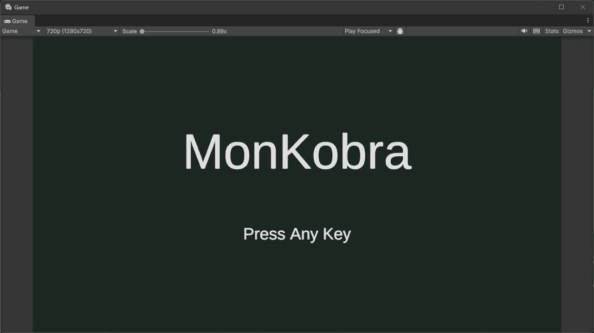
*Title screen: any key or click opens Level Select*

<!-- TODO screen cap: from Title press any key, highlight Endless Mode w/ W S (locked state shows greyed out) -->
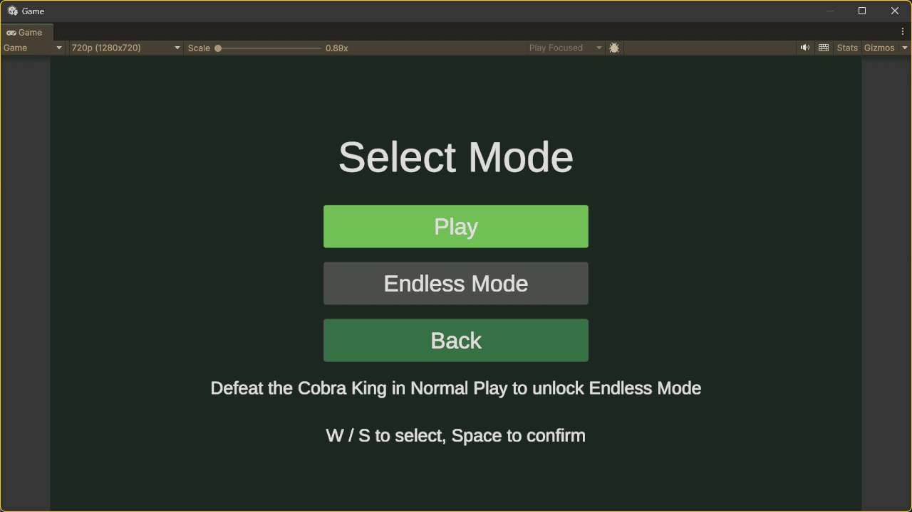
*Level Select: Normal Play, Endless Mode (greyed out until the Cobra King is beaten), Back*

<!-- TODO screen cap: in a run press Esc, highlight Restart w/ S -->
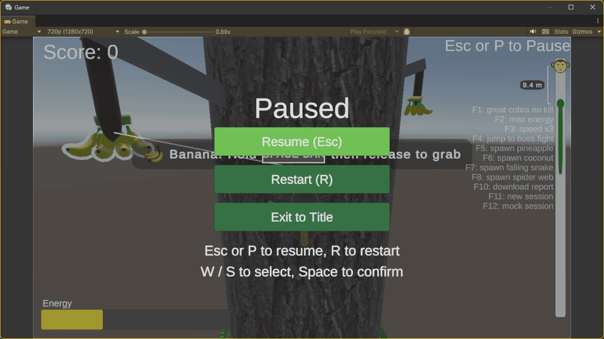
*Pause menu: Resume, Restart & Exit to Title*

<!-- TODO screen cap: Endless Mode run at the tree base, gold armor badge visible -->
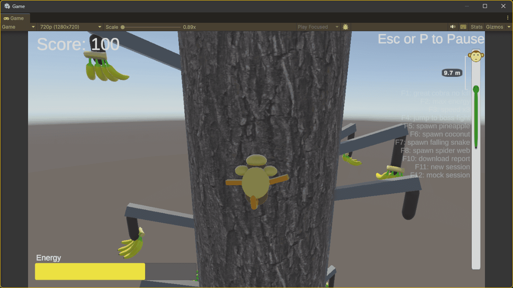
*Endless Mode: the run starts in gold armor w/ post-boss difficulty*

<!-- TODO screen cap: press F5 or F6 during play, frame the pineapple or coconut branch beside a banana branch -->

*Branch kinds: each fruit grows on its own branch prefab*

## Week 12

The 2026-11-03 in-class pod playtest of the class playtest build turned up:

- Grab Timing: players could not tell how long to hold Space, held too long so the hand moved past the banana, & found the arm's maximum reach only late; the Alpha survey flagged the grab as its top issue too
- Misread Hazards: the falling snake read as a 2nd chasing enemy, not an obstacle, & the blue patches were not recognized at all
- Unknown Fruit: players did not know what each fruit does, eg whether the pineapple gives a special ability
- Unseen Safe Start: a player did not realize the starting area was safe & that the cobra would not chase them there
- Misread Stamina: a player took the game for a Temple Run, w/ bananas as collectibles & stamina simply draining over time
- Professor: make stages recognizable, since fruit placement looks random, & give players strategic reasons to choose a fruit

Still open from the Alpha survey: dizziness & nausea from the camera, & an unclear goal.

Our fixes:

- Grab Timing → Grab Popups: the first banana, pineapple & coconut each raise a held popup naming the fruit, "Hold SPACE BAR, then release to grab", w/ a line pointing at it. Initially a small keycap on the fruit; changed to a popup players cannot miss
- Grab Timing → Larger Grab Zone: the fruit branch grab zone is bigger, so reach is easier to judge & overshooting less costly
- Unknown Fruit & Unseen Safe Start → PopUp System: every center message (coconut, cobra warnings, low stamina, web, first fruit grabs) shares 1 look & 1 manager w/ priority & queue, so no hint is drawn over or lost. Initially each widget drew its own text
- Misread Hazards → Rough Bark: broad, raised patches that slow the monkey in every direction, always leaving a way round. Initially blue slippery bark that slid the monkey down, which players did not recognize; changed to rough terrain w/ painted bark textures that reads as part of the tree
- Misread Hazards → 1 Chaser Only: the cobra alert shot fires only when the Great Cobra starts chasing, & no longer on falling snake hits, so the falling snake reads as an obstacle
- Professor's Stages → Stages by Height: difficulty runs 0 at the starting zone exit to 1 at the boss fight & keeps rising after it; each hazard & fruit first appears at its own height: rough bark, pineapple, falling cobra, coconut, web, so the climb has recognizable stages
- Professor's Stages → Trunk Height Markers: the climbed height in m beside the trunk every 50 u, on both sides; a marker pulses the first time the monkey passes it, so progress is seen on the tree itself. Initially a HUD Height label; changed to markers, so the label was removed
- Unclear Goal → Cobra King Boss Fight: a goal at the top of the climb. The king coils round the tree top & alternates rests w/ bite, tail sweep, minion waves & head butt attacks; bananas grabbed there are also thrown at its crown. A win shatters the king & leaves a Golden Armor that absorbs 1 cobra catch; a loss offers a revive after a mock ad
- Survey Dizziness → Camera Redesign: every camera follows a yaw-only anchor, so strafing no longer spins the world. The climb view looks up, a grab shifts the aim instead of cutting, & a shot director runs coconut, cobra alert & pineapple leap shots without rapid cuts. Initially side cameras that cut on every grab & a view that spun & juddered
- Misread Stamina → Progress Bar Redraw: monkey & cobra faces & a distance readout w/ a bracket between them, the cobra gap in m like the markers, so the chase, not a timer, reads as the threat

Also this week:

- Behind the Scenes: 1 balance asset split into player, world & cobra configs; real banana model & tree bark texture; analytics now tracks leaps, rough bark, freezes, pauses & boss events, w/ a dev-only download button on the lose screen

Not addressed yet: more stamina for climbing & a 1 s delay before the cobra starts, both suggested by a player

<!-- TODO screen cap: press F4 to jump to the boss fight; capture the king mid-attack w/ a danger zone showing -->

*Cobra King: danger zones warn of the next attack while the monkey throws bananas at the crown*

<!-- TODO screen cap: climb past 100 m (or F3 speed buff), frame a rough bark patch beside the monkey -->
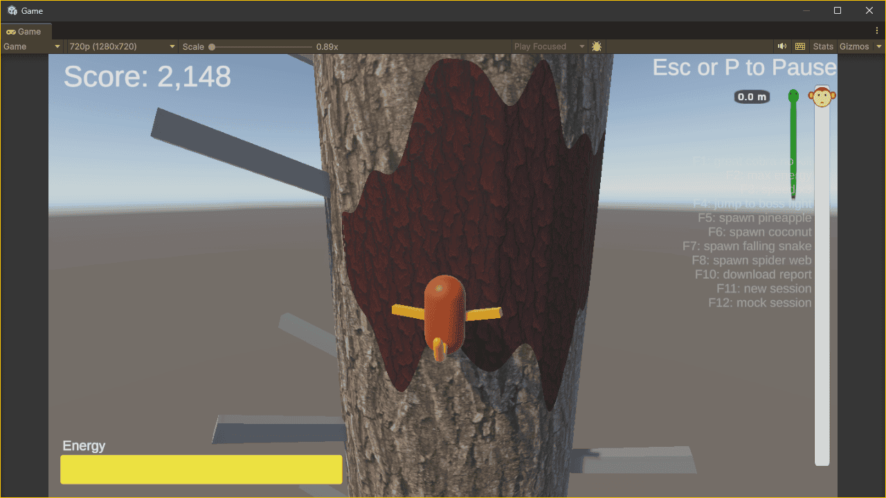
*Rough bark: a raised patch slows the monkey; the dry bark round it stays open*

<!-- TODO screen cap: climb until a height marker is in view on both trunk edges, progress bar visible -->
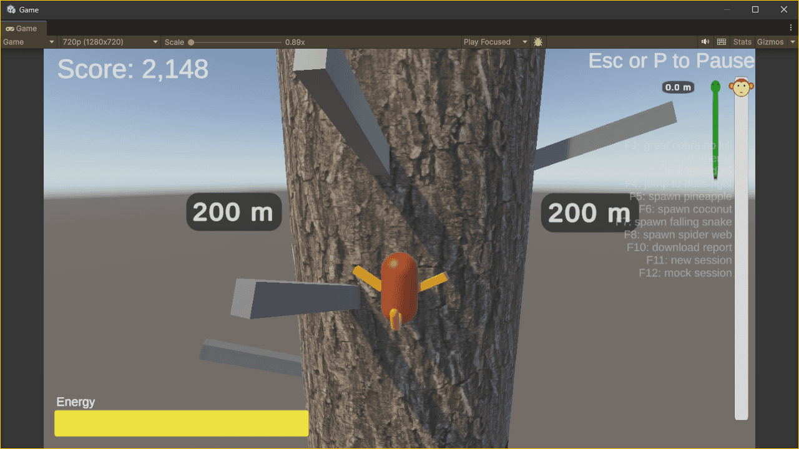
*Height markers on both trunk edges, & the redrawn progress bar w/ the cobra gap in m*

<!-- TODO screen cap: grab a coconut (F6), double-tap to throw it, capture the coconut track shot -->
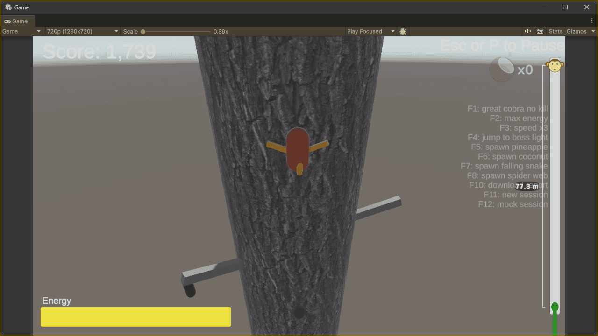
*Camera shot: the view follows a thrown coconut down to the cobra*

## Week 11

The 2026-10-27 in-class pod playtest of `1.0.0-alpha.2` turned up:

- Skipped Tutorial: a player kept climbing w/o any reason to collect bananas in the tutorial area, & left it before learning to grab
- Misread Stamina: a player assumed an empty stamina bar meant death
- Repeat Hit Bug: staying near a banana after a falling snake hit caused repeated hits & continuous falling
- Hazard Pile-Up: a player died when falling snakes & webs came together
- No Goal, Bored Middle: players took the goal to be simply climbing, & seemed bored in the middle & later stages
- Suggestion: a flyover introduction

It confirmed last week's Alpha survey, which asked for clearer grabbing, more power-ups & more benefit from collecting fruit.

Our fixes:

- Skipped Tutorial → Starting Zone Rework: the level opens at 30% stamina, so bananas matter from the first second, w/ softer exhaustion & a higher exit, so there is room to learn the grab. When the monkey leaves, the Great Cobra bursts out w/ "Run! The Great Cobra is chasing you!". Initially the cobra crept up quietly; changed so the start of the chase is felt
- Misread Stamina → Fruit Fly: a grabbed banana flies to the stamina bar & refills it on landing, showing what bananas are for
- Repeat Hit Bug → Falling Cobra Hits Once: after dropping the monkey, the snake switches itself off, so it never strikes twice
- Bored Middle & Survey Power-Ups → Pineapple: grabbing one raises both hands & pulls the monkey up a set height, hazards off during the leap, a new beat for the middle of the climb
- Bored Middle & Survey Power-Ups → Coconut: a rare fruit kept, not eaten; a double-tap throws it down to freeze the Great Cobra for a while, w/ a count, freeze timer & light blue cobra. Initially an instant freeze on the tap; changed to a thrown coconut that freezes on impact
- No Goal → Leaderboard: the lose screen ranks the run against 9 simulated rivals, fixed for the whole playtest, giving a score to beat
- Survey Grab Issues → Closest Fruit: the arm reaches for the fruit closest to the monkey, not the newest in range, so a grab goes where the player expects
- Bored Middle → Slippery Bark: wet patches that made the monkey slide down & lose grip, a new hazard for the middle of the climb

Also this week:

- Climb Feel: climb speed builds up the longer a key is held
- Fruit Models: banana, coconut & pineapple from a free fruit pack replace placeholder shapes
- Pause: Esc or P freezes the run, R restarts
- Scene as Prefabs: `Lv1Scene` split into nested prefabs, & every script renamed to house role suffixes, so teammates edit different files

Taken up in Week 12: the hazard pile-up, by spacing each hazard's first appearance by height. Not built yet: the flyover introduction

<!-- TODO screen cap: press F6 for a coconut branch, grab it, double-tap Space; capture the frozen light blue cobra & freeze timer -->

*Coconut: the frozen Great Cobra turns light blue while the freeze timer counts down*

<!-- TODO screen cap: press F5 for a pineapple branch, grab it, capture the leap mid-pull -->
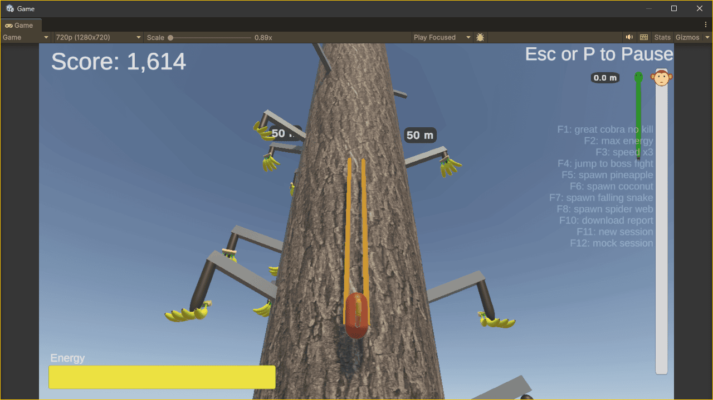
*Pineapple leap: both hands up as the monkey is pulled up the trunk*

<!-- TODO screen cap: lose a run, capture the lose screen w/ the leaderboard -->
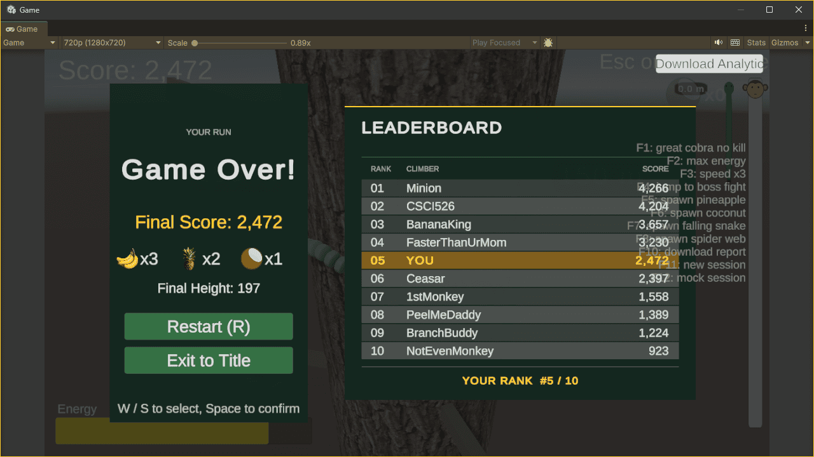
*Leaderboard: the run's rank among 9 simulated rivals*

## Week 10

The Alpha survey (*Peel Five - Alpha Prototype Feedback*) received 11 responses:

- Mixed Onboarding: 4 rated the game somewhat or very easy to learn, 4 somewhat difficult, & 3 neutral
- Banana Grab: the most recurring issue; respondents were unsure how to extend the arm, struggled to collect bananas, & asked for clearer instructions & feedback
- Motion Sickness: 4 reported dizziness or nausea from camera movement, shaking, or the transitions between climbing & grabbing
- Uneven Difficulty: some found the cobra too fast or hard to escape, while another felt difficulty rose too slowly
- Unclear Goal: some described the objective as reaching the top, so the endless climb was not consistently understood
- Liked: the stretching-arm mechanic, the climbing concept, & the tension of escaping spider webs
- Requested: more power-ups & more benefits from collecting fruit

These findings point to clearer grab tutorialization, better camera comfort, clearer communication of the objective, & further testing of difficulty progression.

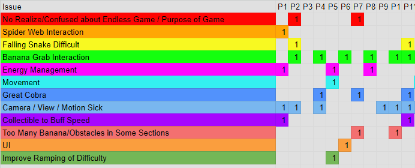
*Rainbow sheet: each row an issue, each column a respondent (P1 to P11); banana grab interaction & camera motion sickness are the widest rows*

Also this week:

- Analytics Docs: the session report & every recorded metric documented, so teammates can read playtest results without the code

## Week 9: Alpha `1.0.0-alpha`

A first simple playtest of the web build turned up 2 issues:

- Cropped View: on a high-resolution web canvas, players did not realize they saw only a zoomed part of the game. The 1920x1080 canvas overflowed smaller laptop screens, so the edges, & some UI, were cut off
- Rushed Player: the Great Cobra climbed from the first second & chased the player, who did not realize it & could not learn the banana grab system, despite some tries

Our fixes:

- Fixed Resolution: web builds lock to 1280x720 w/ a UI that scales to it. A scaling canvas & a `FitWindow` WebGL template keep 16:9 & fit any browser window, so the whole game shows the same on Mac Retina, 4K & Windows
- Starting Zone: a safe zone at the foot of the tree, so the player is not rushed up. The Great Cobra holds its height & bananas and branches are plentiful, so the player can try, explore & learn to move & grab; once the monkey climbs out, the cobra starts to climb & difficulty ramps from 0
- Start Screen Controls: the start screen shows which key does what, so players need not guess. A drawn keyboard (WASD cluster & wide Space key) is captioned `Move`, `Grab Banana` & `Hold to reach, release to grab`, w/ a bundled font so it renders in WebGL
- Camera Shake & Effects: added so hits & low stamina are felt, not only read off the bar. A Cinemachine impulse shake (light for a branch hit, heavier for a falling cobra), plus a vignette & zoom-out pulse on a move attempt at low stamina, lighter while low & stronger once empty. Tuning lives in one `CameraEfxConfig` asset

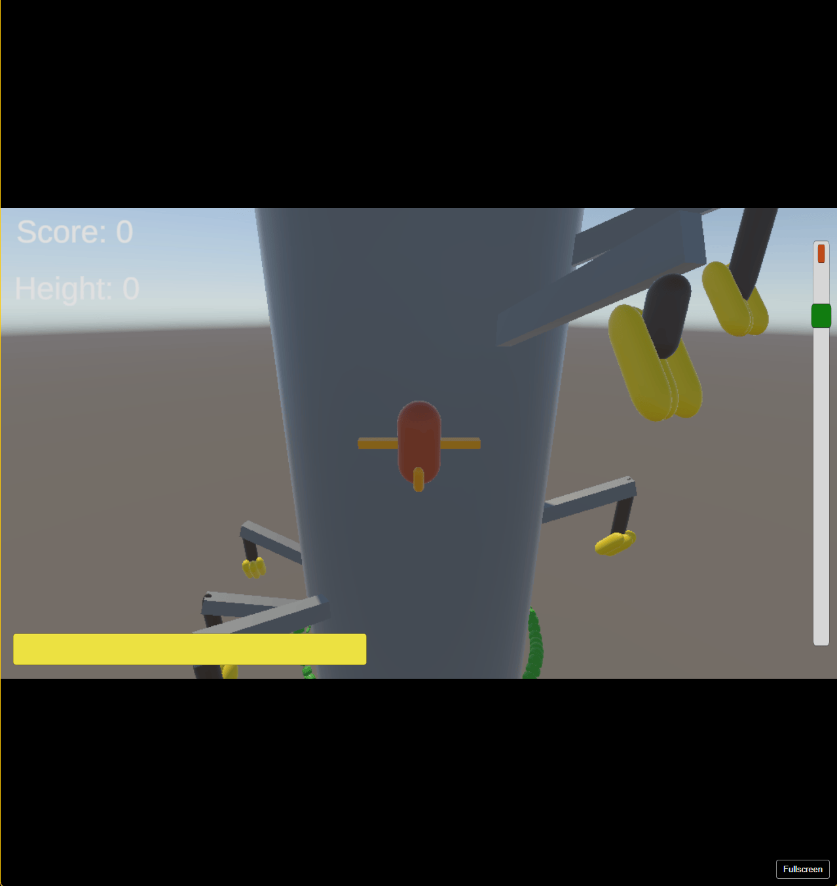
*Fixed resolution: in a tall browser window the web build keeps its 16:9 frame & fills the rest with black bars, so nothing is cropped; a Fullscreen button sits at bottom right*

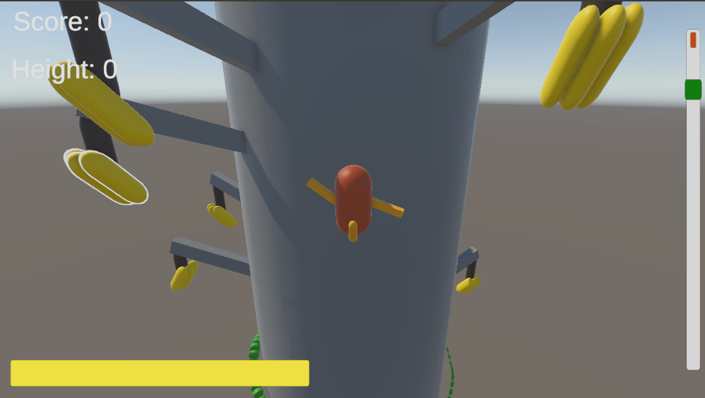
*Starting zone: Score & Height read 0 & branches carry bananas all round the monkey, so the player can practice moving & grabbing before the Great Cobra starts to climb. The banana at top left has the white outline of a grabbable fruit*

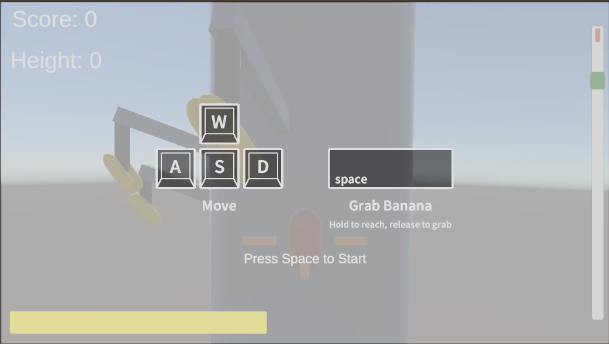
*Start screen: a drawn keyboard shows WASD to move & Space to grab a banana (hold to reach, release to grab), with a "Press Space to Start" prompt over the dimmed scene*

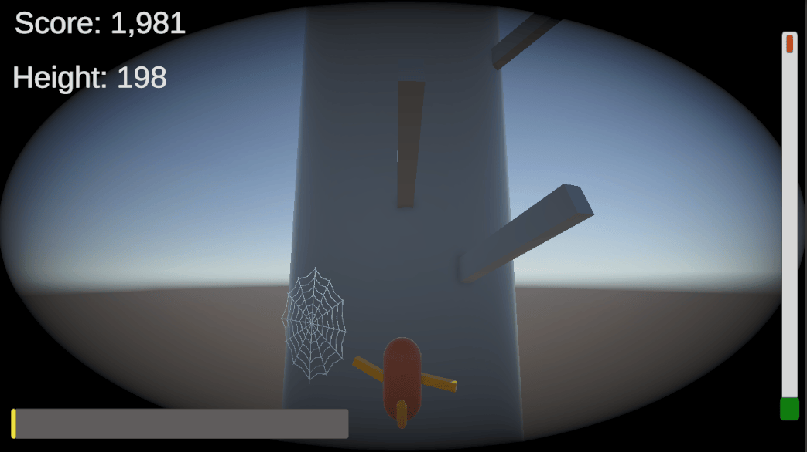
*Camera effect: a heavy vignette closes in at height 198 while the stamina bar is nearly empty, the cool-down pulse from a move attempt at low stamina*

## Week 8: Pre-Alpha `0.9.0`

- Endless Tree & Difficulty: lowest segment recycles over the top, so a run never ends; climb height maps to 0~1 difficulty driving all hazard chances. Initially fixed stack w/ linear branch count; changed to one shared curve in `GameBalanceConfig`
- Spider Web Trap: web holds the monkey, mash Space to break free. Initially placed once at start on fixed heights; changed to per-segment rolls to fit the recycled tree
- Falling Cobra: dormant until the monkey is near, then drops while sliding round the trunk toward it. Initially timer-unlocked & lethal; changed to per-segment rolls & a stun-and-drop hit
- Great Cobra & Stamina: cobra coils round the trunk, any contact kills. Initially empty stamina ended the run; changed to slow upward climb only, w/ progress bar tracking the cobra by height gap
- Fruit Outlines: 2 tiers, reachable & grabbable. Initially one outline, unclear whether a release would grab; changed to 2 materials matching the Grab System release check
- Run Analytics: per-session markdown report w/ death causes, per-run charts, height & stamina curves; F10 generates a mock session. Initially an event log appended at game over; changed to rewrite on every save plus 10 s autosave

*HUD: score and height (high point) top left, stamina bar bottom left, progress bar right showing the player's height relative to the great cobra. The run is infinite: the tree recycles its segments, so there is no summit*

*Spider web trap: the monkey is held on contact, with a prompt and escape bar to mash Space*

*Fruit outline: reachable fruit (inside the detection zone) gets a weaker outline; grabbable fruit (under the hand, so a release grabs it) gets a stronger one*

*Falling cobra hanging dormant above the monkey, green while asleep*

*Falling cobra awake: it turns red as a warning, then drops while sliding round the trunk toward the monkey*
