# MonKobra Analytics: Session: 2026-11-10 11:03:31 (mock)

MonKobra v1.0.0-beta

## Session Summary

#### Death Causes

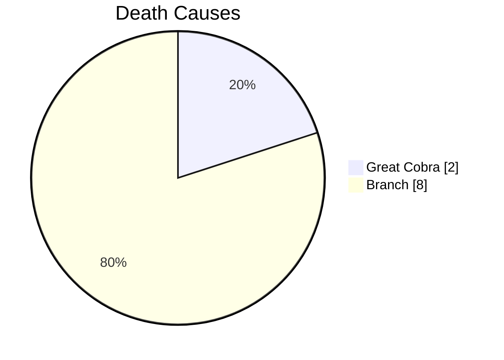

#### Final Score vs Run

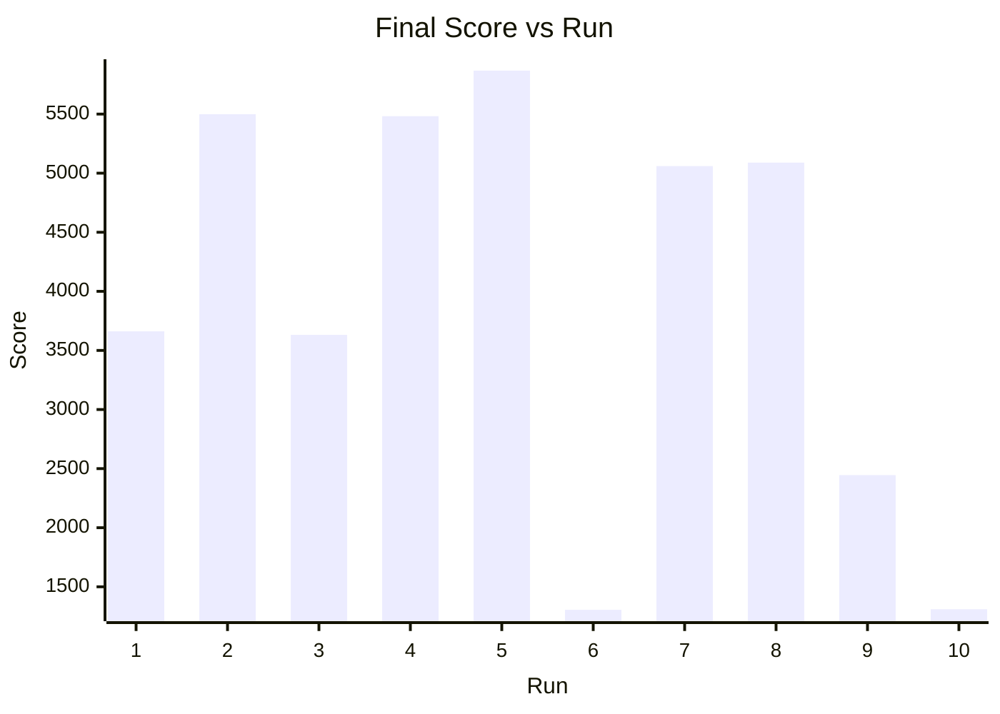

#### Highest Height vs Run

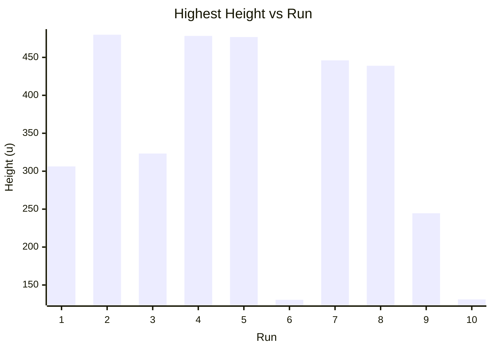

#### Death Height vs Run

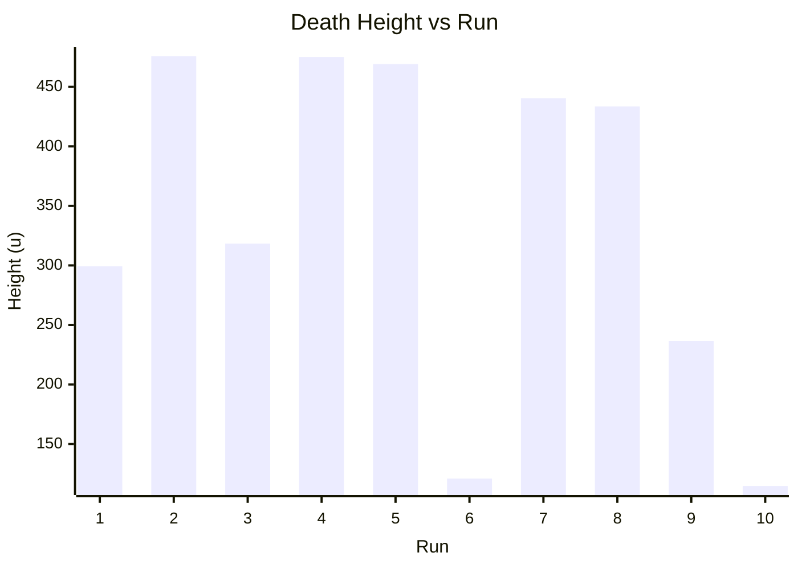

#### Duration vs Run

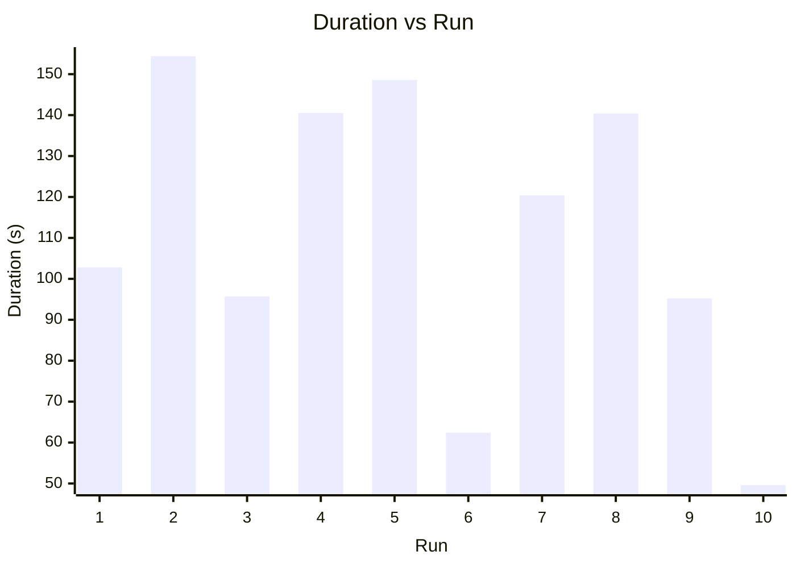

## Run 1

- Mode: Full
- Highest Height: +306.3
- Death Height: +299.2
- Death Cause: Branch

#### Run Duration: 102.8 s

- Time Start: 11:03:31
- Time Stop: 11:05:14
- Starting Zone Exit: +00:00:06, y +20.3

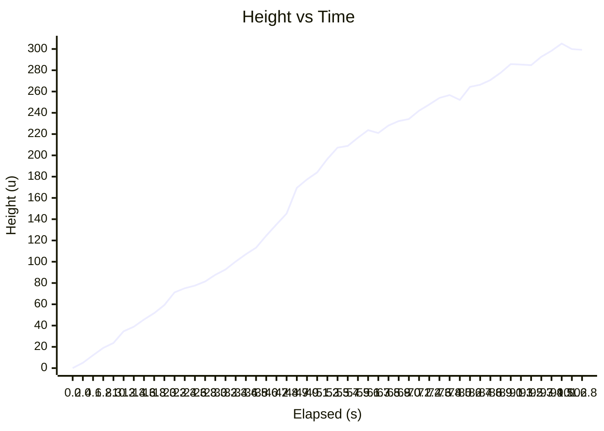

#### Final Score: 3662

- Score from Height: 3062
- Score from Banana: 100 * 4 = 400
- Score from Coconut: 200 * 1 = 200

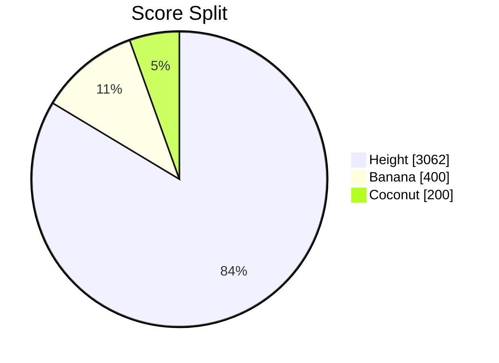

#### Banana Count: 4

| # | Time | y |
|---|---|---|
| 1 | +00:00:02 | 7.9 |
| 2 | +00:00:15 | 49.9 |
| 3 | +00:00:20 | 71.8 |
| 4 | +00:01:37 | 301.5 |

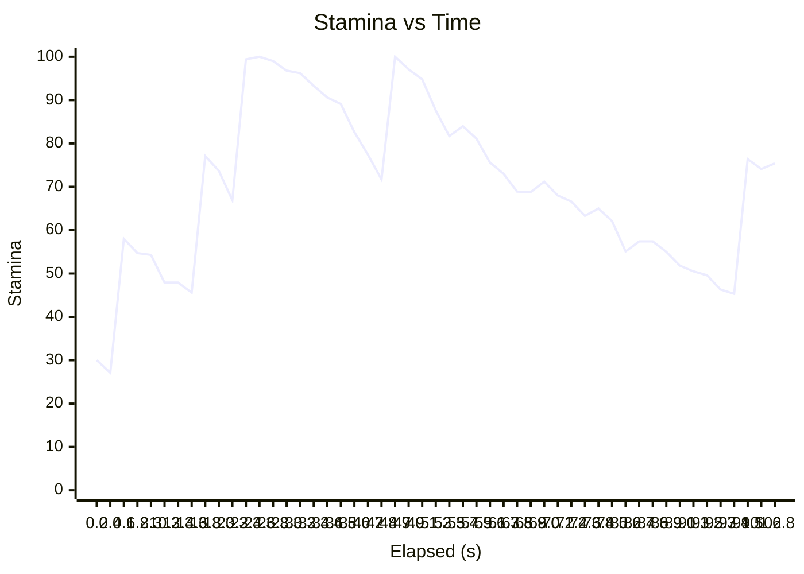

#### Coconut Count: 1

| # | Time | y |
|---|---|---|
| 1 | +00:01:12 | 250.1 |

#### Coconut Used: 1

| # | Time | y |
|---|---|---|
| 1 | +00:01:17 | 254.7 |

#### Web Encounter: 0

#### Branch Hit: 5

| # | Time | y |
|---|---|---|
| 1 | +00:00:59 | 226.1 |
| 2 | +00:01:17 | 261.1 |
| 3 | +00:01:30 | 290.2 |
| 4 | +00:01:39 | 306.3 |
| 5 | +00:01:42 | 300.8 |

#### Pineapple Leap: 1

| # | Time | y |
|---|---|---|
| 1 | +00:00:43 | 150.1 |

#### Rough Bark Contact: 3

| # | Time | y |
|---|---|---|
| 1 | +00:00:52 | 206.8 |
| 2 | +00:01:01 | 219.5 |
| 3 | +00:01:03 | 227.7 |

#### Cobra Freeze: 1

| # | Time | y |
|---|---|---|
| 1 | +00:01:18 | 254.7 |

#### Pause: 0

#### Boss Fight Start: 0

#### Armor Save: 0

#### Boss Revive: 0

## Run 2

- Mode: Full
- Highest Height: +479.9
- Death Height: +475.7
- Death Cause: Branch

#### Run Duration: 154.4 s

- Time Start: 11:05:24
- Time Stop: 11:07:59
- Starting Zone Exit: +00:00:04, y +20.5

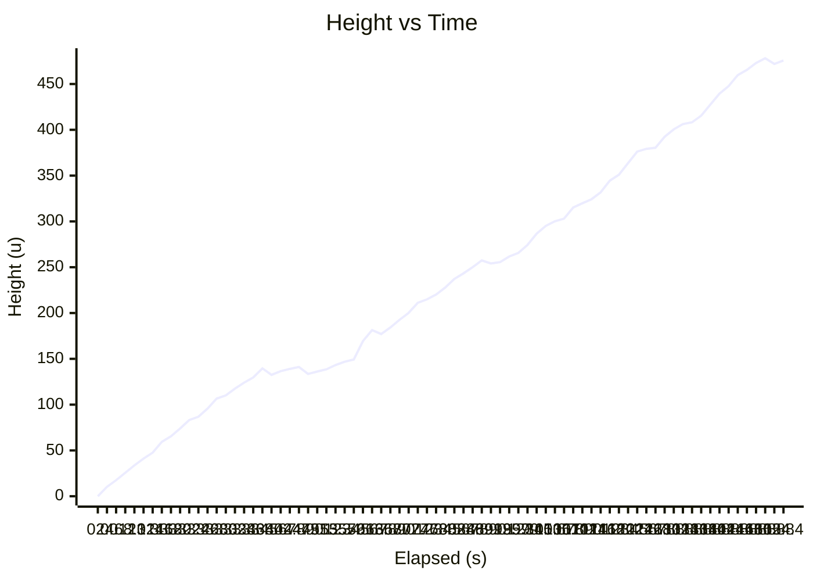

#### Final Score: 5499

- Score from Height: 4799
- Score from Banana: 100 * 5 = 500
- Score from Coconut: 200 * 1 = 200

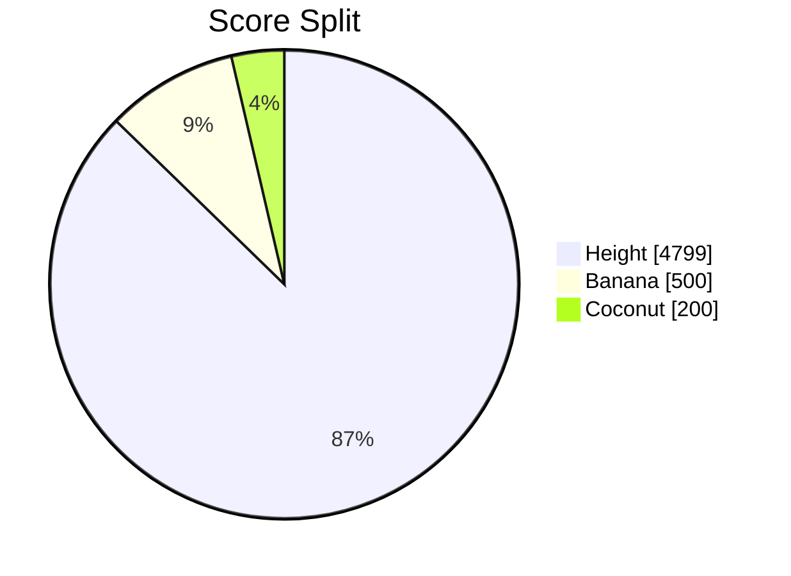

#### Banana Count: 5

| # | Time | y |
|---|---|---|
| 1 | +00:00:02 | 12.1 |
| 2 | +00:01:17 | 227.8 |
| 3 | +00:01:52 | 329.4 |
| 4 | +00:01:56 | 344.4 |
| 5 | +00:02:10 | 401.5 |

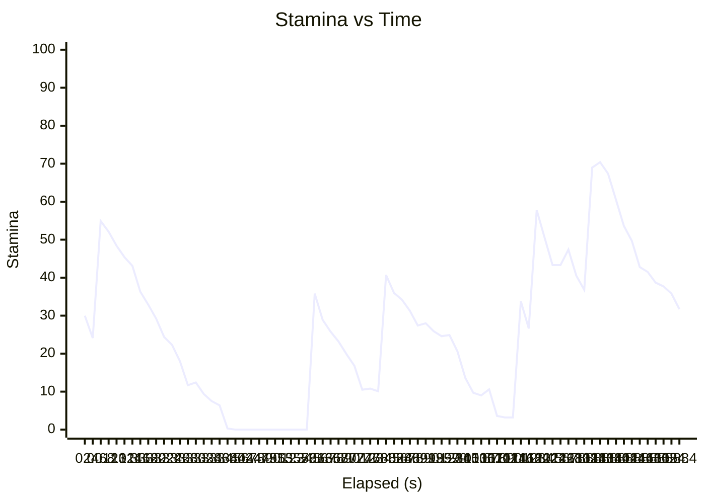

#### Coconut Count: 1

| # | Time | y |
|---|---|---|
| 1 | +00:01:24 | 250.1 |

#### Coconut Used: 1

| # | Time | y |
|---|---|---|
| 1 | +00:01:29 | 250.1 |

#### Web Encounter: 1

| # | Time |
|---|---|
| 1 | +00:02:03 |

#### Branch Hit: 6

| # | Time | y |
|---|---|---|
| 1 | +00:00:36 | 140.4 |
| 2 | +00:00:44 | 141.9 |
| 3 | +00:01:01 | 181.9 |
| 4 | +00:01:28 | 259.7 |
| 5 | +00:02:31 | 479.9 |
| 6 | +00:02:34 | 478.9 |

#### Pineapple Leap: 1

| # | Time | y |
|---|---|---|
| 1 | +00:00:58 | 150.1 |

#### Rough Bark Contact: 2

| # | Time | y |
|---|---|---|
| 1 | +00:01:28 | 259.7 |
| 2 | +00:02:13 | 407.5 |

#### Cobra Freeze: 1

| # | Time | y |
|---|---|---|
| 1 | +00:01:30 | 250.1 |

#### Pause: 1

| # | Time | y |
|---|---|---|
| 1 | +00:00:48 | 135.3 |

#### Boss Fight Start: 0

#### Armor Save: 0

#### Boss Revive: 0

## Run 3

- Mode: Full
- Highest Height: +323.3
- Death Height: +318.3
- Death Cause: Great Cobra

#### Run Duration: 95.7 s

- Time Start: 11:08:10
- Time Stop: 11:09:45
- Starting Zone Exit: +00:00:06, y +20.2

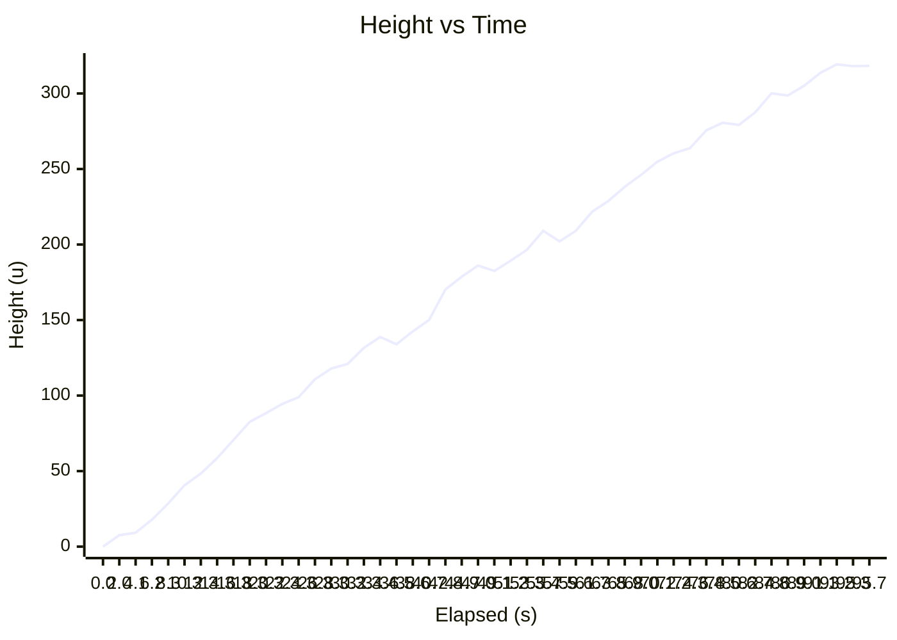

#### Final Score: 3632

- Score from Height: 3232
- Score from Banana: 100 * 4 = 400
- Score from Coconut: 0

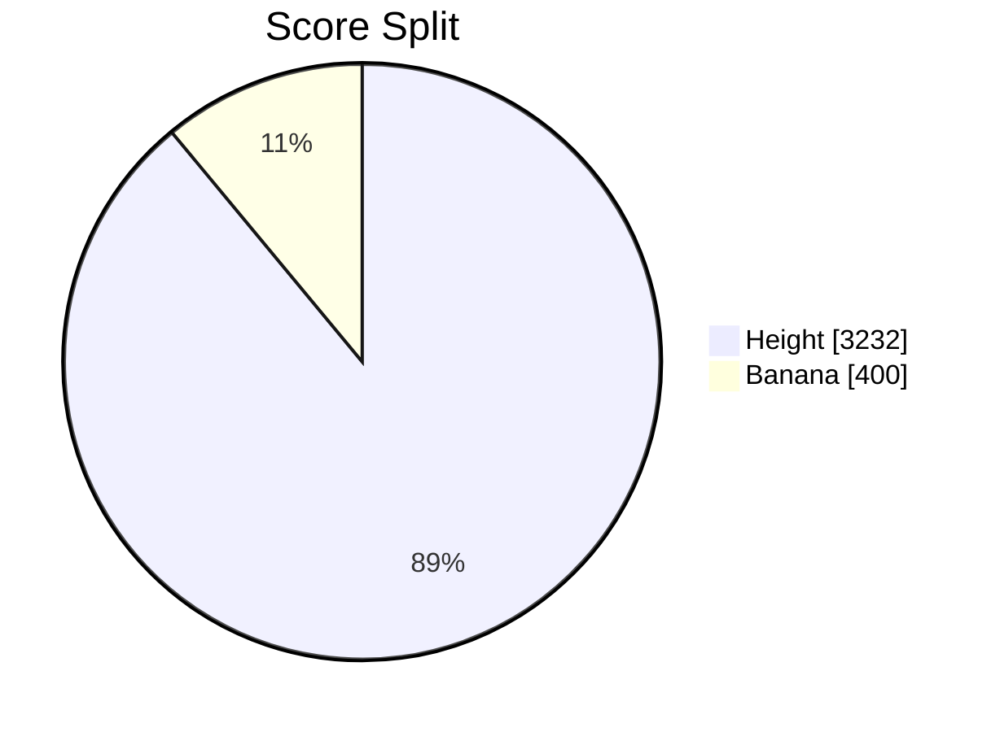

#### Banana Count: 4

| # | Time | y |
|---|---|---|
| 1 | +00:00:05 | 17.8 |
| 2 | +00:00:11 | 48.4 |
| 3 | +00:01:02 | 228.9 |
| 4 | +00:01:16 | 275.6 |

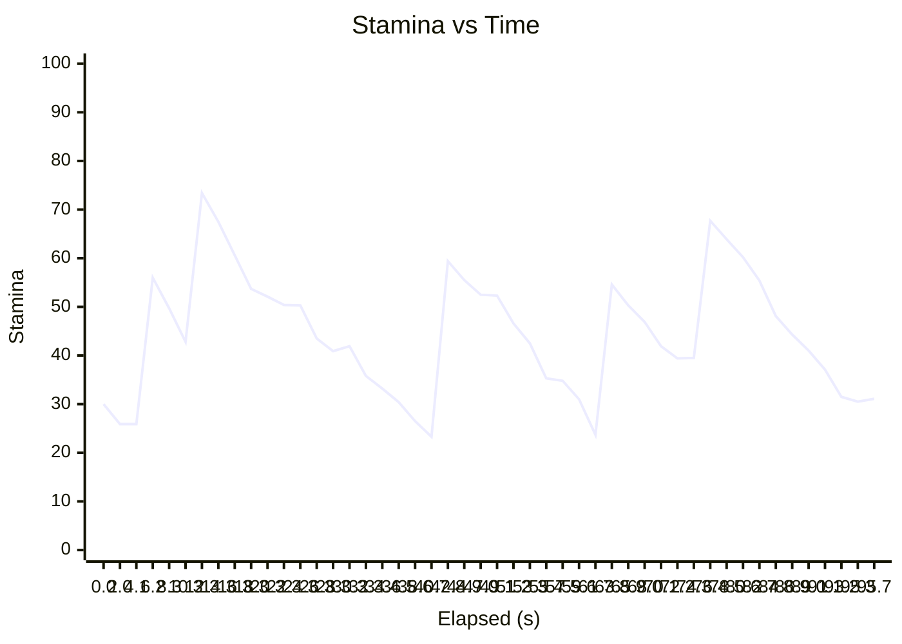

#### Coconut Count: 0

#### Coconut Used: 0

#### Web Encounter: 0

#### Branch Hit: 6

| # | Time | y |
|---|---|---|
| 1 | +00:00:35 | 142.1 |
| 2 | +00:00:48 | 188.9 |
| 3 | +00:00:55 | 209.7 |
| 4 | +00:01:18 | 282.2 |
| 5 | +00:01:25 | 306.7 |
| 6 | +00:01:32 | 323.3 |

#### Pineapple Leap: 1

| # | Time | y |
|---|---|---|
| 1 | +00:00:40 | 150.1 |

#### Rough Bark Contact: 4

| # | Time | y |
|---|---|---|
| 1 | +00:00:57 | 202.6 |
| 2 | +00:01:09 | 252.7 |
| 3 | +00:01:11 | 260.1 |
| 4 | +00:01:20 | 281.0 |

#### Cobra Freeze: 0

#### Pause: 1

| # | Time | y |
|---|---|---|
| 1 | +00:00:43 | 172.5 |

#### Boss Fight Start: 0

#### Armor Save: 0

#### Boss Revive: 0

## Run 4

- Mode: Full
- Highest Height: +478.3
- Death Height: +475.1
- Death Cause: Branch

#### Run Duration: 140.5 s

- Time Start: 11:09:54
- Time Stop: 11:12:15
- Starting Zone Exit: +00:00:06, y +20.3


#### Final Score: 5482

- Score from Height: 4782
- Score from Banana: 100 * 5 = 500
- Score from Coconut: 200 * 1 = 200

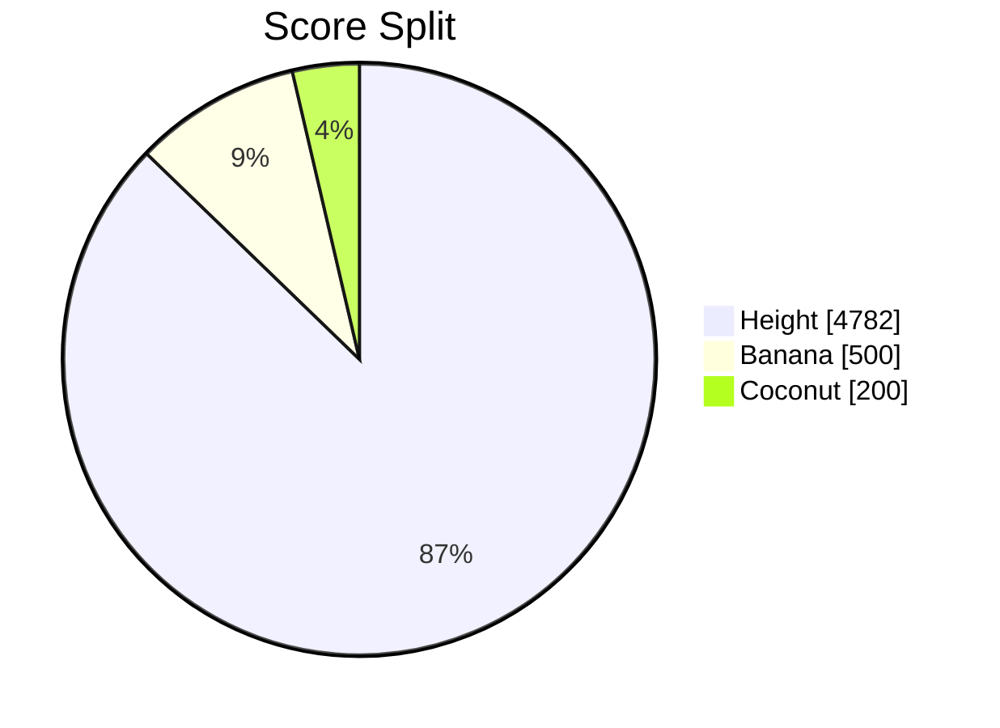

#### Banana Count: 5

| # | Time | y |
|---|---|---|
| 1 | +00:00:27 | 75.2 |
| 2 | +00:00:47 | 152.9 |
| 3 | +00:00:54 | 177.7 |
| 4 | +00:01:19 | 263.1 |
| 5 | +00:01:41 | 365.6 |

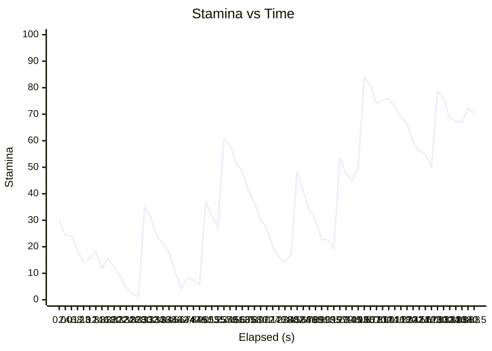

#### Coconut Count: 1

| # | Time | y |
|---|---|---|
| 1 | +00:01:13 | 250.1 |

#### Coconut Used: 1

| # | Time | y |
|---|---|---|
| 1 | +00:01:52 | 391.6 |

#### Web Encounter: 2

| # | Time |
|---|---|
| 1 | +00:01:38 |
| 2 | +00:02:15 |

#### Branch Hit: 6

| # | Time | y |
|---|---|---|
| 1 | +00:00:19 | 62.2 |
| 2 | +00:01:09 | 240.5 |
| 3 | +00:01:52 | 395.6 |
| 4 | +00:02:00 | 417.1 |
| 5 | +00:02:04 | 418.0 |
| 6 | +00:02:20 | 478.3 |

#### Pineapple Leap: 2

| # | Time | y |
|---|---|---|
| 1 | +00:01:34 | 326.4 |
| 2 | +00:02:08 | 428.3 |

#### Rough Bark Contact: 4

| # | Time | y |
|---|---|---|
| 1 | +00:00:50 | 162.5 |
| 2 | +00:01:04 | 221.6 |
| 3 | +00:01:29 | 313.9 |
| 4 | +00:02:13 | 466.2 |

#### Cobra Freeze: 1

| # | Time | y |
|---|---|---|
| 1 | +00:01:53 | 391.6 |

#### Pause: 0

#### Boss Fight Start: 0

#### Armor Save: 0

#### Boss Revive: 0

## Run 5

- Mode: Full
- Highest Height: +476.8
- Death Height: +469.1
- Death Cause: Branch

#### Run Duration: 148.6 s

- Time Start: 11:12:19
- Time Stop: 11:14:48
- Starting Zone Exit: +00:00:06, y +20.2

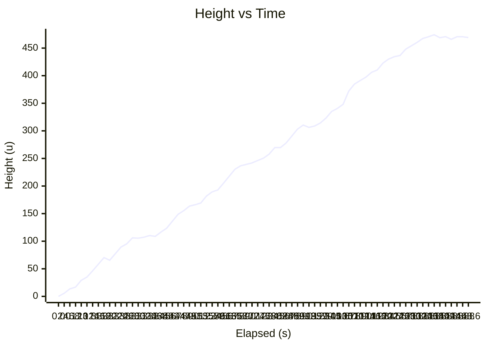

#### Final Score: 5868

- Score from Height: 4768
- Score from Banana: 100 * 7 = 700
- Score from Coconut: 200 * 2 = 400

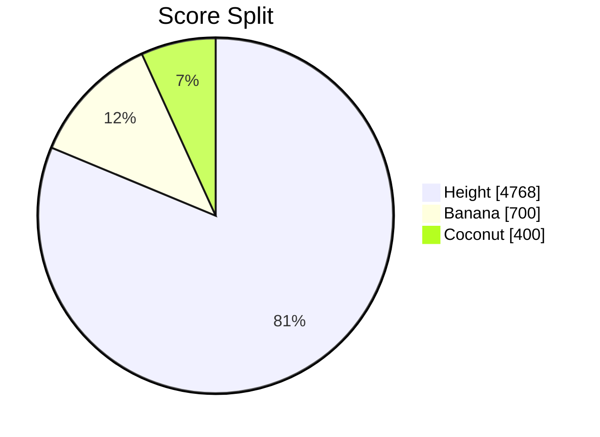

#### Banana Count: 7

| # | Time | y |
|---|---|---|
| 1 | +00:00:01 | 5.6 |
| 2 | +00:00:04 | 13.8 |
| 3 | +00:00:49 | 166.9 |
| 4 | +00:01:12 | 246.4 |
| 5 | +00:01:15 | 257.7 |
| 6 | +00:01:36 | 323.3 |
| 7 | +00:01:54 | 406.1 |

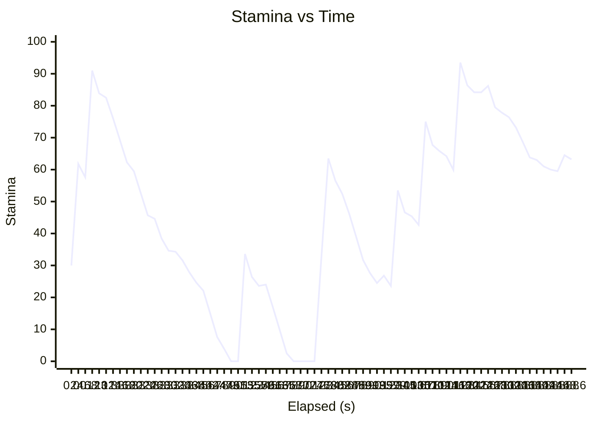

#### Coconut Count: 2

| # | Time | y |
|---|---|---|
| 1 | +00:01:13 | 250.5 |
| 2 | +00:01:27 | 307.5 |

#### Coconut Used: 2

| # | Time | y |
|---|---|---|
| 1 | +00:01:20 | 268.9 |
| 2 | +00:02:16 | 470.0 |

#### Web Encounter: 1

| # | Time |
|---|---|
| 1 | +00:02:24 |

#### Branch Hit: 10

| # | Time | y |
|---|---|---|
| 1 | +00:00:16 | 70.9 |
| 2 | +00:00:27 | 112.7 |
| 3 | +00:00:31 | 110.7 |
| 4 | +00:00:32 | 111.9 |
| 5 | +00:01:19 | 276.9 |
| 6 | +00:01:29 | 315.9 |
| 7 | +00:02:14 | 475.4 |
| 8 | +00:02:17 | 476.8 |
| 9 | +00:02:20 | 472.4 |
| 10 | +00:02:27 | 474.7 |

#### Pineapple Leap: 1

| # | Time | y |
|---|---|---|
| 1 | +00:01:43 | 349.9 |

#### Rough Bark Contact: 0

#### Cobra Freeze: 2

| # | Time | y |
|---|---|---|
| 1 | +00:01:21 | 268.9 |
| 2 | +00:02:16 | 470.0 |

#### Pause: 1

| # | Time | y |
|---|---|---|
| 1 | +00:00:40 | 133.1 |

#### Boss Fight Start: 0

#### Armor Save: 0

#### Boss Revive: 0

## Run 6

- Mode: Full
- Highest Height: +130.5
- Death Height: +120.9
- Death Cause: Branch

#### Run Duration: 62.4 s

- Time Start: 11:14:55
- Time Stop: 11:15:57
- Starting Zone Exit: +00:00:06, y +20.1

```mermaid
xychart-beta
    title "Height vs Time"
    x-axis "Elapsed (s)" [0.0, 2.0, 4.1, 6.2, 8.3, 10.3, 12.3, 14.3, 16.3, 18.3, 20.3, 22.3, 24.3, 26.3, 28.3, 30.3, 32.3, 34.4, 36.5, 38.6, 40.7, 42.8, 44.9, 47.0, 49.1, 51.2, 53.3, 55.4, 57.5, 59.6, 61.7, 62.4]
    y-axis "Height (u)" 0 --> 127
    line [0.0, 5.8, 13.0, 20.7, 25.9, 36.5, 38.3, 46.1, 44.0, 47.4, 52.0, 56.8, 63.3, 67.9, 71.7, 80.3, 83.0, 87.2, 89.7, 92.2, 93.4, 100.8, 104.0, 106.1, 109.6, 112.1, 114.4, 117.7, 123.4, 126.1, 126.5, 120.9]
```

#### Final Score: 1305

- Score from Height: 1305
- Score from Banana: 0
- Score from Coconut: 0

```mermaid
pie showData
    title Score Split
    "Height" : 1305
```

#### Banana Count: 0

```mermaid
xychart-beta
    title "Stamina vs Time"
    x-axis "Elapsed (s)" [0.0, 2.0, 4.1, 6.2, 8.3, 10.3, 12.3, 14.3, 16.3, 18.3, 20.3, 22.3, 24.3, 26.3, 28.3, 30.3, 32.3, 34.4, 36.5, 38.6, 40.7, 42.8, 44.9, 47.0, 49.1, 51.2, 53.3, 55.4, 57.5, 59.6, 61.7, 62.4]
    y-axis "Stamina" 0 --> 100
    line [30.0, 27.1, 23.0, 18.9, 18.1, 12.5, 15.7, 9.8, 7.4, 8.0, 7.6, 7.1, 4.6, 3.9, 4.2, 0.0, 1.2, 0.0, 0.0, 0.0, 3.4, 0.0, 0.0, 0.8, 0.0, 0.0, 1.3, 2.3, 0.0, 1.0, 0.0, 0.0]
```

#### Coconut Count: 0

#### Coconut Used: 0

#### Web Encounter: 0

#### Branch Hit: 2

| # | Time | y |
|---|---|---|
| 1 | +00:00:14 | 48.5 |
| 2 | +00:01:01 | 130.5 |

#### Pineapple Leap: 0

#### Rough Bark Contact: 0

#### Cobra Freeze: 0

#### Pause: 0

#### Boss Fight Start: 0

#### Armor Save: 0

#### Boss Revive: 0

## Run 7

- Mode: Full
- Highest Height: +446.1
- Death Height: +440.5
- Death Cause: Branch

#### Run Duration: 120.4 s

- Time Start: 11:16:06
- Time Stop: 11:18:06
- Starting Zone Exit: +00:00:06, y +20.5

```mermaid
xychart-beta
    title "Height vs Time"
    x-axis "Elapsed (s)" [0.0, 2.0, 4.1, 6.2, 8.3, 10.3, 12.3, 14.3, 16.3, 18.3, 20.3, 22.3, 24.3, 26.3, 28.3, 30.3, 32.3, 34.4, 36.5, 38.6, 40.7, 42.8, 44.9, 47.0, 49.1, 51.2, 53.3, 55.4, 57.5, 59.6, 61.7, 63.8, 65.9, 68.0, 70.1, 72.2, 74.3, 76.4, 78.5, 80.6, 82.7, 84.8, 86.9, 89.0, 91.1, 93.2, 95.3, 97.4, 99.5, 101.6, 103.7, 105.8, 107.9, 110.0, 112.1, 114.2, 116.3, 118.4, 120.4]
    y-axis "Height (u)" 0 --> 445
    line [0.0, 7.3, 15.1, 20.5, 33.1, 28.3, 40.3, 52.3, 64.3, 76.3, 81.3, 84.6, 95.9, 104.8, 110.3, 120.7, 132.7, 140.8, 153.4, 161.0, 173.6, 182.0, 186.8, 189.2, 194.6, 203.0, 208.4, 216.0, 223.0, 228.0, 231.9, 243.8, 252.9, 261.1, 268.0, 278.6, 287.3, 296.0, 308.6, 321.2, 333.8, 338.6, 347.3, 349.0, 356.4, 359.4, 364.8, 373.5, 374.6, 382.6, 390.5, 399.3, 407.1, 407.1, 417.3, 429.9, 442.5, 444.9, 440.5]
```

#### Final Score: 5060

- Score from Height: 4460
- Score from Banana: 100 * 6 = 600
- Score from Coconut: 0

```mermaid
pie showData
    title Score Split
    "Height" : 4460
    "Banana" : 600
```

#### Banana Count: 6

| # | Time | y |
|---|---|---|
| 1 | +00:00:01 | 7.3 |
| 2 | +00:00:03 | 15.1 |
| 3 | +00:00:05 | 19.3 |
| 4 | +00:00:47 | 190.4 |
| 5 | +00:00:53 | 210.6 |
| 6 | +00:01:42 | 385.2 |

```mermaid
xychart-beta
    title "Stamina vs Time"
    x-axis "Elapsed (s)" [0.0, 2.0, 4.1, 6.2, 8.3, 10.3, 12.3, 14.3, 16.3, 18.3, 20.3, 22.3, 24.3, 26.3, 28.3, 30.3, 32.3, 34.4, 36.5, 38.6, 40.7, 42.8, 44.9, 47.0, 49.1, 51.2, 53.3, 55.4, 57.5, 59.6, 61.7, 63.8, 65.9, 68.0, 70.1, 72.2, 74.3, 76.4, 78.5, 80.6, 82.7, 84.8, 86.9, 89.0, 91.1, 93.2, 95.3, 97.4, 99.5, 101.6, 103.7, 105.8, 107.9, 110.0, 112.1, 114.2, 116.3, 118.4, 120.4]
    y-axis "Stamina" 0 --> 100
    line [30.0, 60.8, 91.3, 99.3, 92.1, 89.3, 82.4, 75.5, 68.6, 61.7, 61.1, 61.7, 55.2, 51.1, 49.9, 44.0, 37.1, 33.4, 26.1, 23.0, 15.8, 12.7, 13.2, 16.1, 48.7, 43.9, 43.0, 73.7, 71.6, 71.2, 71.5, 64.7, 60.2, 56.5, 52.8, 46.7, 42.6, 38.4, 31.2, 23.9, 16.7, 16.4, 12.9, 16.2, 12.9, 15.2, 14.3, 10.1, 14.2, 10.9, 41.3, 37.0, 34.5, 39.8, 34.9, 27.7, 20.4, 23.3, 25.4]
```

#### Coconut Count: 0

#### Coconut Used: 0

#### Web Encounter: 2

| # | Time |
|---|---|
| 1 | +00:01:47 |
| 2 | +00:01:56 |

#### Branch Hit: 2

| # | Time | y |
|---|---|---|
| 1 | +00:00:08 | 34.3 |
| 2 | +00:01:59 | 446.1 |

#### Pineapple Leap: 0

#### Rough Bark Contact: 2

| # | Time | y |
|---|---|---|
| 1 | +00:01:07 | 260.4 |
| 2 | +00:01:09 | 266.9 |

#### Cobra Freeze: 0

#### Pause: 1

| # | Time | y |
|---|---|---|
| 1 | +00:01:41 | 384.1 |

#### Boss Fight Start: 0

#### Armor Save: 0

#### Boss Revive: 0

## Run 8

- Mode: Full
- Highest Height: +439.0
- Death Height: +433.5
- Death Cause: Branch

#### Run Duration: 140.4 s

- Time Start: 11:18:14
- Time Stop: 11:20:35
- Starting Zone Exit: +00:00:07, y +20.5

```mermaid
xychart-beta
    title "Height vs Time"
    x-axis "Elapsed (s)" [0.0, 2.0, 4.1, 6.2, 8.3, 10.3, 12.3, 14.3, 16.3, 18.3, 20.3, 22.3, 24.3, 26.3, 28.3, 30.3, 32.3, 34.4, 36.5, 38.6, 40.7, 42.8, 44.9, 47.0, 49.1, 51.2, 53.3, 55.4, 57.5, 59.6, 61.7, 63.8, 65.9, 68.0, 70.1, 72.2, 74.3, 76.4, 78.5, 80.6, 82.7, 84.8, 86.9, 89.0, 91.1, 93.2, 95.3, 97.4, 99.5, 101.6, 103.7, 105.8, 107.9, 110.0, 112.1, 114.2, 116.3, 118.4, 120.5, 122.6, 124.7, 126.8, 128.8, 130.8, 132.8, 134.8, 136.8, 138.8, 140.4]
    y-axis "Height (u)" 0 --> 439
    line [0.0, 3.5, 12.1, 18.7, 27.7, 22.9, 29.7, 40.0, 51.1, 58.4, 70.4, 75.8, 87.6, 99.6, 111.6, 123.6, 128.9, 137.7, 145.9, 157.5, 162.5, 164.9, 170.6, 175.4, 182.3, 182.9, 191.8, 194.9, 200.5, 202.8, 206.1, 215.8, 223.0, 232.7, 238.8, 251.1, 256.0, 260.2, 267.0, 263.7, 259.1, 262.4, 271.4, 281.0, 287.9, 300.0, 306.5, 309.1, 312.0, 308.9, 320.1, 331.7, 339.0, 345.7, 349.6, 352.4, 356.6, 362.7, 369.3, 381.9, 392.9, 396.3, 403.4, 414.4, 420.8, 426.4, 438.4, 431.2, 433.5]
```

#### Final Score: 5089

- Score from Height: 4389
- Score from Banana: 100 * 7 = 700
- Score from Coconut: 0

```mermaid
pie showData
    title Score Split
    "Height" : 4389
    "Banana" : 700
```

#### Banana Count: 7

| # | Time | y |
|---|---|---|
| 1 | +00:00:04 | 12.1 |
| 2 | +00:00:06 | 18.7 |
| 3 | +00:01:00 | 204.6 |
| 4 | +00:01:26 | 271.4 |
| 5 | +00:01:35 | 307.1 |
| 6 | +00:01:38 | 312.0 |
| 7 | +00:01:51 | 349.6 |

```mermaid
xychart-beta
    title "Stamina vs Time"
    x-axis "Elapsed (s)" [0.0, 2.0, 4.1, 6.2, 8.3, 10.3, 12.3, 14.3, 16.3, 18.3, 20.3, 22.3, 24.3, 26.3, 28.3, 30.3, 32.3, 34.4, 36.5, 38.6, 40.7, 42.8, 44.9, 47.0, 49.1, 51.2, 53.3, 55.4, 57.5, 59.6, 61.7, 63.8, 65.9, 68.0, 70.1, 72.2, 74.3, 76.4, 78.5, 80.6, 82.7, 84.8, 86.9, 89.0, 91.1, 93.2, 95.3, 97.4, 99.5, 101.6, 103.7, 105.8, 107.9, 110.0, 112.1, 114.2, 116.3, 118.4, 120.5, 122.6, 124.7, 126.8, 128.8, 130.8, 132.8, 134.8, 136.8, 138.8, 140.4]
    y-axis "Stamina" 0 --> 100
    line [30.0, 28.5, 23.9, 90.1, 84.9, 82.1, 80.2, 74.3, 68.2, 65.2, 58.3, 57.2, 50.4, 43.5, 36.6, 29.7, 28.7, 24.4, 19.7, 13.2, 12.8, 15.2, 13.7, 14.2, 11.7, 16.4, 12.0, 14.0, 13.0, 15.9, 51.1, 46.0, 42.6, 37.5, 36.0, 28.9, 28.6, 28.7, 22.9, 21.1, 18.3, 18.4, 48.2, 42.7, 40.5, 33.5, 29.8, 64.0, 98.9, 95.6, 88.7, 82.3, 79.5, 77.2, 100.0, 95.6, 90.4, 89.0, 85.2, 77.9, 72.1, 72.9, 68.8, 62.7, 60.5, 59.3, 52.4, 51.0, 51.0]
```

#### Coconut Count: 0

#### Coconut Used: 0

#### Web Encounter: 0

#### Branch Hit: 7

| # | Time | y |
|---|---|---|
| 1 | +00:00:08 | 27.7 |
| 2 | +00:01:18 | 270.2 |
| 3 | +00:01:21 | 266.3 |
| 4 | +00:01:40 | 317.7 |
| 5 | +00:01:53 | 357.2 |
| 6 | +00:02:16 | 439.0 |
| 7 | +00:02:20 | 434.3 |

#### Pineapple Leap: 0

#### Rough Bark Contact: 9

| # | Time | y |
|---|---|---|
| 1 | +00:00:42 | 164.3 |
| 2 | +00:01:04 | 221.2 |
| 3 | +00:01:12 | 255.3 |
| 4 | +00:01:19 | 261.2 |
| 5 | +00:01:22 | 260.3 |
| 6 | +00:01:33 | 304.2 |
| 7 | +00:01:58 | 363.2 |
| 8 | +00:02:06 | 396.8 |
| 9 | +00:02:16 | 439.0 |

#### Cobra Freeze: 0

#### Pause: 1

| # | Time | y |
|---|---|---|
| 1 | +00:00:08 | 24.5 |

#### Boss Fight Start: 0

#### Armor Save: 0

#### Boss Revive: 0

## Run 9

- Mode: Full
- Highest Height: +244.6
- Death Height: +236.6
- Death Cause: Great Cobra

#### Run Duration: 95.2 s

- Time Start: 11:20:42
- Time Stop: 11:22:17
- Starting Zone Exit: +00:00:03, y +20.5

```mermaid
xychart-beta
    title "Height vs Time"
    x-axis "Elapsed (s)" [0.0, 2.0, 4.1, 6.2, 8.3, 10.3, 12.3, 14.3, 16.3, 18.3, 20.3, 22.3, 24.3, 26.3, 28.3, 30.3, 32.3, 34.4, 36.5, 38.6, 40.7, 42.8, 44.9, 47.0, 49.1, 51.2, 53.3, 55.4, 57.5, 59.6, 61.7, 63.8, 65.9, 68.0, 70.1, 72.2, 74.3, 76.4, 78.5, 80.6, 82.7, 84.8, 86.9, 89.0, 91.1, 93.2, 95.2]
    y-axis "Height (u)" 0 --> 241
    line [0.0, 10.3, 22.9, 31.9, 34.0, 40.1, 44.9, 49.9, 56.9, 66.0, 69.6, 75.0, 79.2, 91.2, 91.8, 87.0, 94.9, 99.2, 101.6, 105.3, 107.9, 110.1, 115.4, 118.7, 121.2, 126.5, 129.1, 131.6, 135.2, 138.1, 141.5, 145.7, 148.2, 158.9, 177.7, 185.9, 196.5, 202.1, 213.4, 215.2, 219.3, 231.1, 226.9, 237.6, 240.1, 239.8, 236.6]
```

#### Final Score: 2445

- Score from Height: 2445
- Score from Banana: 0
- Score from Coconut: 0

```mermaid
pie showData
    title Score Split
    "Height" : 2445
```

#### Banana Count: 0

```mermaid
xychart-beta
    title "Stamina vs Time"
    x-axis "Elapsed (s)" [0.0, 2.0, 4.1, 6.2, 8.3, 10.3, 12.3, 14.3, 16.3, 18.3, 20.3, 22.3, 24.3, 26.3, 28.3, 30.3, 32.3, 34.4, 36.5, 38.6, 40.7, 42.8, 44.9, 47.0, 49.1, 51.2, 53.3, 55.4, 57.5, 59.6, 61.7, 63.8, 65.9, 68.0, 70.1, 72.2, 74.3, 76.4, 78.5, 80.6, 82.7, 84.8, 86.9, 89.0, 91.1, 93.2, 95.2]
    y-axis "Stamina" 0 --> 100
    line [30.0, 24.1, 16.8, 13.1, 16.2, 14.4, 14.7, 14.5, 11.8, 7.0, 8.5, 8.1, 8.9, 2.0, 6.4, 3.7, 0.0, 0.0, 0.0, 0.0, 0.0, 1.4, 0.0, 0.0, 2.0, 0.0, 0.0, 0.0, 0.1, 0.0, 0.0, 0.0, 0.0, 35.0, 30.2, 26.5, 20.4, 18.2, 11.7, 15.1, 15.8, 8.9, 5.8, 0.0, 1.8, 0.0, 0.0]
```

#### Coconut Count: 0

#### Coconut Used: 0

#### Web Encounter: 0

#### Branch Hit: 3

| # | Time | y |
|---|---|---|
| 1 | +00:00:28 | 93.0 |
| 2 | +00:01:25 | 234.7 |
| 3 | +00:01:32 | 244.6 |

#### Pineapple Leap: 1

| # | Time | y |
|---|---|---|
| 1 | +00:01:07 | 150.0 |

#### Rough Bark Contact: 1

| # | Time | y |
|---|---|---|
| 1 | +00:01:13 | 195.5 |

#### Cobra Freeze: 0

#### Pause: 0

#### Boss Fight Start: 0

#### Armor Save: 0

#### Boss Revive: 0

## Run 10

- Mode: Full
- Highest Height: +131.0
- Death Height: +114.7
- Death Cause: Branch

#### Run Duration: 49.6 s

- Time Start: 11:22:29
- Time Stop: 11:23:18
- Starting Zone Exit: +00:00:05, y +20.4

```mermaid
xychart-beta
    title "Height vs Time"
    x-axis "Elapsed (s)" [0.0, 2.0, 4.1, 6.2, 8.3, 10.3, 12.3, 14.3, 16.3, 18.3, 20.3, 22.3, 24.3, 26.3, 28.3, 30.3, 32.3, 34.4, 36.5, 38.6, 40.7, 42.8, 44.9, 47.0, 49.1, 49.6]
    y-axis "Height (u)" 0 --> 129
    line [0.0, 3.9, 12.2, 21.2, 25.7, 31.5, 43.2, 43.8, 52.8, 54.3, 62.2, 70.0, 73.8, 82.4, 83.6, 95.0, 97.7, 104.5, 110.5, 116.4, 119.0, 123.3, 126.9, 128.9, 118.7, 114.7]
```

#### Final Score: 1310

- Score from Height: 1310
- Score from Banana: 0
- Score from Coconut: 0

```mermaid
pie showData
    title Score Split
    "Height" : 1310
```

#### Banana Count: 0

```mermaid
xychart-beta
    title "Stamina vs Time"
    x-axis "Elapsed (s)" [0.0, 2.0, 4.1, 6.2, 8.3, 10.3, 12.3, 14.3, 16.3, 18.3, 20.3, 22.3, 24.3, 26.3, 28.3, 30.3, 32.3, 34.4, 36.5, 38.6, 40.7, 42.8, 44.9, 47.0, 49.1, 49.6]
    y-axis "Stamina" 0 --> 100
    line [30.0, 28.3, 23.8, 19.8, 19.5, 17.9, 11.1, 15.5, 11.6, 15.1, 11.5, 8.8, 9.8, 5.6, 9.5, 3.1, 4.6, 2.9, 2.2, 0.0, 1.2, 0.3, 0.0, 1.8, 0.3, 0.3]
```

#### Coconut Count: 0

#### Coconut Used: 0

#### Web Encounter: 0

#### Branch Hit: 2

| # | Time | y |
|---|---|---|
| 1 | +00:00:47 | 131.0 |
| 2 | +00:00:48 | 121.9 |

#### Pineapple Leap: 0

#### Rough Bark Contact: 0

#### Cobra Freeze: 0

#### Pause: 0

#### Boss Fight Start: 0

#### Armor Save: 0

#### Boss Revive: 0

## Run 11

- Mode: Full
- Status: Interrupted
- Highest Height: +319.7

#### Run Duration: 78.7 s

- Time Start: 11:23:30
- Time Stop: 11:24:49
- Starting Zone Exit: +00:00:08, y +20.2

```mermaid
xychart-beta
    title "Height vs Time"
    x-axis "Elapsed (s)" [0.0, 2.0, 4.1, 6.2, 8.3, 10.3, 12.3, 14.3, 16.3, 18.3, 20.3, 22.3, 24.3, 26.3, 28.3, 30.3, 32.3, 34.4, 36.5, 38.6, 40.7, 42.8, 44.9, 47.0, 49.1, 51.2, 53.3, 55.4, 57.5, 59.6, 61.7, 63.8, 65.9, 68.0, 70.1, 72.2, 74.3, 76.4, 78.5, 78.6]
    y-axis "Height (u)" 0 --> 320
    line [0.0, 5.8, 8.6, 15.2, 20.7, 32.7, 38.7, 44.3, 45.6, 54.1, 59.7, 64.4, 76.2, 83.3, 90.3, 96.0, 92.8, 96.6, 108.3, 120.9, 133.5, 139.4, 153.0, 175.3, 184.3, 190.7, 196.0, 208.5, 215.6, 228.0, 234.3, 235.6, 241.1, 263.2, 277.6, 290.2, 302.8, 315.4, 319.5, 319.7]
```

#### Final Score: 3696

- Score from Height: 3196
- Score from Banana: 100 * 5 = 500
- Score from Coconut: 0

```mermaid
pie showData
    title Score Split
    "Height" : 3196
    "Banana" : 500
```

#### Banana Count: 5

| # | Time | y |
|---|---|---|
| 1 | +00:00:02 | 8.1 |
| 2 | +00:00:07 | 19.0 |
| 3 | +00:00:11 | 38.1 |
| 4 | +00:00:12 | 41.1 |
| 5 | +00:00:15 | 44.5 |

```mermaid
xychart-beta
    title "Stamina vs Time"
    x-axis "Elapsed (s)" [0.0, 2.0, 4.1, 6.2, 8.3, 10.3, 12.3, 14.3, 16.3, 18.3, 20.3, 22.3, 24.3, 26.3, 28.3, 30.3, 32.3, 34.4, 36.5, 38.6, 40.7, 42.8, 44.9, 47.0, 49.1, 51.2, 53.3, 55.4, 57.5, 59.6, 61.7, 63.8, 65.9, 68.0, 70.1, 72.2, 74.3, 76.4, 78.5, 78.6]
    y-axis "Stamina" 0 --> 100
    line [30.0, 27.1, 60.7, 57.1, 89.0, 82.1, 99.7, 98.6, 99.4, 95.2, 94.0, 93.6, 86.8, 84.0, 81.2, 80.2, 77.4, 76.3, 69.6, 62.3, 55.1, 54.0, 82.8, 79.4, 74.9, 73.0, 72.2, 65.0, 62.4, 55.3, 53.4, 56.7, 55.5, 87.2, 80.6, 73.4, 66.1, 58.9, 59.0, 58.9]
```

#### Coconut Count: 0

#### Coconut Used: 0

#### Web Encounter: 0

#### Branch Hit: 1

| # | Time | y |
|---|---|---|
| 1 | +00:00:31 | 100.8 |

#### Pineapple Leap: 2

| # | Time | y |
|---|---|---|
| 1 | +00:00:44 | 150.0 |
| 2 | +00:01:06 | 246.9 |

#### Rough Bark Contact: 1

| # | Time | y |
|---|---|---|
| 1 | +00:01:18 | 319.1 |

#### Cobra Freeze: 0

#### Pause: 1

| # | Time | y |
|---|---|---|
| 1 | +00:00:39 | 128.1 |

#### Boss Fight Start: 0

#### Armor Save: 0

#### Boss Revive: 0

