# MonKobra Analytics: Session: 2026-11-10 11:10:54 (mock)

MonKobra v1.0.0-beta

## Session Summary

#### Death Causes

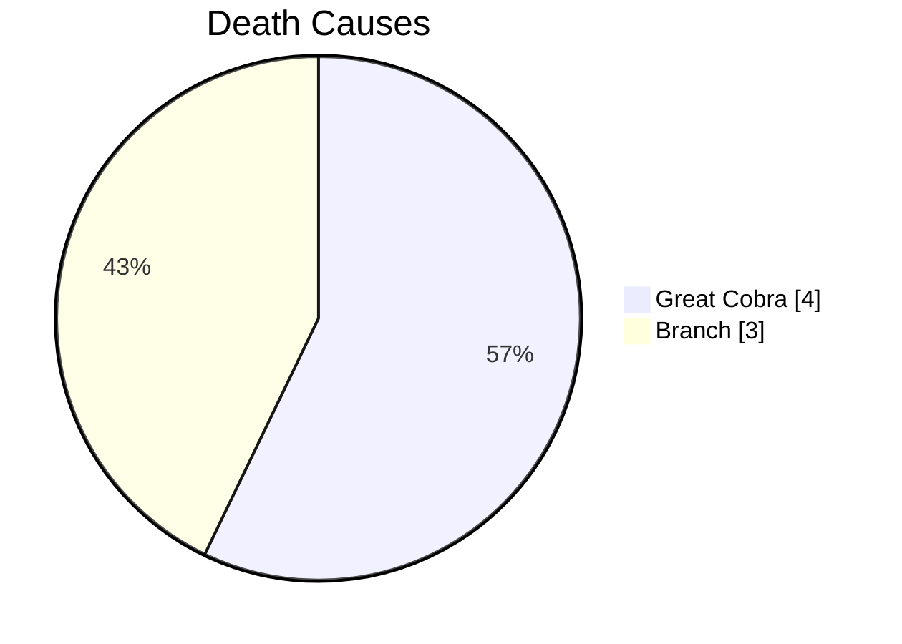

#### Final Score vs Run

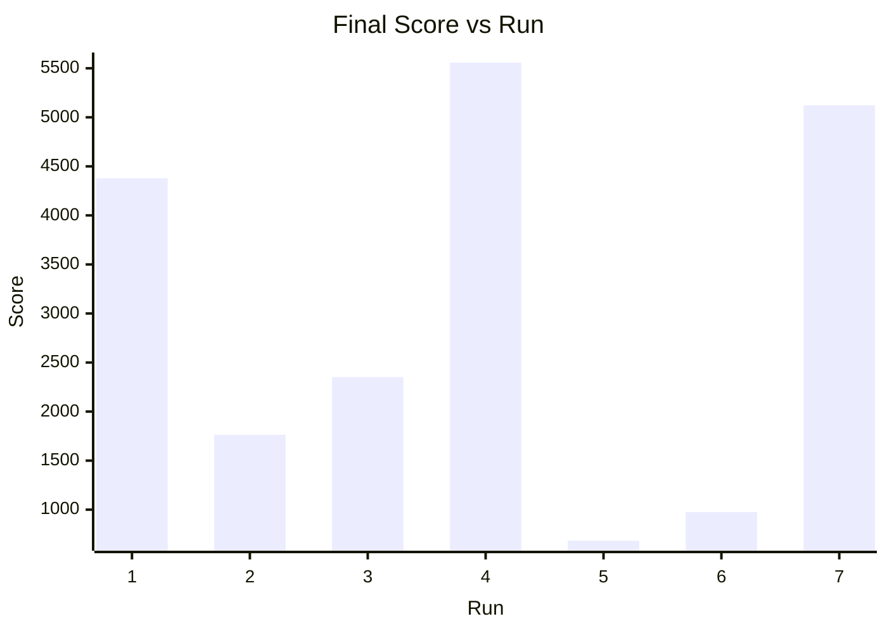

#### Highest Height vs Run

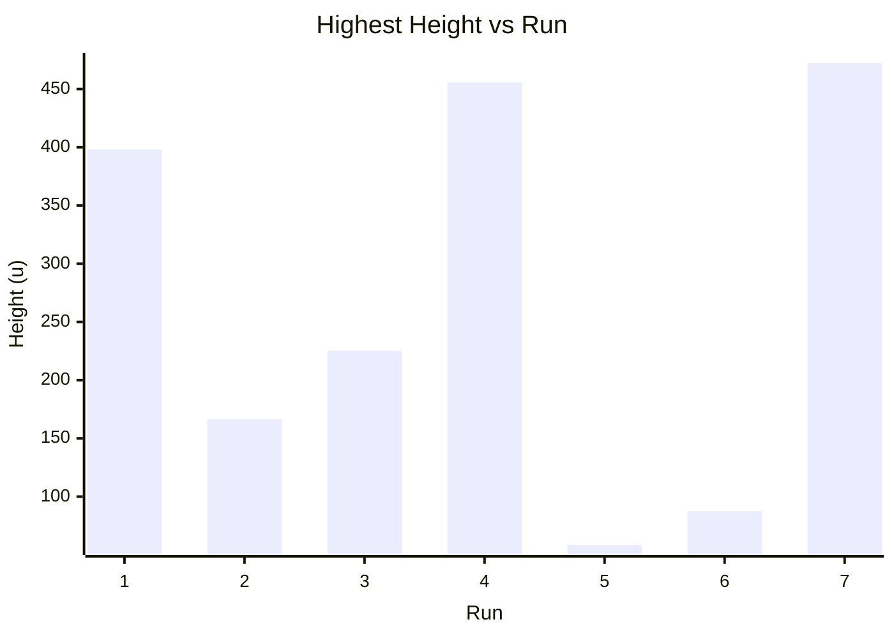

#### Death Height vs Run

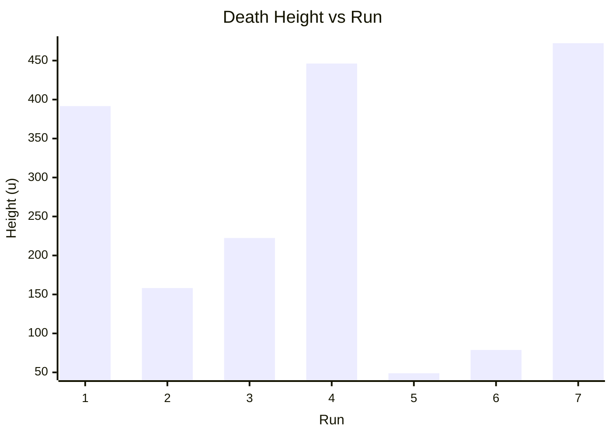

#### Duration vs Run

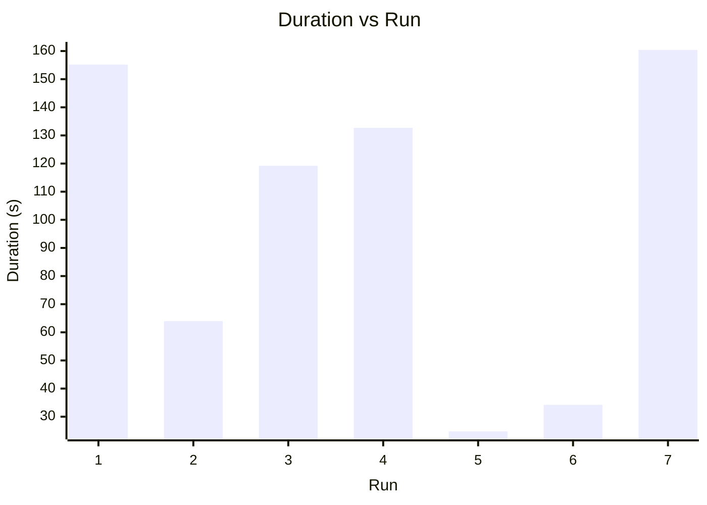

## Run 1

- Mode: Full
- Highest Height: +398.0
- Death Height: +391.6
- Death Cause: Great Cobra

#### Run Duration: 155.2 s

- Time Start: 11:10:54
- Time Stop: 11:13:29
- Starting Zone Exit: +00:00:05, y +20.3

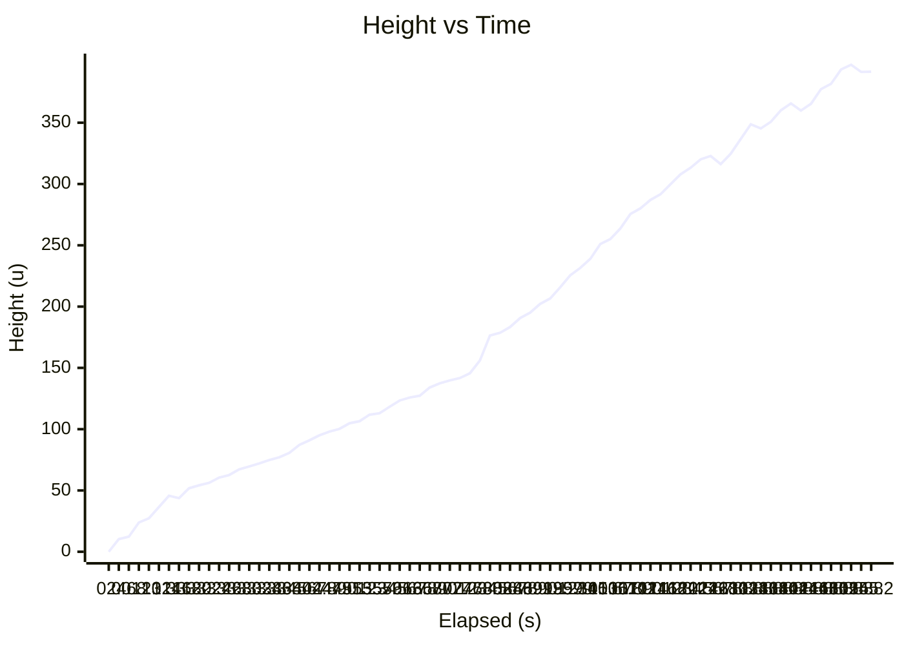

#### Final Score: 4379

- Score from Height: 3979
- Score from Banana: 100 * 2 = 200
- Score from Coconut: 200 * 1 = 200

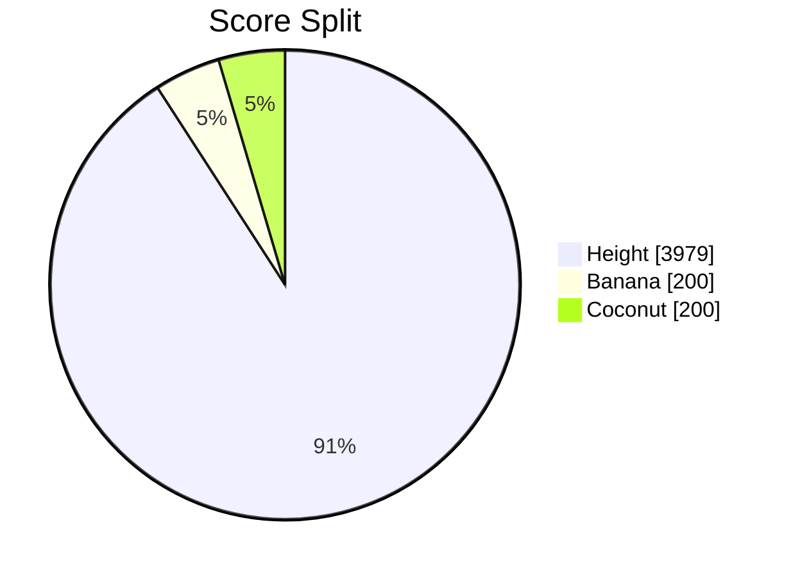

#### Banana Count: 2

| # | Time | y |
|---|---|---|
| 1 | +00:01:23 | 186.5 |
| 2 | +00:01:29 | 202.7 |

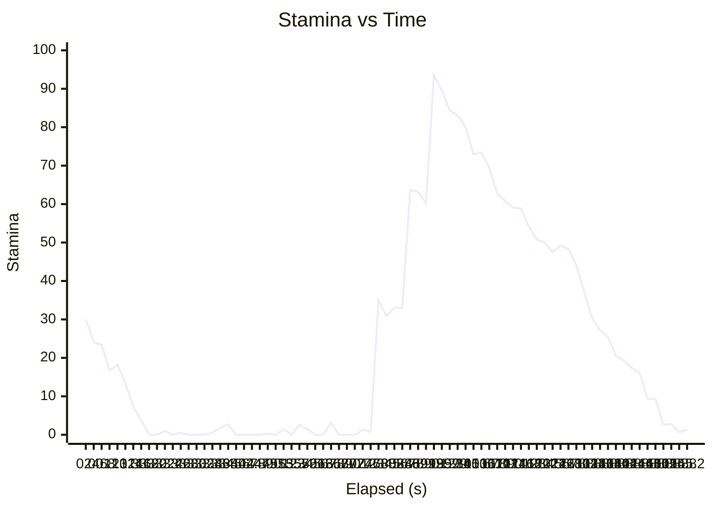

#### Coconut Count: 1

| # | Time | y |
|---|---|---|
| 1 | +00:01:55 | 299.9 |

#### Coconut Used: 1

| # | Time | y |
|---|---|---|
| 1 | +00:02:07 | 316.4 |

#### Web Encounter: 0

#### Branch Hit: 5

| # | Time | y |
|---|---|---|
| 1 | +00:00:12 | 47.3 |
| 2 | +00:02:04 | 323.9 |
| 3 | +00:02:13 | 354.1 |
| 4 | +00:02:20 | 366.9 |
| 5 | +00:02:33 | 398.0 |

#### Pineapple Leap: 1

| # | Time | y |
|---|---|---|
| 1 | +00:01:15 | 150.0 |

#### Rough Bark Contact: 2

| # | Time | y |
|---|---|---|
| 1 | +00:01:26 | 194.1 |
| 2 | +00:01:47 | 275.1 |

#### Cobra Freeze: 1

| # | Time | y |
|---|---|---|
| 1 | +00:02:07 | 316.4 |

#### Pause: 0

#### Boss Fight Start: 0

#### Armor Save: 0

#### Boss Revive: 0

## Run 2

- Mode: Full
- Highest Height: +166.5
- Death Height: +158.2
- Death Cause: Great Cobra

#### Run Duration: 64.0 s

- Time Start: 11:13:39
- Time Stop: 11:14:43
- Starting Zone Exit: +00:00:05, y +20.1

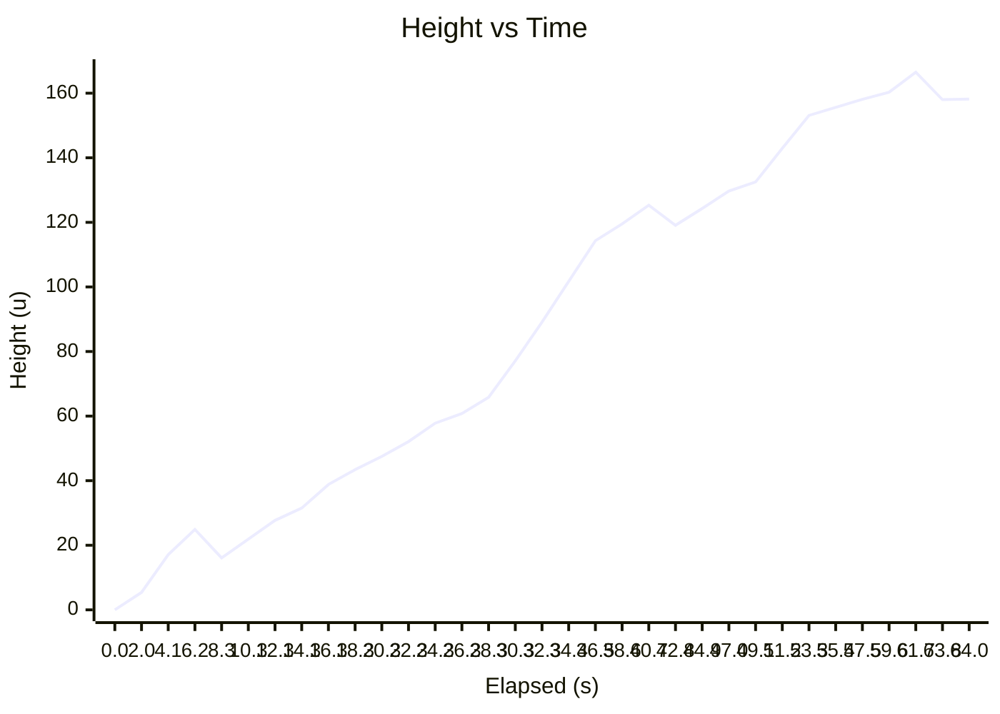

#### Final Score: 1764

- Score from Height: 1664
- Score from Banana: 100 * 1 = 100
- Score from Coconut: 0

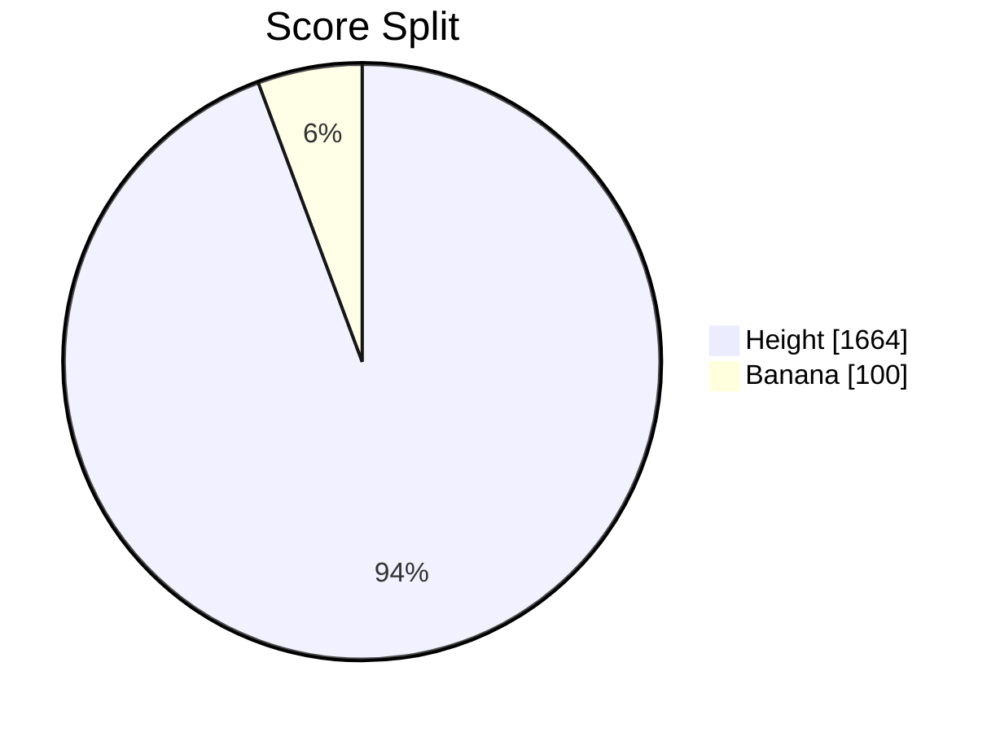

#### Banana Count: 1

| # | Time | y |
|---|---|---|
| 1 | +00:00:04 | 17.1 |

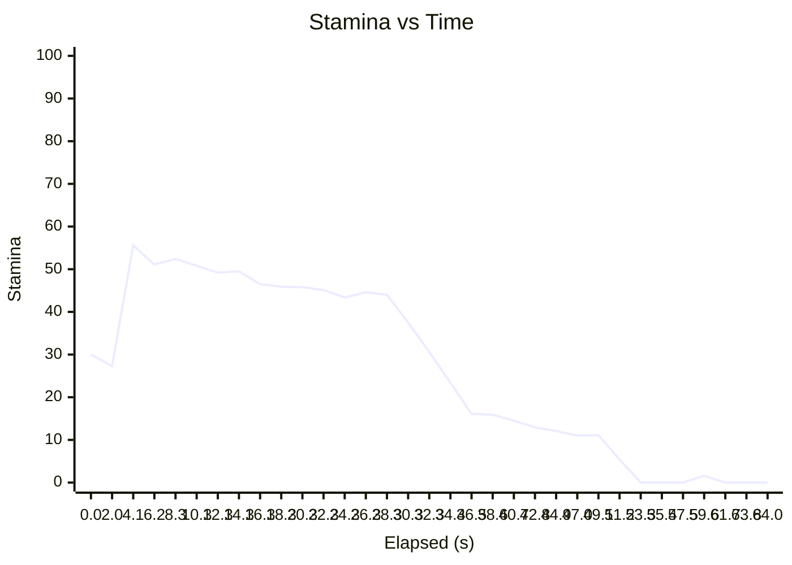

#### Coconut Count: 0

#### Coconut Used: 0

#### Web Encounter: 0

#### Branch Hit: 3

| # | Time | y |
|---|---|---|
| 1 | +00:00:06 | 24.9 |
| 2 | +00:00:41 | 127.1 |
| 3 | +00:01:01 | 166.5 |

#### Pineapple Leap: 0

#### Rough Bark Contact: 1

| # | Time | y |
|---|---|---|
| 1 | +00:00:46 | 129.5 |

#### Cobra Freeze: 0

#### Pause: 0

#### Boss Fight Start: 0

#### Armor Save: 0

#### Boss Revive: 0

## Run 3

- Mode: Full
- Highest Height: +225.3
- Death Height: +222.4
- Death Cause: Great Cobra

#### Run Duration: 119.2 s

- Time Start: 11:14:52
- Time Stop: 11:16:51
- Starting Zone Exit: +00:00:05, y +20.3

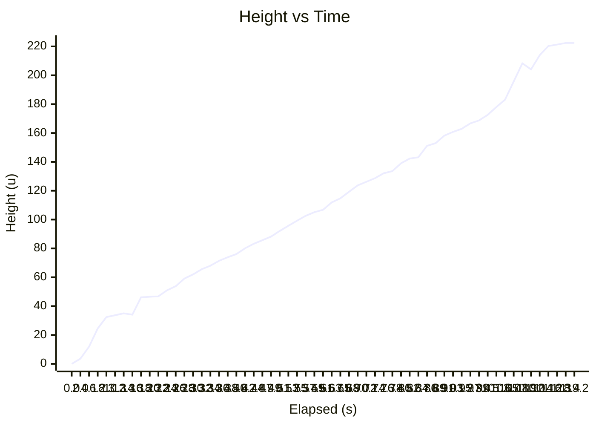

#### Final Score: 2352

- Score from Height: 2252
- Score from Banana: 100 * 1 = 100
- Score from Coconut: 0


#### Banana Count: 1

| # | Time | y |
|---|---|---|
| 1 | +00:01:38 | 170.5 |

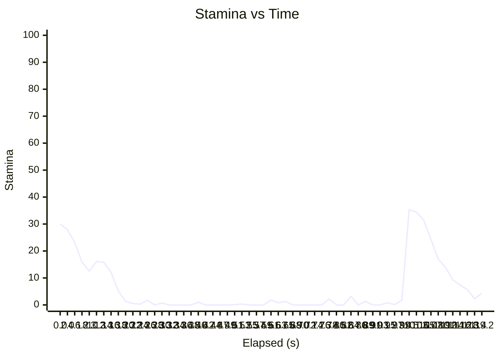

#### Coconut Count: 0

#### Coconut Used: 0

#### Web Encounter: 0

#### Branch Hit: 4

| # | Time | y |
|---|---|---|
| 1 | +00:00:12 | 37.4 |
| 2 | +00:00:17 | 52.9 |
| 3 | +00:01:48 | 213.7 |
| 4 | +00:01:55 | 225.3 |

#### Pineapple Leap: 0

#### Rough Bark Contact: 2

| # | Time | y |
|---|---|---|
| 1 | +00:01:34 | 164.2 |
| 2 | +00:01:41 | 178.0 |

#### Cobra Freeze: 0

#### Pause: 0

#### Boss Fight Start: 0

#### Armor Save: 0

#### Boss Revive: 0

## Run 4

- Mode: Full
- Highest Height: +455.8
- Death Height: +446.2
- Death Cause: Branch

#### Run Duration: 132.7 s

- Time Start: 11:16:58
- Time Stop: 11:19:11
- Starting Zone Exit: +00:00:10, y +20.5


#### Final Score: 5558

- Score from Height: 4558
- Score from Banana: 100 * 8 = 800
- Score from Coconut: 200 * 1 = 200

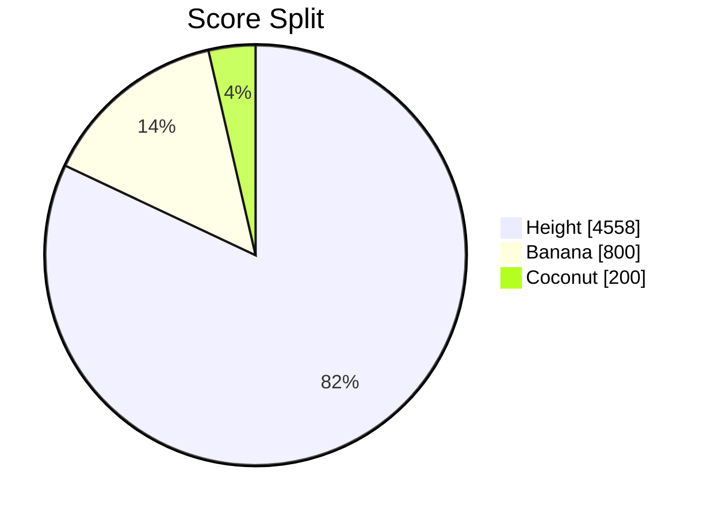

#### Banana Count: 8

| # | Time | y |
|---|---|---|
| 1 | +00:00:01 | 3.9 |
| 2 | +00:00:03 | 6.7 |
| 3 | +00:00:08 | 15.8 |
| 4 | +00:00:23 | 91.5 |
| 5 | +00:00:31 | 129.8 |
| 6 | +00:01:25 | 303.8 |
| 7 | +00:01:40 | 357.2 |
| 8 | +00:01:42 | 363.8 |

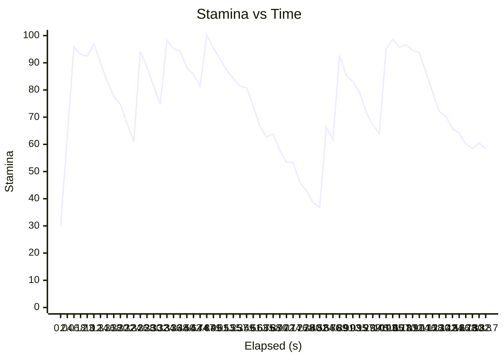

#### Coconut Count: 1

| # | Time | y |
|---|---|---|
| 1 | +00:01:08 | 250.6 |

#### Coconut Used: 1

| # | Time | y |
|---|---|---|
| 1 | +00:01:18 | 274.2 |

#### Web Encounter: 0

#### Branch Hit: 9

| # | Time | y |
|---|---|---|
| 1 | +00:00:32 | 136.4 |
| 2 | +00:00:38 | 145.1 |
| 3 | +00:01:04 | 248.3 |
| 4 | +00:01:14 | 277.4 |
| 5 | +00:01:17 | 277.4 |
| 6 | +00:01:19 | 270.2 |
| 7 | +00:01:38 | 360.8 |
| 8 | +00:01:44 | 368.6 |
| 9 | +00:02:11 | 455.8 |

#### Pineapple Leap: 2

| # | Time | y |
|---|---|---|
| 1 | +00:00:43 | 150.2 |
| 2 | +00:01:22 | 270.8 |

#### Rough Bark Contact: 3

| # | Time | y |
|---|---|---|
| 1 | +00:00:36 | 132.3 |
| 2 | +00:00:46 | 177.0 |
| 3 | +00:02:04 | 435.2 |

#### Cobra Freeze: 1

| # | Time | y |
|---|---|---|
| 1 | +00:01:18 | 274.2 |

#### Pause: 1

| # | Time | y |
|---|---|---|
| 1 | +00:01:21 | 265.4 |

#### Boss Fight Start: 0

#### Armor Save: 0

#### Boss Revive: 0

## Run 5

- Mode: Full
- Highest Height: +58.5
- Death Height: +48.9
- Death Cause: Branch

#### Run Duration: 24.8 s

- Time Start: 11:19:15
- Time Stop: 11:19:40
- Starting Zone Exit: +00:00:05, y +20.1

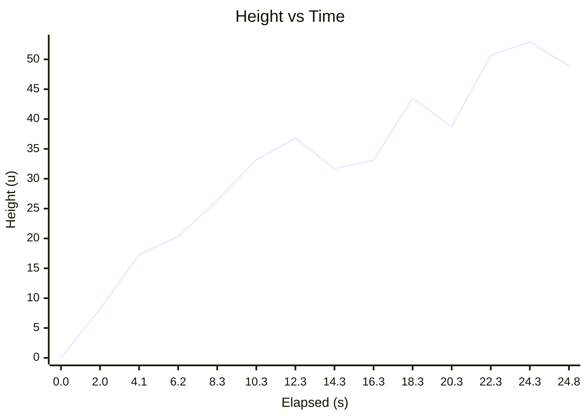

#### Final Score: 684

- Score from Height: 584
- Score from Banana: 100 * 1 = 100
- Score from Coconut: 0

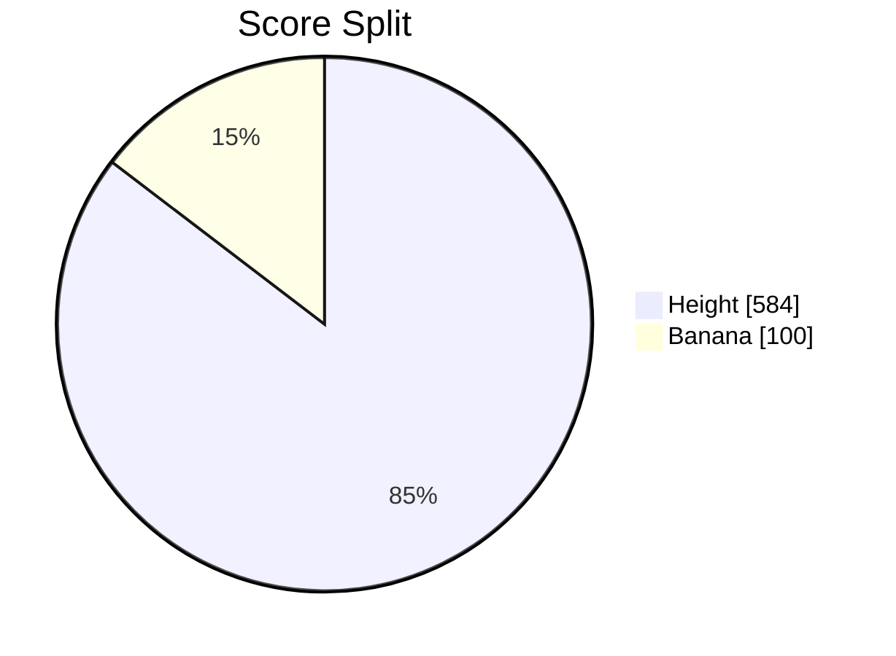

#### Banana Count: 1

| # | Time | y |
|---|---|---|
| 1 | +00:00:14 | 32.3 |

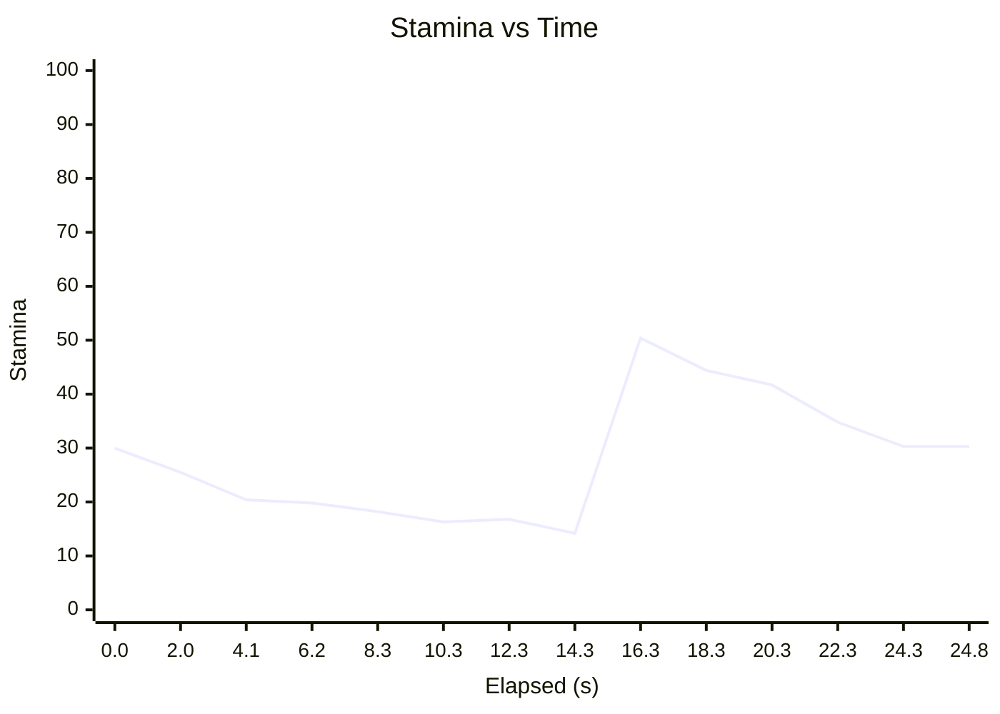

#### Coconut Count: 0

#### Coconut Used: 0

#### Web Encounter: 0

#### Branch Hit: 3

| # | Time | y |
|---|---|---|
| 1 | +00:00:12 | 39.5 |
| 2 | +00:00:18 | 47.1 |
| 3 | +00:00:23 | 58.5 |

#### Pineapple Leap: 0

#### Rough Bark Contact: 0

#### Cobra Freeze: 0

#### Pause: 0

#### Boss Fight Start: 0

#### Armor Save: 0

#### Boss Revive: 0

## Run 6

- Mode: Full
- Highest Height: +87.6
- Death Height: +78.8
- Death Cause: Branch

#### Run Duration: 34.2 s

- Time Start: 11:19:50
- Time Stop: 11:20:24
- Starting Zone Exit: +00:00:05, y +20.4

```mermaid
xychart-beta
    title "Height vs Time"
    x-axis "Elapsed (s)" [0.0, 2.0, 4.1, 6.2, 8.3, 10.3, 12.3, 14.3, 16.3, 18.3, 20.3, 22.3, 24.3, 26.3, 28.3, 30.3, 32.3, 34.2]
    y-axis "Height (u)" 0 --> 87
    line [0.0, 4.9, 10.2, 20.0, 13.0, 18.0, 30.0, 42.0, 43.0, 41.2, 53.1, 58.4, 69.1, 81.1, 86.4, 80.9, 84.2, 78.8]
```

#### Final Score: 975

- Score from Height: 875
- Score from Banana: 100 * 1 = 100
- Score from Coconut: 0

```mermaid
pie showData
    title Score Split
    "Height" : 875
    "Banana" : 100
```

#### Banana Count: 1

| # | Time | y |
|---|---|---|
| 1 | +00:00:02 | 6.5 |

```mermaid
xychart-beta
    title "Stamina vs Time"
    x-axis "Elapsed (s)" [0.0, 2.0, 4.1, 6.2, 8.3, 10.3, 12.3, 14.3, 16.3, 18.3, 20.3, 22.3, 24.3, 26.3, 28.3, 30.3, 32.3, 34.2]
    y-axis "Stamina" 0 --> 100
    line [30.0, 27.7, 59.6, 53.1, 54.5, 53.9, 47.0, 40.1, 40.1, 37.0, 30.2, 29.6, 23.5, 16.6, 15.8, 13.4, 14.5, 12.6]
```

#### Coconut Count: 0

#### Coconut Used: 0

#### Web Encounter: 0

#### Branch Hit: 4

| # | Time | y |
|---|---|---|
| 1 | +00:00:06 | 21.6 |
| 2 | +00:00:16 | 45.4 |
| 3 | +00:00:28 | 86.8 |
| 4 | +00:00:33 | 87.6 |

#### Pineapple Leap: 0

#### Rough Bark Contact: 0

#### Cobra Freeze: 0

#### Pause: 1

| # | Time | y |
|---|---|---|
| 1 | +00:00:08 | 13.0 |

#### Boss Fight Start: 0

#### Armor Save: 0

#### Boss Revive: 0

## Run 7

- Mode: Full
- Highest Height: +472.3
- Death Height: +472.3
- Death Cause: Great Cobra

#### Run Duration: 160.4 s

- Time Start: 11:20:32
- Time Stop: 11:23:12
- Starting Zone Exit: +00:00:04, y +20.5

```mermaid
xychart-beta
    title "Height vs Time"
    x-axis "Elapsed (s)" [0.0, 2.0, 4.1, 6.2, 8.3, 10.3, 12.3, 14.3, 16.3, 18.3, 20.3, 22.3, 24.3, 26.3, 28.3, 30.3, 32.3, 34.4, 36.5, 38.6, 40.7, 42.8, 44.9, 47.0, 49.1, 51.2, 53.3, 55.4, 57.5, 59.6, 61.7, 63.8, 65.9, 68.0, 70.1, 72.2, 74.3, 76.4, 78.5, 80.6, 82.7, 84.8, 86.9, 89.0, 91.1, 93.2, 95.3, 97.4, 99.5, 101.6, 103.7, 105.8, 107.9, 110.0, 112.1, 114.2, 116.3, 118.4, 120.5, 122.6, 124.7, 126.8, 128.8, 130.8, 132.8, 134.8, 136.8, 138.8, 140.8, 142.8, 144.8, 146.8, 148.8, 150.8, 152.8, 154.8, 156.8, 158.8, 160.4]
    y-axis "Height (u)" 0 --> 473
    line [0.0, 7.9, 17.5, 24.7, 37.1, 48.1, 56.7, 68.7, 80.7, 86.9, 80.1, 72.4, 79.1, 88.3, 92.7, 104.1, 112.8, 117.1, 119.8, 123.0, 125.5, 128.0, 129.6, 135.0, 137.1, 142.0, 144.1, 147.6, 151.5, 180.0, 183.3, 192.2, 199.0, 211.6, 224.2, 236.8, 249.4, 256.6, 262.6, 274.9, 283.8, 289.1, 296.9, 302.1, 305.1, 308.1, 309.9, 315.3, 315.2, 323.6, 331.2, 338.3, 347.4, 354.3, 365.8, 369.9, 379.7, 384.4, 386.3, 389.7, 397.0, 401.8, 401.8, 413.8, 419.7, 427.6, 436.2, 440.8, 446.0, 447.8, 450.9, 452.9, 457.2, 459.9, 463.2, 465.6, 468.0, 470.4, 472.3]
```

#### Final Score: 5122

- Score from Height: 4722
- Score from Banana: 100 * 2 = 200
- Score from Coconut: 200 * 1 = 200

```mermaid
pie showData
    title Score Split
    "Height" : 4722
    "Banana" : 200
    "Coconut" : 200
```

#### Banana Count: 2

| # | Time | y |
|---|---|---|
| 1 | +00:00:01 | 7.9 |
| 2 | +00:01:35 | 311.5 |

```mermaid
xychart-beta
    title "Stamina vs Time"
    x-axis "Elapsed (s)" [0.0, 2.0, 4.1, 6.2, 8.3, 10.3, 12.3, 14.3, 16.3, 18.3, 20.3, 22.3, 24.3, 26.3, 28.3, 30.3, 32.3, 34.4, 36.5, 38.6, 40.7, 42.8, 44.9, 47.0, 49.1, 51.2, 53.3, 55.4, 57.5, 59.6, 61.7, 63.8, 65.9, 68.0, 70.1, 72.2, 74.3, 76.4, 78.5, 80.6, 82.7, 84.8, 86.9, 89.0, 91.1, 93.2, 95.3, 97.4, 99.5, 101.6, 103.7, 105.8, 107.9, 110.0, 112.1, 114.2, 116.3, 118.4, 120.5, 122.6, 124.7, 126.8, 128.8, 130.8, 132.8, 134.8, 136.8, 138.8, 140.8, 142.8, 144.8, 146.8, 148.8, 150.8, 152.8, 154.8, 156.8, 158.8, 160.4]
    y-axis "Stamina" 0 --> 100
    line [30.0, 60.4, 54.9, 52.3, 45.2, 39.1, 34.9, 28.0, 21.1, 19.8, 18.4, 18.4, 16.0, 11.7, 11.2, 4.6, 0.8, 0.0, 0.5, 0.0, 0.0, 0.0, 2.2, 0.0, 1.8, 0.0, 0.9, 0.0, 35.0, 69.0, 67.9, 63.1, 60.7, 53.5, 46.2, 39.0, 31.7, 27.6, 26.1, 19.0, 14.7, 14.6, 12.2, 11.4, 13.7, 16.0, 18.9, 50.8, 46.7, 40.5, 36.2, 32.1, 26.9, 23.6, 17.3, 17.7, 12.6, 12.3, 15.5, 15.3, 13.1, 13.6, 18.6, 11.7, 10.0, 7.0, 2.8, 2.6, 0.0, 0.0, 0.0, 0.8, 0.3, 0.0, 0.0, 0.0, 0.0, 0.0, 0.0]
```

#### Coconut Count: 1

| # | Time | y |
|---|---|---|
| 1 | +00:01:14 | 250.6 |

#### Coconut Used: 1

| # | Time | y |
|---|---|---|
| 1 | +00:01:40 | 320.0 |

#### Web Encounter: 1

| # | Time |
|---|---|
| 1 | +00:02:06 |

#### Branch Hit: 4

| # | Time | y |
|---|---|---|
| 1 | +00:00:18 | 87.1 |
| 2 | +00:00:20 | 81.2 |
| 3 | +00:01:00 | 192.1 |
| 4 | +00:01:38 | 322.4 |

#### Pineapple Leap: 2

| # | Time | y |
|---|---|---|
| 1 | +00:00:57 | 150.0 |
| 2 | +00:00:59 | 171.1 |

#### Rough Bark Contact: 6

| # | Time | y |
|---|---|---|
| 1 | +00:01:03 | 192.1 |
| 2 | +00:01:42 | 328.4 |
| 3 | +00:01:44 | 336.6 |
| 4 | +00:01:48 | 351.6 |
| 5 | +00:02:00 | 386.1 |
| 6 | +00:02:19 | 445.0 |

#### Cobra Freeze: 1

| # | Time | y |
|---|---|---|
| 1 | +00:01:41 | 320.0 |

#### Pause: 0

#### Boss Fight Start: 0

#### Armor Save: 0

#### Boss Revive: 0

## Run 8

- Mode: Full
- Status: Interrupted
- Highest Height: +393.7

#### Run Duration: 107.3 s

- Time Start: 11:23:23
- Time Stop: 11:25:11
- Starting Zone Exit: +00:00:05, y +20.6

```mermaid
xychart-beta
    title "Height vs Time"
    x-axis "Elapsed (s)" [0.0, 2.0, 4.1, 6.2, 8.3, 10.3, 12.3, 14.3, 16.3, 18.3, 20.3, 22.3, 24.3, 26.3, 28.3, 30.3, 32.3, 34.4, 36.5, 38.6, 40.7, 42.8, 44.9, 47.0, 49.1, 51.2, 53.3, 55.4, 57.5, 59.6, 61.7, 63.8, 65.9, 68.0, 70.1, 72.2, 74.3, 76.4, 78.5, 80.6, 82.7, 84.8, 86.9, 89.0, 91.1, 93.2, 95.3, 97.4, 99.5, 101.6, 103.7, 105.8, 107.2]
    y-axis "Height (u)" 0 --> 394
    line [0.0, 3.0, 13.4, 22.6, 27.6, 22.7, 34.7, 43.4, 50.3, 59.5, 66.7, 75.4, 79.3, 90.8, 102.8, 114.8, 126.8, 139.4, 148.6, 166.7, 180.6, 186.5, 193.2, 199.7, 210.0, 215.1, 207.8, 215.1, 227.7, 234.3, 242.5, 250.3, 255.0, 263.2, 267.1, 278.7, 291.3, 287.1, 299.7, 311.4, 318.7, 324.8, 336.5, 338.3, 344.3, 349.5, 352.5, 363.6, 376.2, 377.6, 384.5, 390.9, 393.7]
```

#### Final Score: 4537

- Score from Height: 3937
- Score from Banana: 100 * 4 = 400
- Score from Coconut: 200 * 1 = 200

```mermaid
pie showData
    title Score Split
    "Height" : 3937
    "Banana" : 400
    "Coconut" : 200
```

#### Banana Count: 4

| # | Time | y |
|---|---|---|
| 1 | +00:00:00 | 1.3 |
| 2 | +00:00:06 | 25.4 |
| 3 | +00:00:21 | 75.4 |
| 4 | +00:01:34 | 352.5 |

```mermaid
xychart-beta
    title "Stamina vs Time"
    x-axis "Elapsed (s)" [0.0, 2.0, 4.1, 6.2, 8.3, 10.3, 12.3, 14.3, 16.3, 18.3, 20.3, 22.3, 24.3, 26.3, 28.3, 30.3, 32.3, 34.4, 36.5, 38.6, 40.7, 42.8, 44.9, 47.0, 49.1, 51.2, 53.3, 55.4, 57.5, 59.6, 61.7, 63.8, 65.9, 68.0, 70.1, 72.2, 74.3, 76.4, 78.5, 80.6, 82.7, 84.8, 86.9, 89.0, 91.1, 93.2, 95.3, 97.4, 99.5, 101.6, 103.7, 105.8, 107.2]
    y-axis "Stamina" 0 --> 100
    line [30.0, 63.4, 57.5, 53.4, 85.6, 82.8, 75.9, 71.7, 69.5, 64.7, 61.8, 91.8, 91.1, 84.5, 77.6, 70.7, 63.8, 56.5, 52.5, 87.7, 81.4, 80.5, 77.9, 76.4, 70.7, 69.6, 69.2, 66.5, 59.3, 55.5, 51.8, 47.3, 46.8, 42.1, 42.6, 35.9, 28.7, 25.6, 18.4, 11.9, 9.2, 7.9, 1.2, 4.7, 1.8, 0.0, 35.0, 28.6, 21.4, 24.6, 22.1, 20.2, 20.3]
```

#### Coconut Count: 1

| # | Time | y |
|---|---|---|
| 1 | +00:01:03 | 250.3 |

#### Coconut Used: 1

| # | Time | y |
|---|---|---|
| 1 | +00:01:44 | 384.7 |

#### Web Encounter: 0

#### Branch Hit: 3

| # | Time | y |
|---|---|---|
| 1 | +00:00:08 | 27.6 |
| 2 | +00:00:51 | 215.6 |
| 3 | +00:01:15 | 296.1 |

#### Pineapple Leap: 1

| # | Time | y |
|---|---|---|
| 1 | +00:00:37 | 150.4 |

#### Rough Bark Contact: 0

#### Cobra Freeze: 1

| # | Time | y |
|---|---|---|
| 1 | +00:01:44 | 384.7 |

#### Pause: 0

#### Boss Fight Start: 0

#### Armor Save: 0

#### Boss Revive: 0

