# MonKobra Analytics: Session: 2026-11-10 12:08:23

MonKobra v1.0.0-beta

## Session Summary

#### Death Causes

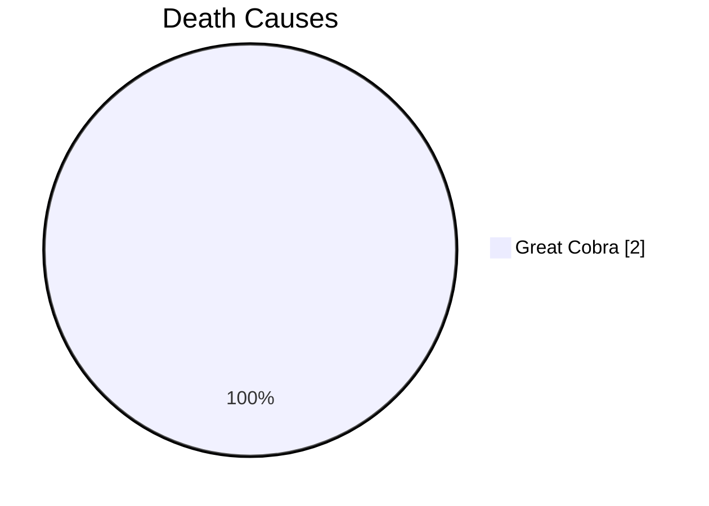

#### Final Score vs Run

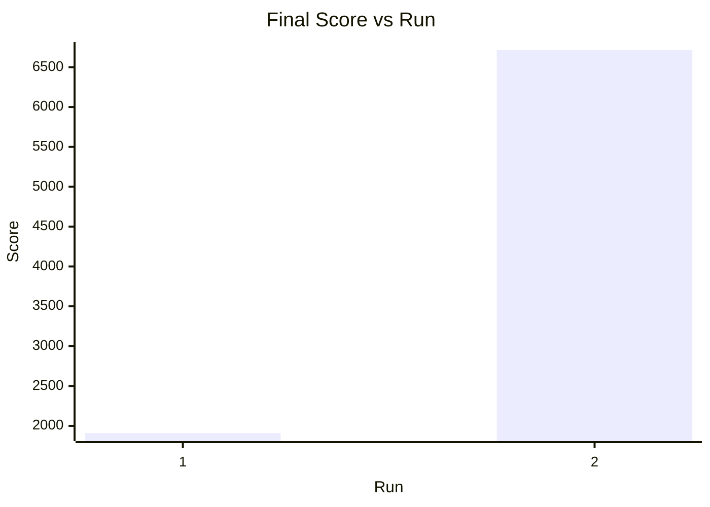

#### Highest Height vs Run

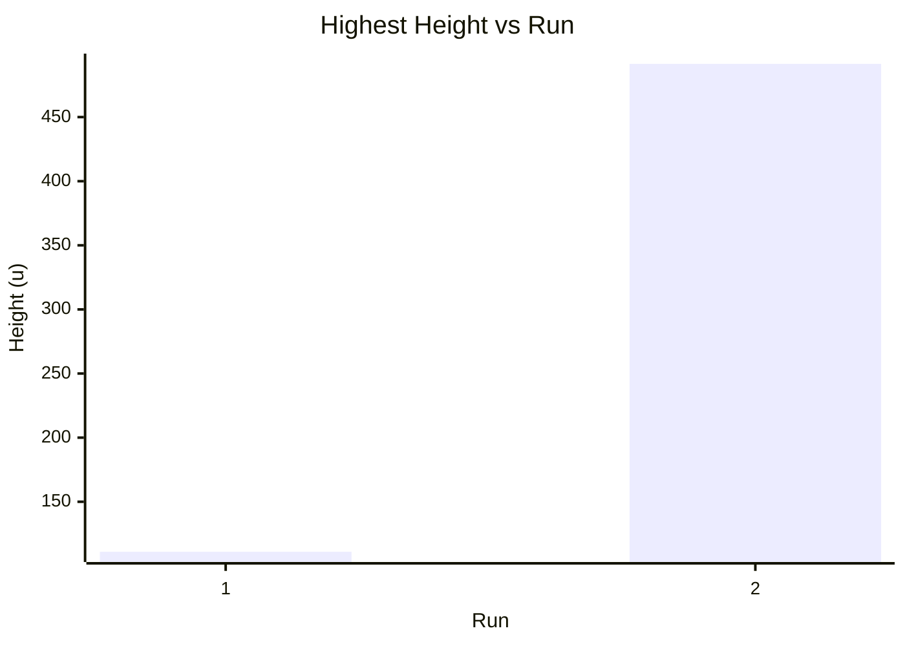

#### Death Height vs Run

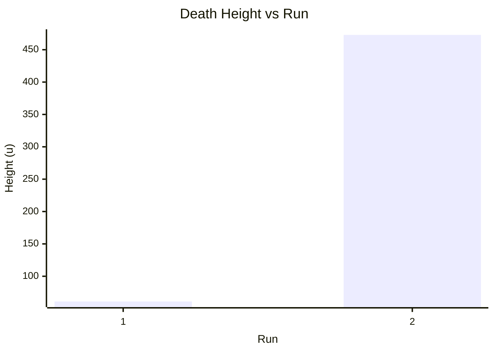

#### Duration vs Run

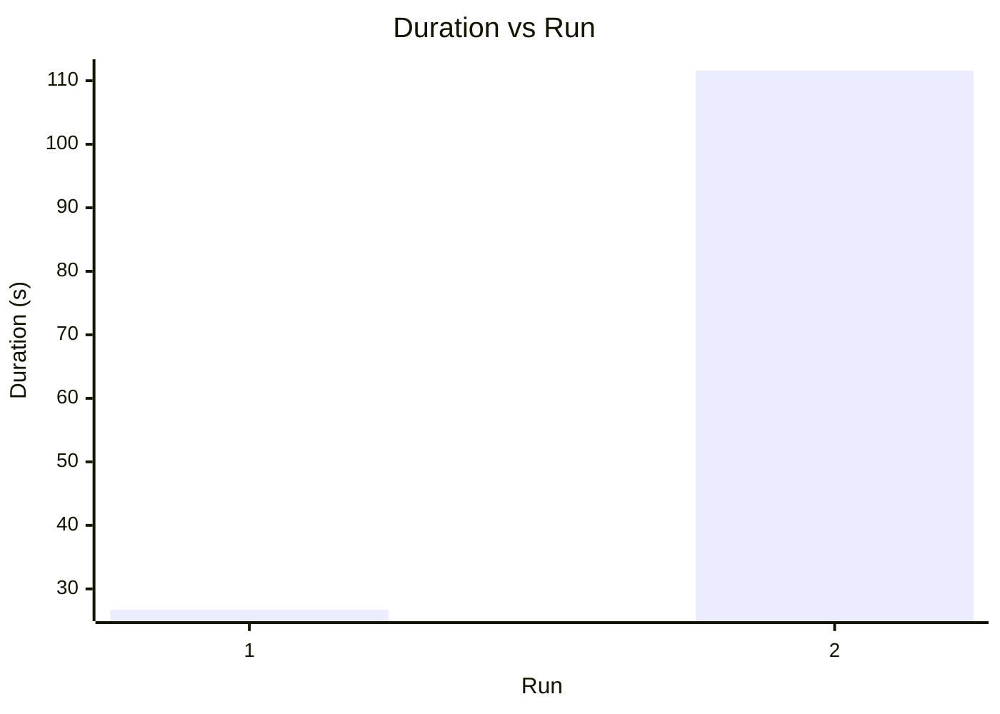

## Run 1

- Mode: Full
- Highest Height: +111.0
- Death Height: +61.0
- Death Cause: Great Cobra

#### Run Duration: 26.7 s

- Time Start: 12:08:28
- Time Stop: 12:08:55
- Starting Zone Exit: +00:00:12, y +58.5

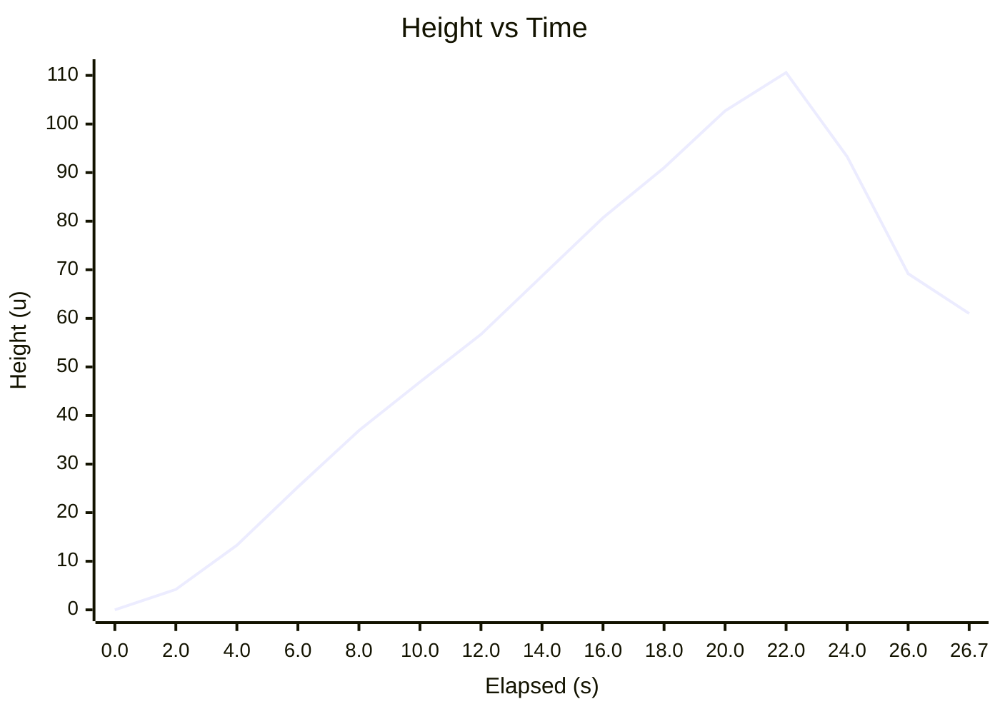

#### Final Score: 1910

- Score from Height: 1110
- Score from Banana: 100 * 8 = 800
- Score from Coconut: 0

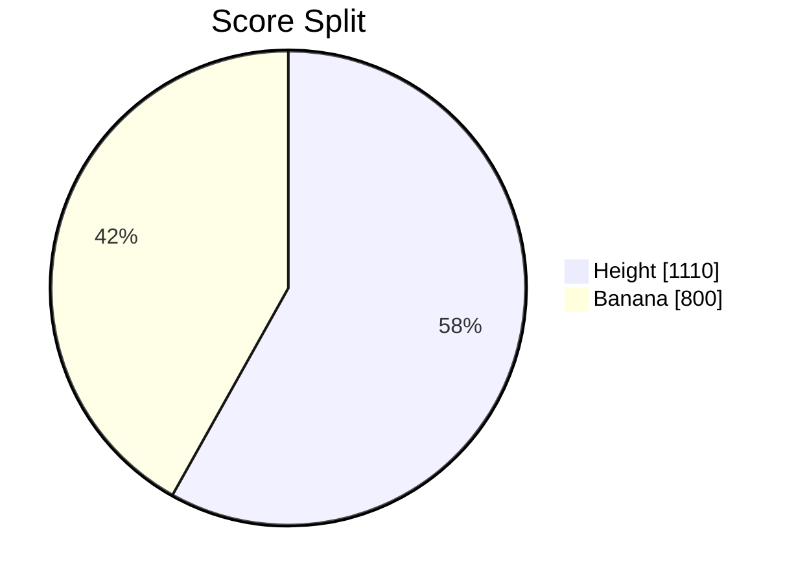

#### Banana Count: 8

| # | Time | y |
|---|---|---|
| 1 | +00:00:01 | 3.3 |
| 2 | +00:00:03 | 12.5 |
| 3 | +00:00:04 | 18.9 |
| 4 | +00:00:06 | 26.1 |
| 5 | +00:00:08 | 40.1 |
| 6 | +00:00:10 | 50.7 |
| 7 | +00:00:18 | 91.6 |
| 8 | +00:00:21 | 110.8 |

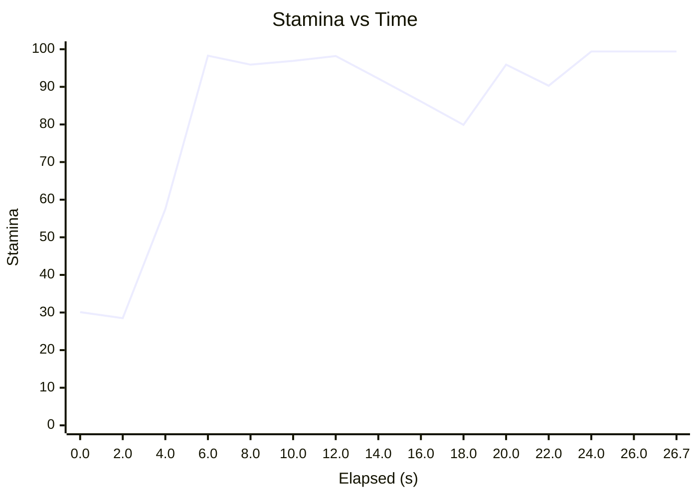

#### Coconut Count: 0

#### Coconut Used: 0

#### Web Encounter: 0

#### Branch Hit: 0

#### Pineapple Leap: 0

#### Rough Bark Contact: 0

#### Cobra Freeze: 0

#### Pause: 0

#### Boss Fight Start: 0

#### Armor Save: 0

#### Boss Revive: 0

## Run 2

- Mode: Full
- Highest Height: +491.5
- Death Height: +472.9
- Death Cause: Great Cobra

#### Run Duration: 111.6 s

- Time Start: 12:08:57
- Time Stop: 12:10:48
- Starting Zone Exit: +00:00:13, y +58.6

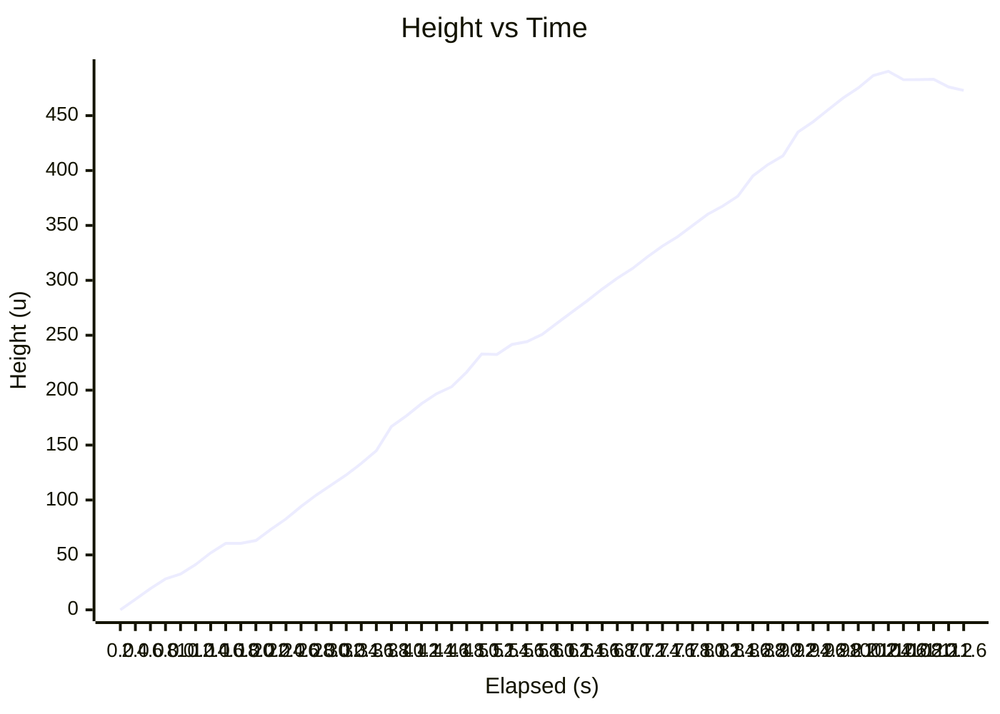

#### Final Score: 6714

- Score from Height: 4914
- Score from Banana: 100 * 12 = 1200
- Score from Coconut: 200 * 3 = 600

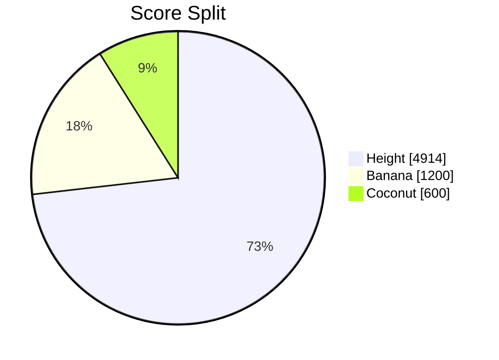

#### Banana Count: 12

| # | Time | y |
|---|---|---|
| 1 | +00:00:07 | 30.6 |
| 2 | +00:00:08 | 35.9 |
| 3 | +00:00:10 | 41.5 |
| 4 | +00:00:21 | 81.5 |
| 5 | +00:00:30 | 125.0 |
| 6 | +00:00:49 | 231.3 |
| 7 | +00:01:00 | 271.4 |
| 8 | +00:01:14 | 340.3 |
| 9 | +00:01:17 | 356.9 |
| 10 | +00:01:24 | 399.0 |
| 11 | +00:01:34 | 455.9 |
| 12 | +00:01:36 | 466.8 |

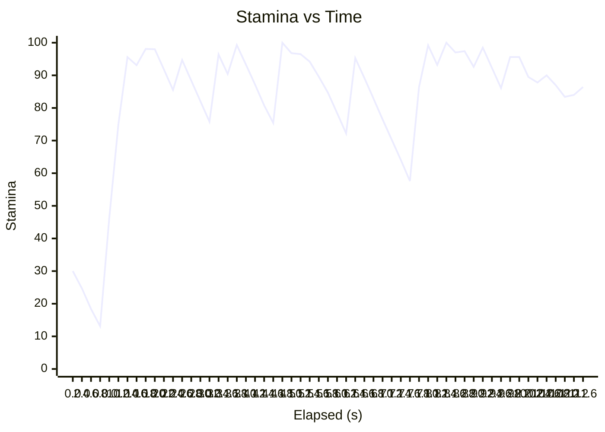

#### Coconut Count: 3

| # | Time | y |
|---|---|---|
| 1 | +00:00:53 | 246.3 |
| 2 | +00:01:07 | 309.5 |
| 3 | +00:01:26 | 409.5 |

#### Coconut Used: 2

| # | Time | y |
|---|---|---|
| 1 | +00:00:54 | 244.0 |
| 2 | +00:01:08 | 313.3 |

#### Web Encounter: 0

#### Branch Hit: 1

| # | Time | y |
|---|---|---|
| 1 | +00:00:53 | 248.2 |

#### Pineapple Leap: 4

| # | Time | y |
|---|---|---|
| 1 | +00:00:34 | 146.1 |
| 2 | +00:00:45 | 209.3 |
| 3 | +00:01:21 | 370.0 |
| 4 | +00:01:28 | 413.3 |

#### Rough Bark Contact: 0

#### Cobra Freeze: 2

| # | Time | y |
|---|---|---|
| 1 | +00:00:55 | 248.4 |
| 2 | +00:01:09 | 318.3 |

#### Pause: 0

#### Boss Fight Start: 0

#### Armor Save: 0

#### Boss Revive: 0

## Run 3

- Mode: Full
- Status: Interrupted
- Highest Height: +46.8

#### Run Duration: 11.4 s

- Time Start: 12:10:50
- Time Stop: 12:11:02

```mermaid
xychart-beta
    title "Height vs Time"
    x-axis "Elapsed (s)" [0.0, 2.0, 4.0, 6.0, 8.0, 10.0, 11.4]
    y-axis "Height (u)" 0 --> 47
    line [0.0, 8.0, 18.8, 17.5, 28.1, 40.0, 46.8]
```

#### Final Score: 768

- Score from Height: 468
- Score from Banana: 100 * 3 = 300
- Score from Coconut: 0

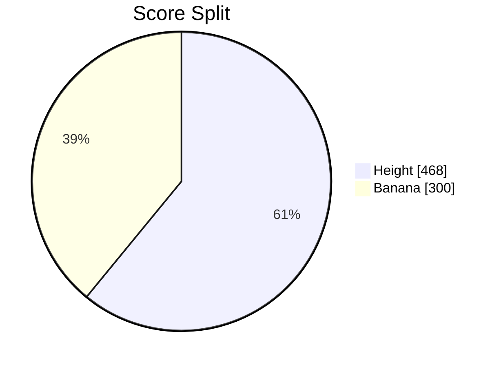

#### Banana Count: 3

| # | Time | y |
|---|---|---|
| 1 | +00:00:03 | 14.2 |
| 2 | +00:00:04 | 20.1 |
| 3 | +00:00:08 | 33.4 |

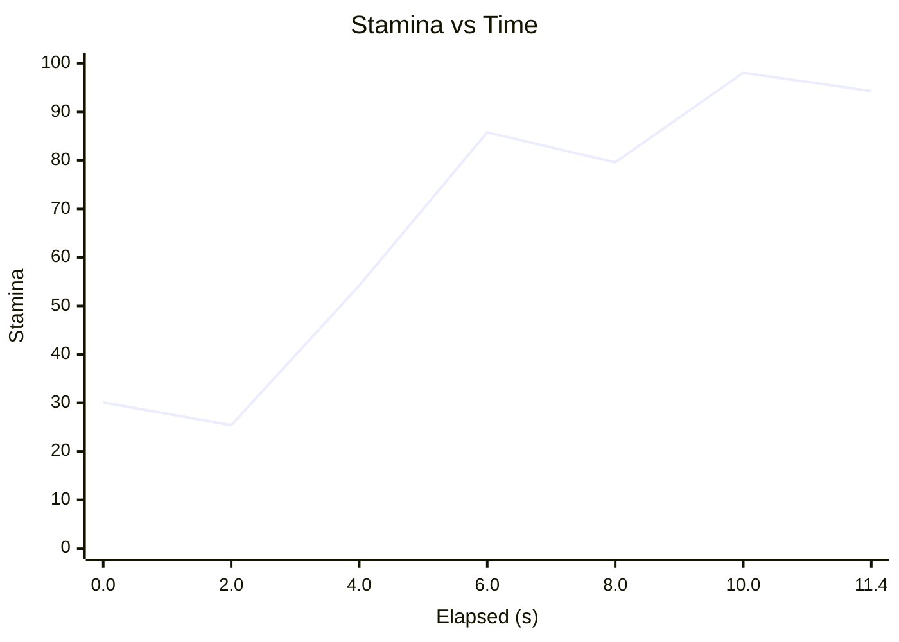

#### Coconut Count: 0

#### Coconut Used: 0

#### Web Encounter: 0

#### Branch Hit: 2

| # | Time | y |
|---|---|---|
| 1 | +00:00:04 | 20.6 |
| 2 | +00:00:04 | 16.7 |

#### Pineapple Leap: 0

#### Rough Bark Contact: 0

#### Cobra Freeze: 0

#### Pause: 0

#### Boss Fight Start: 0

#### Armor Save: 0

#### Boss Revive: 0

