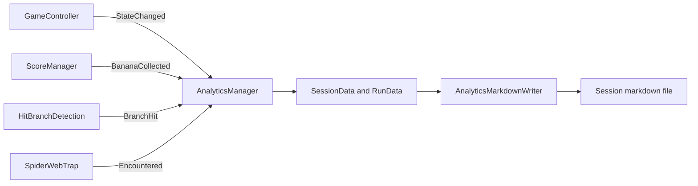

# Monkobra Analytics

How the game records playtests: one markdown report per game launch, with a record of every run. The wider system map is in the [Technical Design Document](monkobra-tdd.md#analytics), the run states it observes are in the [Gameplay Loop](gameplay-loop-doc.md), and the hazards it counts are in [Mobs](mob-doc.md).

## Overview

`AnalyticsManager` is a scene-placed singleton kept across scene reloads. It listens to the game and writes the data to a markdown file, so a playtest can be read with any markdown viewer that renders Mermaid.

- Session: one game launch, one file; a scene restart keeps the same session
- Run: one attempt from the start of play to a game over; every run adds one entry to the session file
- Report: the markdown file, rewritten whole on every save

## Session Lifecycle

A session opens when the manager wakes, and a run follows the game state.

1. `GameState.Playing` opens a new run, takes its first sample, and saves
2. banana, web, and branch events are stamped into the open run, each followed by a save
3. a timer samples height and stamina while the run plays, and autosaves
4. `GameState.Lost` closes the run as `Lost`: the end, the score, and the death cause are filled in, then the file is saved
5. a run cut short, ie Play mode stopped, a scene reload mid run, an application pause, or the restart key, is closed as `Interrupted`

| Run Status | Meaning | In Session Summary |
| --- | --- | --- |
| `InProgress` | run still being played | ❌ |
| `Lost` | ended by a game over | ✔️ |
| `Interrupted` | cut short without a game over | ❌ |

## Output Files

Files land in `Application.persistentDataPath/Analytics/`.

- Session File: `0<yyyy-MM-dd_HH_mm_ss>.md`, named by the session start time
- Mock File: `0<stamp>-mock.md`, a fully faked session saved beside the real ones, the live session untouched
- Download: in a WebGL player the report is handed to the browser as a download instead (`WebDownload`); elsewhere it saves the session file

The file opens with an h1 title and the app version, then a `Session Summary` (only once a run was lost), then one `## Run N` entry per run.

## Metrics

Every figure the report carries, grouped by where it appears. Heights are in world units above the run start.

### Session Summary

Drawn from the `Lost` runs only.

- Death Causes: pie of what ended each lost run, see [Death Causes](#death-causes)
- Final Score vs Run: bar chart of the total score of each lost run
- Highest Height vs Run: bar chart of the highest point each lost run reached
- Death Height vs Run: bar chart of the height at which each lost run ended
- Duration vs Run: bar chart of how long each lost run lasted, in seconds

### Run Header

- Status: shown only when the run is not `Lost`
- Highest Height: highest point reached, which can exceed where the run ended
- Death Height: height at the moment of the loss, shown for a lost run
- Death Cause: what ended the run, shown for a lost run

### Run Timing

- Run Duration: seconds from start to end
- Time Start, Time Stop: wall clock times of the run's start and end
- Height vs Time: line of the sampled height over the run

### Score

- Final Score: total score of the run
- Score from Height: points earned by climbing
- Score from Banana: points earned by bananas, shown as `unit * count = total` when every banana paid the same
- Score Split: pie of height score against banana score

### Events

Each event list is a table of its time since the run start; banana and branch rows also carry the height `y`.

- Banana Count: bananas collected, with the stamina curve (Stamina vs Time) under it
- Web Encounter: times the monkey touched a spider web
- Branch Hit: times the monkey's branch sensor met a branch; the falling cobra counts here too

### Death Causes

The player always dies to the great cobra, so the cause names what hit the monkey just before. `DeathCauseResolver` picks the latest branch hit or web encounter within `DeathCauseWindowS` before the loss.

| Cause | When |
| --- | --- |
| `Branch` | a branch hit inside the window, and later than any web |
| `Web` | a web encounter inside the window, and later than any branch |
| `GreatCobra` | neither inside the window |

## Tuning

Values are in `Settings/Analytics/AnalyticsConfig.asset`, never hard-coded.

- Sample Interval: seconds between height and stamina samples while a run plays, default 2, minimum 0.1
- Autosave Interval: seconds between timed saves while a run plays, default 10, 0 turns it off
- Death Cause Window: seconds before a loss in which a branch hit or web encounter counts as its cause, default 2

## Dev Keys

The keys work only in a development build or the Editor, and live in `HackShortcutConfig` (see [Hack Shortcuts](monkobra-tdd.md#hack-shortcuts)).

| Action | Default Key | Effect |
| --- | --- | --- |
| `RestartSession` | F9 | closes the session and opens a new file, run numbering restarts |
| `DownloadReport` | F8 | downloads the report in the browser, saves the file elsewhere |
| `MockSession` | F10 | saves a mock session file |

## Scripts

All under `Assets/_Monkobra/Scripts/Analytics/`.

- `AnalyticsManager`: observes the game, fills the data, saves
- `SessionData`, `RunData`: plain data of a session and a run
- `AnalyticsMarkdownWriter`: renders the data to markdown, writes the file
- `DeathCause`, `DeathCauseResolver`: infers and names the death cause
- `AnalyticsConfig`: tuning asset
- `MockAnalyticsGenerator`: builds the mock session
- `WebDownload`: browser download bridge
