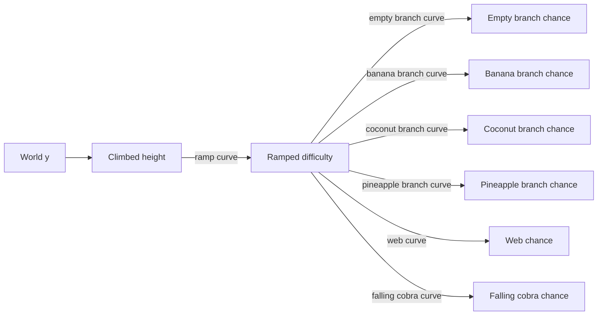

# Monkobra Balance Design

Why difficulty works the way it does: one height-driven ramp, a shared roll model for every hazard, and one home per number. The numbers are deliberately not here, they live in `Settings/Player/PlayerBalanceConfig.asset`, `Settings/Environment/WorldBalanceConfig.asset`, `Settings/MobGreatCobra/CobraBalanceConfig.asset`, and `Settings/Scoring/ScoreConfig.asset` (every score value), and change often. The field list and wiring are in the [Technical Design Document](monkobra-tdd.md#game-balance), what each hazard does on touch in [Mobs](mob-doc.md), and the intent behind the difficulty in the [Game Design Document](monkobra-gdd.md#difficulty).

## Design Goals

- One Knob For Pace: how fast the game gets harder is a single decision, not one per hazard
- Skill Sets The Pace: difficulty follows how high the monkey is, so a player who climbs well meets harder content sooner, and one who struggles stays in easier content
- Same Rules For Every Hazard: a designer who understands one spawn rule understands them all
- Data Not Code: no balance value is hard-coded, so a playtest finding is a one-asset edit

## Difficulty Follows Height

Difficulty is not a timer and not the score. It is a single value in 3 stages, 0~1 before the Cobra King, 1~2 between the 2 bosses, 2 up to a plateau after the Spider King, derived only from how far the monkey is above where it started.

- Why Height: height is what the player is trying to maximize, so tying difficulty to it makes the tension track progress; a timer would punish slow play instead of rewarding fast play
- Why A Shared Scale: difficulty is 0 at the starting zone exit, 1 at the Cobra King zone bottom and 2 at the Spider King zone bottom, so every hazard curve shares one x axis and its first appearance is a point on that axis, found from its height; reshaping when difficulty arrives never touches the hazard curves. Inside the Cobra King zone difficulty holds at 1 and inside the Spider King zone at 2; a curve's 1~2 part shapes the stretch between the bosses, and its part from 2 to the plateau the run after the Spider King
- Two Baselines: every climb height (score, trunk height markers, the boss zone) is measured above the monkey's start y (`GetClimbedYDistance`), while the ramp itself starts at 0 at the y of the starting zone exit trigger (`RampBaseYPosition`), so the protected start is not counted as climbing difficulty. Both are owned by `RampedDifficultyManager`, and nothing else reads raw world y for balance, so shifting the world only means moving those baselines
- Floored: the service floors the ramp at 0 and leaves the top open, so past the curve's end difficulty stays at its last value; a hazard curve holds its last value past its own last key the same way
- Highest Not Current: score and the lose panel read the highest height reached, so falling and re-climbing is neither rewarded nor double counted

## Two Curves Per Hazard

Pace and density are separated on purpose:

- The 3 ramp curves answer when: how much climbed height it takes to reach each level of difficulty, `preBossRampCurve` up to the Cobra King zone, `midBossRampCurve` between the 2 zones and `postBossRampCurve` after the Spider King zone (a short ramp then flat)
- A hazard's own curve answers how much: the chance of that hazard at each level of difficulty

Changing the ramp slides every hazard earlier or later together. Changing a hazard's curve reshapes only that hazard. This is why a hazard curve is not allowed to know about heights.

## One Roll Model

The tree is an endless stack of segments recycled upward ([Tree](monkobra-tdd.md#tree)), and every hazard is rolled per segment, when it is placed or restarted:

1. read the segment's ramped difficulty at its middle height
2. sample the hazard's probability curve there, clamped to 0~1
3. make a fixed number of attempts, each succeeding if a uniform roll falls below that chance

- Attempts Are A Ceiling: the attempt count is the most a segment can hold, and the chance says how often it gets there; the expected count is attempts times chance
- Why Attempts: a fixed count of small independent rolls gives natural variety segment to segment without any hazard clumping to a quota
- Why The Middle: a segment is one difficulty step, not a gradient, so every hazard in it shares the same value and a segment reads as one coherent chunk of the climb
- Four Branch Kinds: a branch is not one roll that then picks a fruit; empty, banana, coconut and pineapple branches are 4 separate things, each its own prefab, attempt count and chance curve, rolled per segment like any hazard, rarest first so a common kind never crowds a rare one out of its spot. Only the banana kind grows in the starting zone, at a flat chance
- Guaranteed Fruit: the coconut and the pineapple each also have a fixed climbed height in `WorldBalanceConfig`; the segment covering it always grows one branch of that kind at exactly that height, placed before every roll, so the first of each is never left to luck; it also grows on the monkey's side of the trunk, within `guaranteedBranchYawSpreadDeg` either way of the monkey's angle when the segment rolls, never on the far side, while every rolled branch keeps a random angle
- Order Matters: branches are placed first, then webs, falling cobras, and rough bark answer `BranchesGenerated`, so late hazards can keep clear of what already stands
- A Roll Can Place Nothing: webs and falling cobras are skipped when no clear spot is found, so the curve gives the chance of trying, not a guarantee

## Boss Zone

Every boss arena, both kings, both modes, is generated from 2 inputs: the **boss location** `t` (the climbed height the fight starts at, where its height marker stands) and the **arena height** `H`. One shared builder (`BossArenaLayout`) derives the rest, so no arena has its own hand-set heights.

| Derived | Rule | Normal Cobra (525, 50) | Normal Spider (1025, 50) | Hardcore Loop 1 Cobra (100, 40) |
| --- | --- | --- | --- | --- |
| Bare zone | `t - H/2` ~ `t + H/2` | 500 ~ 550 | 1000 ~ 1050 | 80 ~ 120 |
| Height marker | `t` | 525 m | 1025 m | 100 m |
| Spider seen waiting | `t - H` | n/a | 975 | n/a (Cobra) |
| Guard height | `t - min(guardDepthU, H/2)` | 513 (12) | 1005 (20) | 88 (12) |
| Fight space above `t` | nest / Spider arena height, must fit `H/2` | 11 <= 25 | 18 <= 25 | 11 <= 20 |
| Great cobra drop after win | `H` below the monkey | 50 (was 45) | 50 (was 45) | 40 |
| Branches, fruit, webs, bark | grown & cleared only inside the bare zone | as today | as today | as today |

- Normal: `cobraKingArena` {525, 50}, `spiderKingArena` {1025, 50}; the Spider King moves from 1000 u to 1025 u, the same 25 u into its zone the Cobra King stands in
- Hardcore: {`100 x (encounter + 1)`, `hardcoreArenaHeightU`} with the height 40, so 60 u of real climbing lies between two fights
- Fight geometry (guard depth, nest height, Spider arena height) stays in each king's config; the layout clamps the guard to `H/2`, and `OnValidate` warns when the fight space exceeds `H/2`
- Bare Trunk: nothing but the fight is generated inside a live zone, branches of every kind, webs, falling cobras and rough bark each skipping any spot that falls in it, judged by the spot's own height so a segment straddling an edge still fills its outside part
- Flat Difficulty (Normal): the ramp reaches 1 at the Cobra King zone bottom and holds it through the zone, climbs to 2 by the Spider King zone bottom, holds 2 through that zone, then takes the post boss curve
- Post Boss Plateau (Normal): `postBossRampCurve` is a short ramp, 2 to 2.6 over 300 u above the Spider King zone top, clamped flat past it; its end is exposed as the plateau value, and one source feeds both modes
- Why: the fight builds its arena at runtime and needs a clear, fair stage; keeping the stage clear by generation is simpler than sweeping hazards away when the fight begins
- Marker Meters: the heights are climbed heights, the same meters the trunk height markers show

## Hardcore Loops

Hardcore Mode is the boss rush mode. Kings take turns every 100 u, and each repeat of a king is a **Loop**, counted per king.

- Climb Between Kings: ramped difficulty is fixed at Normal Play's plateau value (2.6 proposed) from the starting zone exit on, every Loop alike, and 0 inside the starting zone; retuning Normal's plateau retunes Hardcore
- Loop 0: today's EASY fight (revive card of Normal Play only); Loop 1: that king's Normal fight; both read existing config fields, so neither can drift
- Loop 2+: one growth function per feature per king, anchored on that king's Loop 1 value `v1`, `n` the Loop number:

`v(n) = clamp(round(v1 + step x (n - 1)), limit)`

- `round` is `Floor`, `Ceil` or `None` (scales stay fractional); `limit` is a cap for rising values and a floor for falling ones; `step`, `round` and `limit` live per feature per king in `WorldBalanceConfig` (`LoopGrowth`); lessons play only in Loop 0 and 1

| Feature | Loop 0 (EASY) | Loop 1 (Normal) | step / Loop | round | limit | Loop 2 | Loop 3 | Loop 4 | Loop 5 | Loop 6 |
| --- | --- | --- | --- | --- | --- | --- | --- | --- | --- | --- |
| Cobra King health | 5 (x0.6) | 8 (was 12) | +2.5 | ceil | none | 11 | 13 | 16 | 18 | 21 |
| Spider King health | 7 (x0.45) | 15 | +5 | ceil | none | 20 | 25 | 30 | 35 | 40 |
| Wind ups, warnings, rests | Cobra warn x1.35, rest 3.25 s; Spider x1.7 | x1 | -0.12 | none | floor x0.5 | x0.88 | x0.76 | x0.64 | x0.52 | x0.5 |
| Spider shot, slash, dash speed | x0.7, reach x1.3 | x1 | +0.1 | none | cap x1.5 | x1.1 | x1.2 | x1.3 | x1.4 | x1.5 |
| Cobra King minion waves | 1 | 2 | +0.75 | ceil | cap 8 | 3 | 4 | 5 | 5 | 6 |
| Spider slashes in a row, stage 2 | stage cap 1 | 1 | +0.5 | ceil | cap 5 | 2 | 2 | 3 | 3 | 4 |
| Spider slashes in a row, stage 3 | stage cap 1 | 1 | +1 | floor | cap 5 | 2 | 3 | 4 | 5 | 5 |
| Monkey hearts | 3 | 3 | -0.5 | ceil | floor 1 | 3 | 2 | 2 | 1 | 1 |
| Defeat points scale | 1000 / 2000 | 1000 / 2000 | +0.5 | none (total floored) | none | x1.5 | x2 | x2.5 | x3 | x3.5 |

- Stage 1 of the Spider King is always 1 slash; rounded features rise in steps, so 2 Loops can share one value (minion waves 5 at Loops 4 and 5) while health, time and points still climb every Loop
- Cobra King health: Normal Play's Cobra King drops from 12 to 8 (`bossMaxHealth`); EASY keeps `easyHealthScale` 0.6, giving 5
- Monkey Hearts: 3 per boss fight in Normal and Loop 1; a fatal fight hit costs gold armor first, else 1 heart; the stamina bar is hidden during a fight and a heart row plus armor badge takes its place
- Revive: Normal Play offers it unlimited, as Loop 0 (EASY) or a retry of Loop 1, hearts refilled to 3; Hardcore Mode has none, so hearts at 0 end the run

## Balance Lives In Three Assets

The balance numbers have 4 homes, split by what they tune: `ScoreConfig` for every score value (points per meter, points per reward kind), `PlayerBalanceConfig` for the player's run (stamina, starting zone, branch hit, coconut), `WorldBalanceConfig` for the generated world (ramped difficulty, the 4 branch kinds, rough bark, spider web, boss zone), and `CobraBalanceConfig` for both cobras (falling cobra, great cobra).

- Why Split By Concern: one asset had grown to a dozen unrelated groups, so a designer tuning the cobras scrolled past stamina and score; each question now has one obvious home, while every number still lives in exactly one asset, so there is no second, forgotten copy of it
- Cross-System Questions: stamina drain, banana supply, and climb speed together decide how long a run lasts, and they sit in different assets; read `PlayerBalanceConfig` and `WorldBalanceConfig` side by side when tuning a run's length
- Readers Hold The Reference: each consumer has a field for every slice it reads (`playerBalanceConfig`, `worldBalanceConfig`, `cobraBalanceConfig`) and no slice it does not, so there is no global to trip over, and a test scene can swap in another asset
- What Stays Out: tuning that is geometry or feel rather than balance stays with its owner: arm stroke and reach in `MonkeyArmConfig`, climb and orbit in `MonkeyClimbConfig`, branch geometry in `BranchFruitPlacementConfig`, the pineapple leap's distance, speed curve, and timings in `PineappleLeapConfig`, web and falling cobra spawn geometry on their spawners, the great cobra, falling cobra, both bosses and the boss HUD in `CobraMotorConfig`, `FallingCobraConfig`, `CobraKingConfig`, `SpiderKingConfig` and `BossFightHudConfig` (Config assets, not balance)

## The Stamina Loop

Stamina is the pressure that makes the ramp matter, and it couples three balance groups:

- Drain: a cost per distance climbed or orbited, upward costing more than sideways, so wandering is worse than climbing; there is no timer drain, standing still never costs stamina
- Refill: bananas are the only real refill, apart from a slow recovery while the monkey rests
- Supply: banana chance by height decides how often a refill is on offer

Because bananas also cost focus to grab ([Grab System](grab-doc.md)), raising banana supply makes a run easier and also tempts the player into riskier grabs. Tune it knowing it moves both.

## Tuning Guide

- Pace: reshape the ramp curves, the only place height maps to difficulty; move the boss zone heights to shift where each stage begins
- Density Ceiling: change a hazard's attempt count
- Density Shape: change a hazard's probability curve
- Kind Mix: change a branch kind's attempt count for its ceiling or its curve for its shape; the 4 curves are independent, so raising one never lowers another
- Fairness Of Refill: change banana supply and the restore amount together, never one alone
- Reading A Change: only segments rolled after an edit reflect it, so play far enough for the pool to recycle, or restart the scene
- Webs Early: the `SpiderWebSpawner` test override skips the curve entirely ([Testing](mob-doc.md#testing))
- Coconut: `coconutBranchProbabilityCurve` (`WorldBalanceConfig`) rolls a coconut branch like every other kind, its zero stretch setting where coconuts begin; `cobraFreezeDurationS` sets how much a coconut is worth

## Known Gaps

- Every hazard shares one ramp, so a hazard cannot begin at its own height without reshaping its curve to stay flat until then
- A freshly created balance config's defaults differ from the tuned asset, so a recreated asset plays differently until retuned
- Difficulty ignores how close the chasing cobra is; only the cobra's own surge reacts to the player, speeding up after each hit or web and stacking with repeated mistakes, see [Mobs](mob-doc.md#motion)
