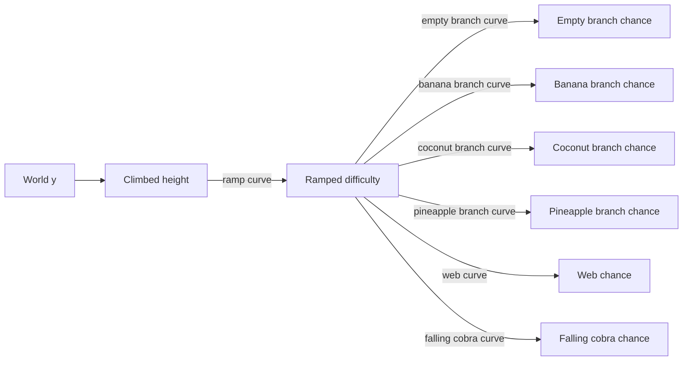

# Monkobra Balance Design

Why difficulty works the way it does: one height-driven ramp, a shared location scatter for every hazard, and one home per number. The numbers are deliberately not here, they live in `Settings/Player/PlayerBalanceConfig.asset`, `Settings/Environment/WorldBalanceConfig.asset`, `Settings/MobGreatCobra/CobraBalanceConfig.asset`, and `Settings/Scoring/ScoreConfig.asset` (every score value), and change often. The field list and wiring are in the [Technical Design Document](monkobra-tdd.md#game-balance), what each hazard does on touch in [Mobs](mob-doc.md), and the intent behind the difficulty in the [Game Design Document](monkobra-gdd.md#difficulty).

## Design Goals

- One Knob For Pace: how fast the game gets harder is a single decision, not one per hazard
- Skill Sets The Pace: difficulty follows how high the monkey is, so a player who climbs well meets harder content sooner, and one who struggles stays in easier content
- Same Rules For Every Hazard: a designer who understands one spawn rule understands them all
- Data Not Code: no balance value is hard-coded, so a playtest finding is a one-asset edit

## Difficulty Follows Height

Difficulty is not a timer and not the score. It is a single value in 3 stages, 0~1 before the Cobra King, 1~2 between the 2 bosses, 2 and up after the Spider King, derived only from how far the monkey is above where it started.

- Why Height: height is what the player is trying to maximize, so tying difficulty to it makes the tension track progress; a timer would punish slow play instead of rewarding fast play
- Why A Shared Scale: difficulty is 0 at the starting zone exit, 1 at the Cobra King zone start and 2 at the Spider King zone start, so every hazard curve shares one x axis and its first appearance is a point on that axis, found from its height; reshaping when difficulty arrives never touches the hazard curves. Inside the Cobra King zone difficulty holds at 1 and inside the Spider King zone at 2; a curve's 1~2 part shapes the stretch between the bosses, and its part past 2 the run after the Spider King
- Two Baselines: every climb height (score, trunk height markers, the boss zone) is measured above the monkey's start y (`GetClimbedYDistance`), while the ramp itself starts at 0 at the y of the starting zone exit trigger (`RampBaseYPosition`), so the protected start is not counted as climbing difficulty. Both are owned by `RampedDifficultyManager`, and nothing else reads raw world y for balance, so shifting the world only means moving those baselines
- Floored: the service floors the ramp at 0 and leaves the top open, so past the curve's end difficulty stays at its last value; a hazard curve holds its last value past its own last key the same way
- Highest Not Current: score and the lose panel read the highest height reached, so falling and re-climbing is neither rewarded nor double counted

## Two Curves Per Hazard

Pace and density are separated on purpose:

- The 3 ramp curves answer when: how much climbed height it takes to reach each level of difficulty, `preBossRampCurve` up to the Cobra King zone, `midBossRampCurve` between the 2 zones and `postBossRampCurve` after the Spider King zone
- A hazard's own curve answers how much: the chance of that hazard at each level of difficulty

Changing the ramp slides every hazard earlier or later together. Changing a hazard's curve reshapes only that hazard. This is why a hazard curve is not allowed to know about heights.

## Location Scatter

The tree is an endless stack of segments recycled upward ([Tree](monkobra-tdd.md#tree)), but a hazard's spot belongs to the world height, not to the segment it lands on. Each kind of thing is its own channel (`ScatterChannel`: empty, banana, coconut and pineapple branch, web, falling cobra, rough bark), an evenly spaced stream along the trunk from `TrunkScatter`:

1. the channel's density curve gives the expected count per 10 u of trunk (`TrunkScatter.DENSITY_SPAN_U`) at each height's ramped difficulty, read at that height, never at a segment middle
2. the density is integrated upward from the stack bottom into a running expected count, and item `i` sits where that count reaches `i` plus a per-run offset plus a small hashed jitter
3. when a segment is placed or restarted, each channel hands over the items whose height falls in that segment, and the placer grows them

- Count Tracks The Curve: any stretch holds within 1 of the curve's expected count, and a gap never falls below `1 - jitterFraction` of the even spacing, so there are no bare stretches next to clumps; a zero stretch of the curve, such as a fruit's start, grows nothing
- Smooth, Not Stepped: the density is sampled per height, so it follows the ramp smoothly and shows no seam at a segment joint
- Pure And Order Free: an item's height and yaw depend only on the run seed, its channel, its index and the curves, so segment order, boundaries and recycling never change them. Yaw spirals by the golden angle with a small jitter, so neighbours never stack on one side
- Seed: a random seed each run; `useFixedSeed` and `fixedSeed` on `TrunkScatter` replay one tree, and a development build logs the seed
- Four Branch Kinds: a branch is not one roll that then picks a fruit; empty, banana, coconut and pineapple branches are 4 separate things, each its own prefab and density curve, its own stream. Only the banana kind grows in the starting zone, at a flat density
- Guaranteed Fruit: the coconut and the pineapple each also have a fixed climbed height in `WorldBalanceConfig`; the segment covering it always grows one branch of that kind at exactly that height, placed before the scatter, so the first of each is never left to luck; it also grows on the monkey's side of the trunk, within `guaranteedBranchYawSpreadDeg` either way of the monkey's angle when the segment is placed, never on the far side, while every scattered branch takes its item's yaw
- Conflicts: height is fixed and the later placer yields. A blocked item retries its yaw in golden angle steps, up to `maxRetries`, then is skipped. Branches keep their separation from every live branch, across segment joints too; webs, falling cobras and rough bark keep clear of branches
- Order Matters: branches are placed first, then webs, falling cobras, and rough bark answer `BranchesGenerated`, so late hazards can keep clear of what already stands
- A Spot Can Place Nothing: an item is skipped when no clear yaw is found, so the density curve gives the expected count of spots, not a guarantee

## Boss Zone

The boss fight owns a stretch of the trunk, set by 3 heights in `WorldBalanceConfig`: where the zone starts, where the fight triggers inside it, and where the zone ends.

- Bare Trunk: nothing but the fight is generated inside the zone, branches of every kind, webs, falling cobras and rough bark each skipping any spot that falls in it, judged by the spot's own height so a segment straddling an edge still fills its outside part
- Flat Difficulty: the ramp reaches 1 at the Cobra King zone start and holds it through the zone, climbs to 2 by the Spider King zone start, holds 2 through that zone, then climbs above 2 after its end on its own curve
- Why: the fight builds its arena at runtime and needs a clear, fair stage; keeping the stage clear by generation is simpler than sweeping hazards away when the fight begins
- Marker Meters: the 3 heights are climbed heights, the same meters the trunk height markers show
- Endless Mode: a boss rush every `endlessBossIntervalU` (300 u), each boss harder by encounter, the monkey & great cobra at normal speed (`endlessSpeedScale`, 1); no fixed boss zone and no flat stretch, only each coming arena kept bare; the ramp is 0 through the starting zone, then reads the post boss curve from the zone exit on, so difficulty opens at 2, the level after the Spider King, and keeps climbing; climbed heights, score and markers stay real

## Balance Lives In Three Assets

The balance numbers have 4 homes, split by what they tune: `ScoreConfig` for every score value (points per meter, points per reward kind), `PlayerBalanceConfig` for the player's run (stamina, starting zone, branch hit, coconut), `WorldBalanceConfig` for the generated world (ramped difficulty, the 4 branch kinds, rough bark, spider web, boss zone), and `CobraBalanceConfig` for both cobras (falling cobra, great cobra).

- Why Split By Concern: one asset had grown to a dozen unrelated groups, so a designer tuning the cobras scrolled past stamina and score; each question now has one obvious home, while every number still lives in exactly one asset, so there is no second, forgotten copy of it
- Cross-System Questions: stamina drain, banana supply, and climb speed together decide how long a run lasts, and they sit in different assets; read `PlayerBalanceConfig` and `WorldBalanceConfig` side by side when tuning a run's length
- Readers Hold The Reference: each consumer has a field for every slice it reads (`playerBalanceConfig`, `worldBalanceConfig`, `cobraBalanceConfig`) and no slice it does not, so there is no global to trip over, and a test scene can swap in another asset
- What Stays Out: tuning that is geometry or feel rather than balance stays with its owner: arm stroke and reach in `MonkeyArmConfig`, climb and orbit in `MonkeyClimbConfig`, branch geometry in `BranchFruitPlacementConfig`, the pineapple leap's distance, speed curve, and timings in `PineappleLeapConfig`, web and falling cobra spawn geometry on their spawners, the great cobra, falling cobra, both bosses and the boss HUD in `CobraMotorConfig`, `FallingCobraConfig`, `CobraKingConfig`, `SpiderKingConfig` and `BossFightHudConfig` (Config assets, not balance)

## The Stamina Loop

Stamina is the pressure that makes the ramp matter, and it couples three balance groups:

- Drain: a cost per distance climbed or orbited, upward costing more than sideways, so wandering is worse than climbing; there is no timer drain, standing still never costs stamina
- Refill: bananas are the only real refill, apart from a slow recovery while the monkey rests
- Supply: banana chance by height decides how often a refill is on offer

Because bananas also cost focus to grab ([Grab System](grab-doc.md)), raising banana supply makes a run easier and also tempts the player into riskier grabs. Tune it knowing it moves both.

## Tuning Guide

- Pace: reshape the ramp curves, the only place height maps to difficulty; move the boss zone heights to shift where each stage begins
- Density: change a hazard's density curve, expected count per 10 u of trunk at each ramped difficulty; the height of the curve is the count, its shape is where it grows
- Kind Mix: change a branch kind's density curve; the 4 curves are independent, so raising one never lowers another
- Spacing: `TrunkScatterConfig` sets how loose it is: `jitterFraction` near 0 is a rigid grid, near 1 lets neighbours almost touch; `yawJitterDeg` sets the wobble around the spiral
- Fairness Of Refill: change banana supply and the restore amount together, never one alone
- Reading A Change: only segments placed after an edit reflect it, so play far enough for the pool to recycle, or restart the scene; `Monkobra > Report Trunk Scatter` prints each channel's count per 10 u, largest gap and first height from the live configs, no scene needed
- Webs Early: the `SpiderWebSpawner` test override swaps the curve for a flat test density ([Testing](mob-doc.md#testing))
- Coconut: `coconutBranchDensityCurve` (`WorldBalanceConfig`) spaces coconut branches like every other kind, its zero stretch setting where coconuts begin; `cobraFreezeDurationS` sets how much a coconut is worth

## Known Gaps

- Every hazard shares one ramp, so a hazard cannot begin at its own height without reshaping its curve to stay flat until then
- A freshly created balance config's defaults differ from the tuned asset, so a recreated asset plays differently until retuned
- Difficulty ignores how close the chasing cobra is; only the cobra's own surge reacts to the player, speeding up after each hit or web and stacking with repeated mistakes, see [Mobs](mob-doc.md#motion)
