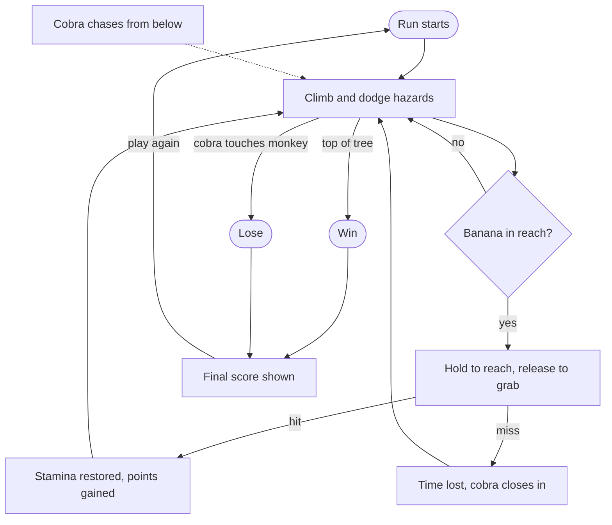

# Monkobra Gameplay Loop

The complete moment-to-moment loop of a run: climbing, hazards, the banana grab, and how a run ends. Design intent is in the [Game Design Document](monkobra-gdd.md), the grab rules in the [Grab System](grab-doc.md), the hazards in [Mobs](mob-doc.md), and the tuning in [Balance Design](balance-doc.md).

## Loop

- Solid Arrows: the player's flow from action to action
- Dashed Arrow: the cobra's pressure, which never pauses

## Stages

1. climb and circle the trunk: the main way to dodge, costing stamina and gaining height
2. read the hazards ahead: branches, falling cobras, and spider webs
3. spot a banana in a side's detection zone and decide whether the pause is worth it
4. hold interact to reach, release when the hand overlaps the banana
5. a hit restores stamina and scores points, a miss only costs time spent exposed
6. repeat until the top is reached or the cobra touches the monkey

## Pressures

- Cobra: constant pursuit, so every pause (a web, a miss, a hit, an empty bar) is paid for in distance
- Stamina: an empty bar does not end the run, it slows the upward climb, see [Technical Design Document](monkobra-tdd.md#stamina)
- Attention: a reach turns the camera to the banana's side, away from the branches and webs ahead

## Win and Lose

- Win: the monkey reaches the top of the tree
- Lose: the cobra touches the monkey
- Result: either outcome ends the run and shows the final score
