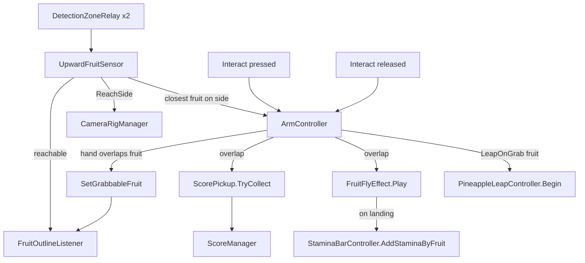

# Monkobra Grab System

How the monkey reaches for and picks fruit: the detection zones, the arm reach, the release check, the pineapple leap, the camera swap, and the feedback. Design intent is in the [Game Design Document](monkobra-gdd.md), the wider system map in the [Technical Design Document](monkobra-tdd.md), and what a web does to a reach in [Mobs](mob-doc.md#trap-and-escape).

## Flow

1. a banana enters a side's detection zone and becomes reachable
2. the player presses interact: the matching arm locks onto the banana closest to the monkey on that side and the camera swings to that side
3. while interact is held the arm keeps re-aiming at the locked banana every physics step while it stretches
4. on release, the grab succeeds only if the hand overlaps the banana at that instant

## Parts

| Script | Role |
| --- | --- |
| `Player/DetectionZoneRelay` | side-tagged trigger volume on the monkey that forwards enter and exit events |
| `Player/UpwardFruitSensor` | singleton (`I`) that keeps the reachable fruit per side, picks the reach side, and relays the grabbable fruit |
| `Player/ArmController` | one arm: hand-over-hand climb stroke, or the reach and the release check |
| `Player/MonkeyConfig` | reach speed, stroke tuning, and the interact action both arms and the camera read |
| `Cameras/CameraRigManager` | swaps the behind, look-left, and look-right Cinemachine cameras |
| `Environment/FruitOutlineListener` | two-tier outline on a banana |
| `Environment/BranchController` | decides whether a branch bears a pineapple, a banana, or no fruit |
| `Scoring/ScorePickup` | on a fruit, hands its points to `ScoreManager` once and switches the fruit off |
| `UI/StaminaBarController` | `AddStaminaByFruit` restores stamina when a grab's flight lands |
| `UI/FruitFlyEffect` | flies a grabbed fruit's sprite to its target, then calls back |
| `Environment/FruitFlyOnGrab` | on a fruit: which target and sprite its flight uses |
| `Environment/LeapOnGrab` | marks a fruit whose grab starts a leap |
| `Player/PineappleLeapController` | on the monkey root: runs the leap |
| `Player/PineappleLeapConfig` | the leap's distance and speed curve |

## Detection

- Zones: two `DetectionZoneRelay` triggers (`LeftDetection`, `RightDetection`, under `Detections` on the monkey prefab) flank the monkey. Each forwards `Entered` and `Exited` with its side
- Filter: `UpwardFruitSensor` keeps only colliders tagged `FruitCollider`, in a set per side plus one entry-order list across both
- Reach Side: `ReachSide` is the side of the closest fruit across both zones, left when none is in reach; a fruit in both zones takes the side of the monkey's right vector it lies on. Only the arm on that side reaches
- Closest Fruit: any fruit in a zone is grabbable, and the target is the one nearest the monkey by 3D distance from the `_Monkey` root to the fruit collider's bounds centre, the older entry on a tie. `UpwardFruitSensor` re-evaluates it every physics step, so the choice follows the climb
- Reach Events: `FruitReachChanged` fires when a fruit enters or leaves both zones combined, so a fruit in the other zone still counts as reachable
- Reach Target: `ReachTarget` is the single fruit a reach would aim at, the closest on `ReachSide`, and `ReachTargetChanged` fires when it changes. While an arm reaches, `SetLockedTarget` pins it to the aimed fruit, so a closer fruit never steals the outline. Only that fruit is outlined
- Removal: a grabbed fruit is switched off inside a zone, where its trigger exit may never fire, so `RemoveFruit` clears it from both sides explicitly

## Reach and Release

`ArmController` has two modes on one `ConfigurableJoint`, and writes only the joint's drive targets, never its configuration.

- Climb Mode: while move input is held the arm sweeps a stroke, the two arms half a cycle apart, and the linear axis is locked
- Reach Mode: pressing interact on the matching side starts the reach. The locked fruit is chosen once, but the aim is re-pointed at it every physics step, so the arm follows the climb, turning at `ReachAimSpeedDeg` (0 snaps), while it stretches at the configured speed up to the joint's linear limit
- Release: `TryGrabFruit` runs on release. It does nothing if the game is paused or over. The grab succeeds only if `Physics.ComputePenetration` finds the hand collider overlapping the aimed fruit at that instant
- Lost Fruit: if the locked fruit is switched off or destroyed mid-hold, the arm drops it: the pin clears, no fruit counts as grabbable, and the release grabs nothing
- Miss: a release before the hand reaches the fruit, or after it stretched past, grabs nothing. The log names it as too short or too long. The arm then pulls back, and the cost is time spent exposed
- Grabbable Cue: while reaching, the arm reports the fruit under the hand through `SetGrabbableFruit`, so the outline can tell the player a release would grab it
- Hand Contacts: only collisions on the hand collider count as the hand's, and the arm ignores collisions with the body's own colliders

## On a Successful Grab

1. `ScorePickup.TryCollect` refuses if the game is over, paused, or the fruit was already collected. Otherwise it hands its reward to `ScoreManager` once and switches the fruit off. A fruit with no `ScorePickup` is just switched off, from the object holding its `FruitFlyOnGrab` when it has one, so a model beside the collider goes too
2. every collider of that fruit is removed from the detection sets
3. `FruitFlyEffect.I.Play` launches the fruit's sprite from where the fruit sat, see [Fruit Fly](#fruit-fly)
4. on landing, `StaminaBarController.I.AddStaminaByFruit` restores stamina, capped at the maximum, and works from empty too; its `FruitConsumed` punches the bar. With no effect in the scene the restore runs at once

Score lands at the grab (step 1), stamina one flight later. A fruit with `LeapOnGrab` also starts a leap at the grab, see [Pineapple Leap](#pineapple-leap).

## Pineapple Leap

A pineapple restores stamina like a banana but scores no fruit reward and no banana count. Its grab also skips a set height. `PineappleLeapController` on the monkey root runs these phases in physics steps, so a pause freezes them:

1. Hands Up: `GameController.SetLeaping(true)` is called, which also ends the starting zone, as a leap may carry the monkey past its exit. `MonkeyController.IsHeld` stops input, drain, and slip, and any stun is cleared. Both arms go kinematic with collisions off and rise to a point above the shoulder, the leap distance plus the arm's rest length, past the joint's reach, and `StretchVisual` spans the arm to the hand
2. Pull: `PullTo` carries the body straight up its ring, its speed re-read each step from the speed curve by the time since the pull began. A curve reaching 0 still finishes the leap at a small floor speed
3. Landing: at the target the hold releases and the arms return to their joints, at rest length again. Control is back, while hazards stay off for the landing grace
4. End: `SetLeaping(false)`, after which a fruit can be grabbed for a new leap as usual; a grab during the grace starts one at once

- Refused: a grab cannot start a leap while `IsHeld`, ie held by a web, so the release grabs nothing and the pineapple stays. This covers the forced release when a web catches a reaching monkey
- Interact: a press does nothing while the hands are up or the body is pulled
- Hazards: each one checks `IsLeaping` in its own code, see [Mobs](mob-doc.md#during-a-pineapple-leap). The body's physics stay on, so the detection zones keep reporting exits and fruit left below leaves the reachable sets
- Height: the distance score and the height display follow the monkey, so a leap counts as climbing

For a quick test press the [hack key](monkobra-tdd.md#hack-shortcuts) that spawns a pineapple branch straight above the monkey.

## Fruit Fly

`FruitFlyEffect` (singleton `I`) sits on `FruitFlyLayer`, a full-stretch child of `InGameHUD`, and flies a semi-transparent pooled `Image` from the fruit's screen point to its target.

| Target | Fruit | Flies To |
| --- | --- | --- |
| `EnergyBar` | banana (no `FruitFlyOnGrab`) | the `StaminaBar` |
| `TopRightCounter` | `Coconut` | `TopRightAnchor`, standing in for a counter not built yet |
| `Monkey` | `Pineapple` | the monkey, found as the `MonkeyController` at start |

- Per Frame: the target's screen point is re-read every frame, so a punching bar or a moving camera never strands the sprite
- Time: the flight runs on scaled time, so a pause freezes it
- Run End: a loss drops every flight without its callback, and a restart reloads the scene, so a cut flight never restores into the next run
- Sprite: a fruit's `FruitFlyOnGrab` may name one; otherwise the effect's default, and a blank square while none is set
- Placeholder: `Coconut` under `Prefabs/Environment/` is the banana's shape without `ScorePickup`, so grabbing one restores stamina but scores nothing; nothing spawns it yet, drop it in by hand in Play mode

## Camera

`CameraRigManager` owns three Cinemachine cameras. The behind view is the default. While interact is held it switches to look-right if only the right side has fruit, else look-left, even with no fruit. Releasing returns to behind. A swap raises the chosen camera's priority above the other two and the `CinemachineBrain` on the main camera blends. If a web traps the monkey, the interact action is disabled, which counts as a release for the camera too.

## Feedback

`FruitOutlineListener` adds an extra material slot, using the `FruitOutline` inverted-hull Shader Graph, in two tiers:

| Tier | When | Priority |
| --- | --- | --- |
| Reachable | the fruit is `ReachTarget`, the one a reach would aim at | lower |
| Grabbable | a hand overlaps the fruit, so a release would grab it | higher, wins |

The listener sits on the object holding the fruit's collider and outlines the meshes under it, or under its `meshRoot` when set, as on the `Pineapple` prefab, whose `PineappleCollider` and `PineappleModel` are siblings. `FruitOutline` measures its width in the mesh's own units, so a scaled model thickens it: the pineapple has its own `PineappleReachable` and `PineappleGrabbable` materials for that reason.

## Fruit Supply

Fruit comes from branches, not its own spawner, and a branch bears 1 fruit or none. `BranchController` rolls in `Initialize`, called by the segment after placing it: first the pineapple chance, then the banana chance, each from its difficulty curve. A hit keeps the stem, scales it between 0.5x and 2x, and turns the fruit randomly; a pineapple is spawned at the banana's spot on the stem and the banana child switched off. With no fruit both banana and stem are disabled. Branch density by height is in [Mobs](mob-doc.md#placement).

## Tuning

The reach extend speed and the aim turn speed (`reachAimSpeedDeg`, deg/s, 0 snaps) are in `Settings/_Shared/MonkeyConfig.asset`, the maximum reach is the linear limit of the `ConfigurableJoint` on the `Arm` prefab, and the stamina and points per banana and the banana chance curve (`bananaSpawnProbabilityCurve`) are in `Settings/GameBalanceConfig.asset`. The pineapple chance curve (`pineappleSpawnProbabilityCurve`), the time the hands take to rise (`pineappleArmExtendS`), and the landing grace (`pineappleLandGraceS`) are there too; the leap distance and speed curve are in `Settings/PineappleLeapConfig.asset`. The fruit flight's duration, look, and easing are in `Settings/FruitFlyConfig.asset`; its duration also delays the stamina restore.

## Known Gaps

- `ArmController` carries a fixme to split it into several systems
- A miss costs no stamina, only exposure
- Scenes without a `ScoreManager` restore stamina on a grab but score nothing, see [Score](monkobra-tdd.md#score)
- The coconut has no effect beyond its flight
- A leap may land overlapping a web or a falling cobra: both act normally once the grace ends if the monkey is still inside
