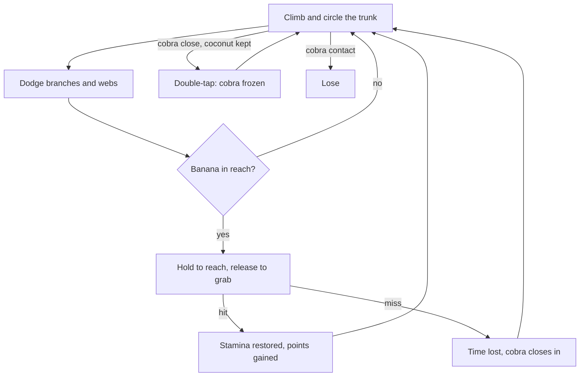
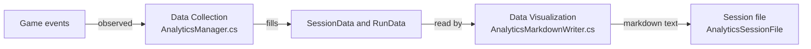

# Monkobra Game Design Document

Design intent for Monkobra: what the player does, why it is tense, and what makes it different. Technical detail lives in [CONTEXT.md](../CONTEXT.md), controls and setup in the [README](../README.md).

## Concept

Monkobra is a 3D vertical upward-scrolling game. You are a monkey climbing a very tall tree while a cobra chases you from below. On the way to the top you dodge branches and reach out an arm to pick bananas, which are the only way to keep your stamina from running dry.

- Genre: 3D obstacle-running, turned vertical
- Reference Games: *Temple Run 2*, *Subway Surfers*, *Minion Rush*
- Timing Reference: the hold-and-release reach borrows from *Gold Miner*
- Camera: monkey held low in view, looking up the tree, the frame sliding toward the fruit while the arm reaches; a brief look down at the cobra when it acts, a follow of a thrown coconut, a higher, wider view during a pineapple leap
- Session: short runs, built for quick retries

## Design Pillars

- Pressure From Two Sides: the cobra climbs from below while stamina drains from within, so the player is never safe
- Earned Rewards: stamina comes only from a deliberate, timed grab, never from touching an item
- Risk Tied To Reward: every grab costs attention and exposes the monkey, so each banana is a gamble
- Readable Mistakes: the player can always tell why a run was lost, a late release, a branch, or a slow climb

## Genre Conventions

3D obstacle-running games share a set of tropes. Monkobra keeps most of them and changes how collecting works.

- Kept: constant pursuit, obstacles to dodge, penalties for collisions, success measured by distance, short replayable runs
- Changed: the character does not advance on its own, the player climbs, and the cobra supplies the forward pressure
- Replaced: passive pickup on contact is replaced by the grab, a skill action of its own

## Core Twist

The twist is **banana grabbing and stamina balancing**.

- Grab: hold the interact key to reach an arm toward a banana on a nearby branch, release at the right moment to pick it up
- Restore: a successful grab refills stamina by a large margin, offsetting the steady drain of climbing
- Balance: climbing costs stamina and grabbing takes focus away from dodging, so the player weighs escape against sustain

### Why It Matters

- Timing as a Skill: collection becomes a skill challenge, not a matter of positioning
- Stationary Vulnerability: the reach trades the genre's uninterrupted reflex sprint for a tense, exposed pause
- Three Demands at Once: escape (climb away from the cobra), sustain (grab bananas), and precision (time the release)

## Core Loop

## Resources and Pressures

- Stamina: the survival resource, drained by time and by movement, restored by grabbing or slowly by resting, and an empty bar slows the monkey instead of ending the run
- The Cobra: a pressure that never relents, it climbs nonstop unless a coconut freezes it for a while, surges after each mistake, and ends the run on any contact
- Coconuts: a rare resource found higher up, kept instead of eaten, and spent with a quick double-tap to freeze the cobra and buy distance
- Height: both the goal and the measure of progress, the tree is endless, so the run is a race for the highest point
- Attention: the hidden resource, since every grab spends focus that dodging would otherwise use

## Mechanics

| Mechanic | Design Intent | Outcome |
| --- | --- | --- |
| Climb and Circle | free vertical movement and circling of the trunk, the main way to dodge | climbing costs the most stamina, circling less, descending none |
| Banana Grab | hold-and-release timing as its own skill check | a hit restores stamina and scores points, a miss wastes time |
| Pineapple Leap | a rare branch fruit that trades the same grab risk for a burst of escape | a hit restores stamina, then both hands shoot up and pull the monkey past a set height, untouchable by hazards on the way |
| Branch Hit | punishes careless movement without ending the run | camera shake, brief loss of control, a drop down the trunk |
| Cobra Chase | constant pursuit from below, its coil wraps the trunk so orbiting or dropping into it is as fatal as being caught from behind | any contact with the cobra's body ends the run |
| Falling Cobra | a hazard from above that rewards watching the branches | warns, then falls, with the same penalty as a branch hit |
| Coconut | a rare, higher-up fruit kept as a panic button, so a good grab can be cashed in when the cobra is close | scores double a banana and restores no stamina; a double-tap freezes the cobra for a while, but its coil stays fatal |
| Spider Web | a forced stop that lets the cobra gain ground, and a clash with the grab since reaching is locked while stuck | holds the monkey until rapid presses fill an escape bar, then brief immunity from further webs |
| Score | rewards height and risk | points per meter climbed and a bonus per banana or coconut grabbed |

## Win and Lose

- Win: none, the tree is endless and a run only ends in a loss
- Lose: the cobra touches the monkey; an empty stamina bar only slows the climb
- Result: the loss ends the run and shows the final height, score, and bananas collected
- Modes: Normal Play is the full run, starting zone and Cobra King included; Endless Mode is the same climb without the king, and both end only in a loss
- Endless Mode: starts at the base of the tree in the state right after the king's defeat, ie the gold armor already worn as a spare life, and the hazards at post-boss density from the end of the starting zone, with no hazard-free stretch and no boss marker; it is for the player who has beaten the king and wants the climb alone
- Unlock: Endless Mode stays greyed out until the Cobra King has been beaten once, remembered on the player's device

## Player Experience

The intended arc is steady tension broken by short bursts of risk. The player climbs while the stamina bar shrinks, spots a banana, and decides whether the pause is worth it. A clean grab feels like relief, and a mistimed one is paid for in cobra distance.

## Difficulty

- Ramp: branches, spider webs, and falling cobras are rolled per tree segment against a probability curve of the ramped difficulty, so each grows denser the higher the monkey climbs, at rates tuned in the balance config. Numbers are in [Mobs](mob-doc.md#placement-1)
- Falling Cobra Ramp: hangs dormant on the trunk, wakes when the monkey comes near, and falls while sliding toward the monkey's side. Numbers are in [Mobs](mob-doc.md#falling-cobra)
- Future Work: broader scaling, such as cobra speed or hazard frequency, is not yet designed

## Analytics

### Methodology Used

The analytics system is a one-way pipeline of two parts, data collection and data visualization. Each part has its own script and knows nothing about the other except through the plain data handed over, so the process can be read part by part.

##### Data Collection

Script: [AnalyticsManager.cs](https://github.com/kami-lel/monkobra/blob/dev/Assets/_Monkobra/Scripts/Analytics/AnalyticsManager.cs), the one file that shows the whole collection process. It only gathers data: it never draws a chart and never builds a file path
Input: the game's own events ([GameController](https://github.com/kami-lel/monkobra/blob/dev/Assets/_Monkobra/Scripts/GameController/GameController.cs).StateChanged, [ScoreManager](https://github.com/kami-lel/monkobra/blob/dev/Assets/_Monkobra/Scripts/Scoring/ScoreManager.cs).BananaCollected, [HitBranchSensor](https://github.com/kami-lel/monkobra/blob/dev/Assets/_Monkobra/Scripts/Player/HitBranchSensor.cs).BranchHit, [SpiderWebTrap](https://github.com/kami-lel/monkobra/blob/dev/Assets/_Monkobra/Scripts/MobSpiderWeb/SpiderWebTrap.cs).Encountered, and others), so no third-party service is needed
Lifetime: a scene singleton kept across scene reloads, so one launch is one session and every attempt in it is one run
What It Records Per Run: start and end stamps, the final score split into height score and banana score, banana pickups, branch hits, and web encounters (each with time, and height where it matters), and the run status (Lost or Interrupted)
Timed Samples: height and stamina are sampled together on a fixed interval, plus once at run start and once at run end, so both curves share one time axis
Death Cause: the game does not report one, so [DeathCauseResolver](https://github.com/kami-lel/monkobra/blob/dev/Assets/_Monkobra/Scripts/Analytics/DeathCauseResolver.cs) infers it when the run closes: a branch hit or web encounter shortly before the loss names the cause, otherwise the great cobra did it
Tuning: sample interval, autosave interval, and the death cause window live in [AnalyticsConfig.asset](https://github.com/kami-lel/monkobra/blob/dev/Assets/_Monkobra/Settings/Analytics/AnalyticsConfig.asset), never in code
Hand-Off: everything collected is stored in [RunData](https://github.com/kami-lel/monkobra/blob/dev/Assets/_Monkobra/Scripts/Analytics/RunData.cs) and [SessionData](https://github.com/kami-lel/monkobra/blob/dev/Assets/_Monkobra/Scripts/Analytics/SessionData.cs), plain data with no logic. They are the only link to the visualization, so either part can change, or the mock generator can stand in for the collection, without touching the other

##### Data Visualization

Script: [AnalyticsMarkdownWriter.cs](https://github.com/kami-lel/monkobra/blob/dev/Assets/_Monkobra/Scripts/Analytics/AnalyticsMarkdownWriter.cs), the one file that shows the whole visualization. It turns the data into text and charts, and reads no scene and writes no file
Input: only [SessionData](https://github.com/kami-lel/monkobra/blob/dev/Assets/_Monkobra/Scripts/Analytics/SessionData.cs) and [RunData](https://github.com/kami-lel/monkobra/blob/dev/Assets/_Monkobra/Scripts/Analytics/RunData.cs), never the live game
Output: one markdown document per session with embedded Mermaid charts
Idea: a chart type is picked by the question it answers. A part of a whole is a pie, a comparison across runs is a bar, a change over time is a line, and a single moment is a table row. The document is split the same way, a summary across runs first, then the detail of each run

Session Summary, drawn from Lost runs only so a quit or reload does not pollute it, answers "how do the attempts compare":

- Death Causes (pie): the share of losses by cause, so the real killer among cobra, branch, and web shows at once; reflects whether hazard balance matches the Readable Mistakes pillar (Metric #1)
- Final Score vs Run (bar): score per attempt in order; reflects the learning curve, so a rising bar says the retry loop works (Metric #2)
- Highest Height vs Run (bar): the best point each attempt reached; reflects how far skill carries the player up the tree
- Death Height vs Run (bar): where each attempt ended; reflects difficulty walls, since deaths clustering at one height point to a hazard curve that turns on too sharply (Metric #3)
- Duration vs Run (bar): how long each attempt lasted; reflects whether runs stay short enough to retry yet long enough to build tension (Metric #4)

Each Run Section answers "how did this one attempt go":

- Run Header: mode, status, highest and death height, death cause; the verdict of the run in one glance
- Height vs Time (line): sampled height over the run; reflects pace, so plateaus mark webs or empty stamina and dips mark branch hits (Metric #5)
- Stamina vs Time (line): sampled stamina over the run, placed under the banana table; reflects the core twist, since a healthy run is a drain and refill sawtooth (Metric #6)
- Score Split (pie): height score against banana and coconut score; reflects what the player was rewarded for, climbing or grabbing, which checks the Earned Rewards pillar
- Event Tables (rows of time since start, and height where it matters): every banana, coconut, branch hit, web, leap, and boss event; reflect risk against reward, the grabs made against the hits taken (Metric #7), and give the exact moment behind any shape seen in a line

Reading Order: the summary finds the pattern across attempts, then the run sections explain it, so a doubt raised by a bar is answered by the line or table of the run behind it
Delivery: [AnalyticsSessionFile](https://github.com/kami-lel/monkobra/blob/dev/Assets/_Monkobra/Scripts/Analytics/AnalyticsSessionFile.cs) writes the text to one file per launch in persistentDataPath/Analytics/, rewritten on session open, run start, every recorded event, game over, quit or pause, and on a timer during a run, so a crash or a closed browser tab loses almost nothing; a WebGL player hands it to the browser as a download instead

###### Mock Data

Script: [MockAnalyticsGenerator.cs](https://github.com/kami-lel/monkobra/blob/dev/Assets/_Monkobra/Scripts/Analytics/MockAnalyticsGenerator.cs) (F12 in the Editor)
Role: fills [SessionData](https://github.com/kami-lel/monkobra/blob/dev/Assets/_Monkobra/Scripts/Analytics/SessionData.cs) and [RunData](https://github.com/kami-lel/monkobra/blob/dev/Assets/_Monkobra/Scripts/Analytics/RunData.cs) with a simulated session of real-game curves, skipping the collection, and the same visualization above then renders it
Output: plain markdown with Mermaid charts, so a report opens directly anywhere markdown renders, ie GitHub, VS Code, or any viewer with Mermaid support
Showcase: three generated sessions, [session 1](https://github.com/kami-lel/monkobra/blob/dev/analytics-mock-reports/02026-11-10_11_24_55-mock.md), [session 2](https://github.com/kami-lel/monkobra/blob/dev/analytics-mock-reports/02026-11-10_11_24_56-mock.md), and [session 3](https://github.com/kami-lel/monkobra/blob/dev/analytics-mock-reports/02026-11-10_11_25_20-mock.md); the mockups below come from this generator, the one real result from a single live playtest session

Balance context for the hypotheses is in the Balance Design and Mobs docs

### Metrics

###### Metric #1: Death Cause

Description: for each lost run, what ended it: the great cobra catching the monkey, a branch hit shortly before the loss, or a spider web encounter shortly before the loss

Justification: Chosen because the Readable Mistakes pillar demands the player know why a run was lost, and this shows which hazard is the real killer, so GameBalanceConfig spawn curves and the web escape bar can be tuned there.
Interpretation: Mostly web means webs are too frequent or sticky, mostly branch means the hit drop or density is too harsh, mostly great cobra means stamina refill is too thin, and an even split means hazards are balanced.
Testable Hypothesis: Across Normal Play runs ending in a loss, the great cobra will be the most frequently inferred death cause, exceeding both branch-related and web-related losses under the existing two-second classification rule.

###### Metric #2: Final Score vs Run

Description: the final score of each lost run in order, i.e. the player's learning curve across attempts within a session
Justification: Chosen because runs are built for quick retries, so a rising score bar shows the game is learnable and a flat one shows the tutorial or early difficulty needs work.
Interpretation: A rising trend means the retry loop works, a flat low trend means players miss the banana grab, and very low early runs mean onboarding is too harsh.
Testable Hypothesis: Among sessions containing at least three Normal Play runs ending in a loss, the mean final score on the third run will be higher than the mean final score on the first run.

###### Metric #3: Highest Height vs Death Height

Description: per run, the highest point the monkey reached and the height at which it died. Both are climbed height above the start, in world units
Justification: Chosen because difficulty follows height (Balance Design), so death-height clusters reveal difficulty walls and the highest-to-death gap reveals falls, guiding reshaping of the ramped difficulty curve.
Interpretation: Deaths clustered at one height mean a hazard curve turns on too sharply there, and a death height well below the highest means the branch hit drop is too large.
Testable Hypothesis: In at least 75% of Normal Play runs ending in a loss, the difference between the highest height reached and the height at death will be no greater than 20 meters.

###### Metric #4: Run Duration vs Run

Description: how many seconds each lost run lasted, from first input to loss

Justification: Chosen because runs should be short enough to retry yet long enough to build tension, and duration with height exposes stamina starvation and guides drain and restore tuning.
Interpretation: Under 15 s means onboarding is too harsh, 30 to 90 s and growing is the intended range, and over 3 min means late hazards or stamina are too generous.
Testable Hypothesis: The median duration of Normal Play runs ending in a loss will fall between 30 and 90 seconds.

###### Metric #5: Height vs Time

Description: the monkey's height every 2 s through one run. It shows pace, stalls, and falls

Justification: Chosen because the loss moment alone hides how a run went, while plateaus mark webs or empty stamina and dips mark branch hits, pinpointing where the hazard curves need changes.
Interpretation: A steady slope means a smooth run, plateaus mean a web or exhaustion, and sharp dips high up mean late branch density is too punishing.
Testable Hypothesis: Across Normal Play runs ending in a loss, at least 70% of consecutive two-second sampling intervals will show an increase in player height.

###### Metric #6: Stamina vs Time

Description: stamina every 2 s through one run, with bananas marked in the run's banana table

Justification: Chosen because stamina is the heart of the core twist, so the curve should be a drain-and-refill sawtooth, and it guides tuning of staminaUpwardDrainPerU, fruitStaminaRestore, and the banana spawn curve.
Interpretation: A sawtooth means the grab loop works, a long flat zero means refills are too scarce, and a curve never below 50 means the drain is too weak for bananas to matter.
Testable Hypothesis: Across Normal Play runs ending in a loss, fewer than 25% of recorded stamina samples will be at or below 10 points on the 100-point stamina scale.

###### Metric #7: Event Counts per Run (Bananas, Branch Hits, Web Encounters)

Description: how many bananas were grabbed, branches hit, and webs met in each run, each with its time and height
Justification: Chosen because bananas against hits is direct evidence of the Earned Rewards and Risk Tied To Reward pillars, and it checks that spawn rolls match the curves in the asset.

Interpretation: Many hits with few bananas means careless grabbing or overlapping branches, many bananas with few hits means grabbing is too safe, and hits concentrated high up mean late density outpaces skill.
Testable Hypothesis: Across Normal Play runs ending in a loss, the mean number of banana pickups per run will exceed the mean combined number of branch hits and web encounters per run.

